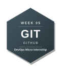
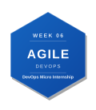
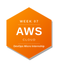
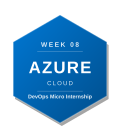
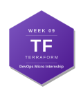
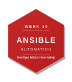
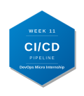
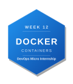
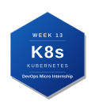
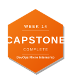

# DevOps Micro Internship with Agentic AI — My Journey

> 👋 **New here?** Read the [submission instructions](./onboarding) first — how to fork, fill in, and submit your assignments.
> Find all the required links & assignment guidelines from here [Required links](./dmi_cohort3_resources.md)

---

## About Me

| | |
|---|---|
| **Name** | EZEOBI CHINECHEREM JUDE |
| **LinkedIn** | (www.linkedin.com/in/ezeobi-palloti-5b231a1b9) |
| **Location** | Lagos, Nigeria |
| **Background** | Cloud Security, DevOps Engineer|
| **Goal** | Gaining clarity about Ai driven Cloud security and Devops Engineering operations |

---

## About the Program

**DevOps Micro Internship with Agentic AI** is a 14-week mentor-led cohort program by [Pravin Mishra](https://www.linkedin.com/in/pravin-mishra-aws-trainer/) — Cloud, DevOps & AI consultant with 15+ years of experience, 5,000+ learners trained, and 26K+ LinkedIn followers.

This is not a course. It is an internship-style program — real deployments, real pipelines, real evidence reviewed by mentors every week.

- 🌐 Program Website: https://dmi.pravinmishra.com?utm_source=github&utm_medium=readme
- 💬 Discord Community: https://discord.pravinmishra.com?utm_source=github&utm_medium=readme
- 📺 YouTube: [Pravin Mishra](https://www.youtube.com/@awswithpravinmishra)
- 🔗 Instructor: [LinkedIn](https://www.linkedin.com/in/pravin-mishra-aws-trainer/)

---

## 🏆 Achievements

### Champion of the Week

<!-- If you were named Champion of the Week, add the badge below and link to your LinkedIn post -->

| Week | Award | Post |
|------|-------|------|
| <!-- e.g. Week 03 --> | <!-- 🏆 Champion of the Week --> | <!-- [LinkedIn Post](#) --> |

### Leaderboard

 Add your cohort leaderboard rank here as you progress 

> 🥇 Cohort 3 Rank: **#__** <!-- Update this each week -->

---

## My DevOps Stack

Your stack earned via participation

 Week 00 → Internet & Networking Basics 

<!---->

  

 Week 01 → Success Mindset 

  

 Week 02 → Agentic AI with Claude Code 

  

 

 Week 03 → Linux & Bash for DevOps 

 

 Week 04 → Git & GitHub 

 

 Week 05 → DevOps Lifecycle & Agile 

  

Week 06 → AWS Cloud 

  

 Week 07 → Azure Cloud 
 
 
  

 Week 08 → Terraform

  

 Week 09 → Ansible 

 

<!-- Week 10 → Azure DevOps CI/CD -->
<!--  -->

 Week 11 → Docker 

  

<!-- Week 12 → Kubernetes -->
<!--  -->

<!-- Week 13 → Final Project / Capstone -->
<!--  -->

*Complete a week → uncomment the badge → watch your stack grow.*

---

## Program Overview

| Phase | Weeks | Focus |
|-------|-------|-------|
| Foundation | 00 – 02 | Networking, Mindset, Agentic AI |
| Core DevOps | 03 – 05 | Linux & Bash, Git, DevOps Lifecycle |
| Cloud | 06 – 07 | AWS & Azure Real Deployments |
| Automation | 08 – 10 | Terraform, Ansible, CI/CD |
| Containers | 11 – 12 | Docker & Kubernetes |
| Capstone | 13 | Final Project |

---

## Weekly Progress

## 📚 Progress Tracker

| Week | Topic | Status | Links |
| :-: | --- | :-: | --- |
| 00 | Internet & Networking Basics | ✅ Done | [🔗 LinkedIn](https://www.linkedin.com/posts/ezeobi-palloti-5b231a1b9_startuplife-networking-techforfounders-share-7473842580309520385-Ts5c) · [📝 Blog](https://medium.com/@palloti10x/in-devops-networking-is-the-backbone-of-continuous-deployment-150e54b739b1) |
| 01 | Success Mindset | ✅ Done | [🔗 LinkedIn](https://www.linkedin.com/posts/ezeobi-palloti-5b231a1b9_devops-cloudengineering-continuouslearning-activity-7476649737945874432-CErC) · [📝 Blog](https://medium.com/@palloti10x/mental-dependencies-before-server-dependencies-why-your-mindset-is-your-true-foundation-in-devops-d0b8e665ce2c) |
| 02 | Agentic AI with Claude Code | ✅ Done | [🔗 LinkedIn](https://www.linkedin.com/posts/ezeobi-palloti-5b231a1b9_devops-agenticai-cloudengineering-ugcPost-7482423989043249152-HAcf) · [📝 Blog](https://medium.com/@palloti10x/the-rise-of-agentic-devops-990ff2cc9551) |
| 03 | Linux for DevOps | ✅ Done | [🔗 LinkedIn](https://www.linkedin.com/posts/ezeobi-palloti-5b231a1b9_devops-linux-cloudsecurity-ugcPost-7485168451012087808-cgMx) · [📝 Blog](https://substack.com/profile/487332231-ezeobi-chinecherem-jude/note/c-298642766) |
| 04 | Bash Scripting | ✅ Done | [🔗 LinkedIn](https://www.linkedin.com/posts/ezeobi-palloti-5b231a1b9_while-reading-engineering-newsletters-tuning-ugcPost-7484574314764107776-PWfQ) · [📝 Blog](https://substack.com/profile/487332231-ezeobi-chinecherem-jude/note/c-298642766) ⚠️ |
| 05 | Git & GitHub | ✅ Done | [🔗 LinkedIn](https://www.linkedin.com/posts/ezeobi-palloti-5b231a1b9_devops-agenticai-git-share-7486473114105753601-OrvQ) · [📝 Blog](https://medium.com/@palloti10x/augmenting-git-workflows-with-agentic-ai-from-pre-commit-hooks-to-ai-pr-reviews-c7180bae93dc) |
| 06 | DevOps Lifecycle & Agile | ✅ Done | [🔗 LinkedIn](https://lnkd.in/p/g2hCt7NU) · [📝 Blog](https://substack.com/profile/487332231-ezeobi-chinecherem-jude/note/c-312180076) |
| 07 | AWS Cloud | ✅ Done | [🔗 LinkedIn](https://lnkd.in/p/eNsd3Ftv) · [📝 Blog](https://medium.com/@palloti10x/troubleshooting-a-3-tier-architecture-on-aws-48f930f3d5fb) |
| 08 | Azure Cloud | ⬜ Pending | [🔗 LinkedIn](https://lnkd.in/p/e_v6nUyq) · [📝 Blog](https://medium.com/@palloti1000/excited-to-share-my-latest-capstone-project-a-production-style-three-tier-web-application-deployed-20bd4e350153) |
| 09 | Terraform | ✅ Done | [🔗 LinkedIn](https://lnkd.in/p/eETYtmFM) · [📝 Blog](https://substack.com/profile/487332231-ezeobi-chinecherem-jude/note/c-342438495) |
| 10 | Ansible | ✅ Done | [🔗 LinkedIn](https://lnkd.in/p/e2HzYfAB) · [📝 Blog](https://medium.com/@palloti1000/the-separation-of-power-in-cloud-automation-building-a-3-tier-web-app-f201cd184602) |
| 11 | Azure DevOps (CI/CD) | ⬜ Pending | — |
| 12 | Docker | ✅ Done | 🔗 LinkedIn: *TODO* · [📝 Blog](https://medium.com/@palloti1000/hardening-containers-orchestrating-secure-stacks-with-ai-assisted-auditing-69beefadd786) |
| 13 | Kubernetes | ⬜ Pending | — |
| 14 | Final Project | ⬜ Pending | — |

**Status:** ⬜ Not Started &nbsp;|&nbsp; 🔄 In Progress &nbsp;|&nbsp; ✅ Completed 
**Assignment:** ⏳ Pending &nbsp;|&nbsp; ✅ Solved

---

## Certificate of Completion

*Awarded upon completing Week 13 — Final Project.*

<!-- Drop your certificate image here -->

---

## Connect

If you found this repo useful or want to follow my DevOps journey:

- ⭐ Star this repo
- 🔗 Connect with me on [LinkedIn](#)
- 🌐 Learn more about the program: https://dmi.pravinmishra.com?utm_source=github&utm_medium=readme
- 💬 Join the community: https://discord.pravinmishra.com?utm_source=github&utm_medium=readme
