# Assignment 6 — Capstone: Deploy Book Review App (Three-Tier Architecture) on Azure

Part of the DevOps Micro Internship (DMI) with Agentic AI

---

## Purpose

Deploy the Book Review App in a production-style three-tier architecture on Azure, with private application and database tiers, public and internal Load Balancers, protected secrets, monitoring, and restart-recovery testing.

---

# Task 1 — Design the Azure Three-Tier Architecture

## Goal

Create an architecture diagram and implementation plan showing the selected Azure services, subnet ranges, application ports, administration path, and traffic flow.

## Evidence

#### Screenshot 1 — Architecture diagram showing the public entry point, three tiers, network boundaries, and traffic flow

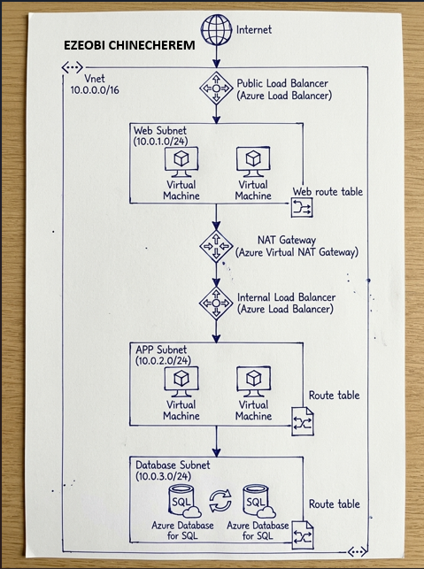

---

#### Architecture Notes

<<<<<<< HEAD
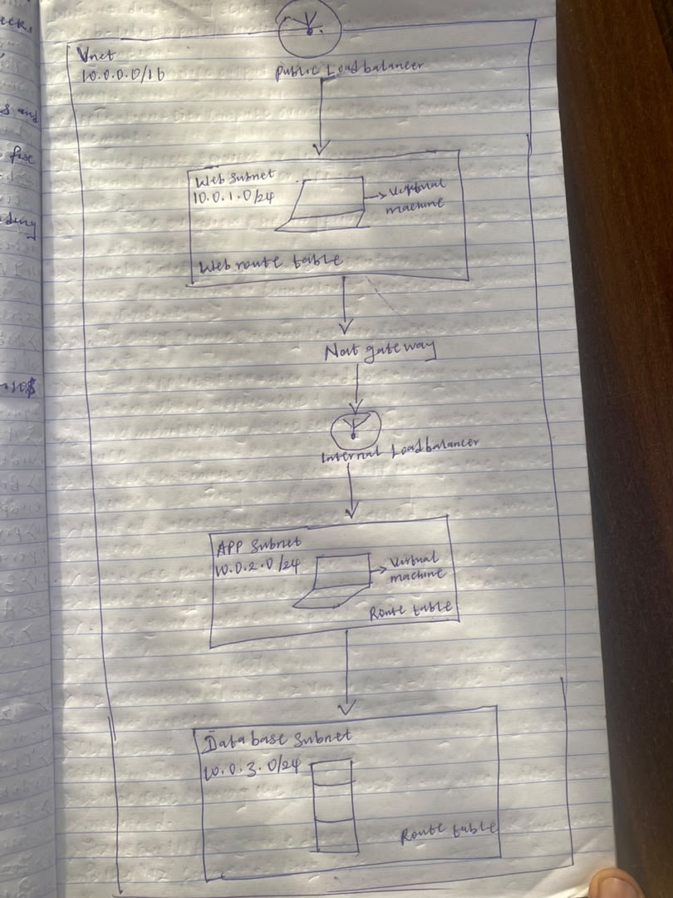
=======
Explain your selected region, VM sizes, database capacity, secret-management method, monitoring, backup, and recovery choices. State that one VM per compute tier allows downtime during a restart or failure.

Write your answer here.
>>>>>>> upstream

---

# Task 2 — Create the Azure Network Foundation

## Goal

Create a Resource Group and VNet using `10.0.0.0/16`, with web subnet `10.0.1.0/24`, application subnet `10.0.2.0/25`, and delegated database subnet `10.0.3.0/26`. Associate a NAT Gateway with the web and application subnets and reserve a private frontend IP for the Internal Load Balancer.

## Evidence

#### Screenshot 2 — Resource Group overview showing the network resources created so far

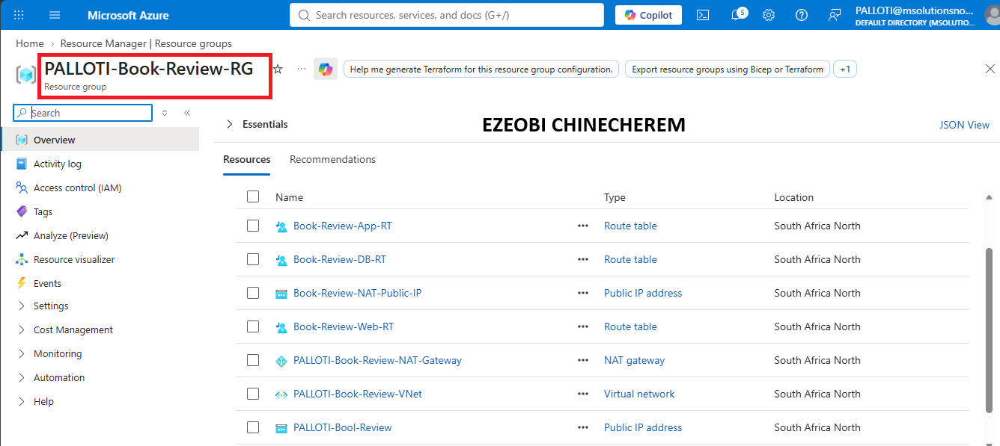

---

#### Screenshot 3 — VNet subnet configuration showing all three subnet names, CIDR ranges, and database subnet delegation

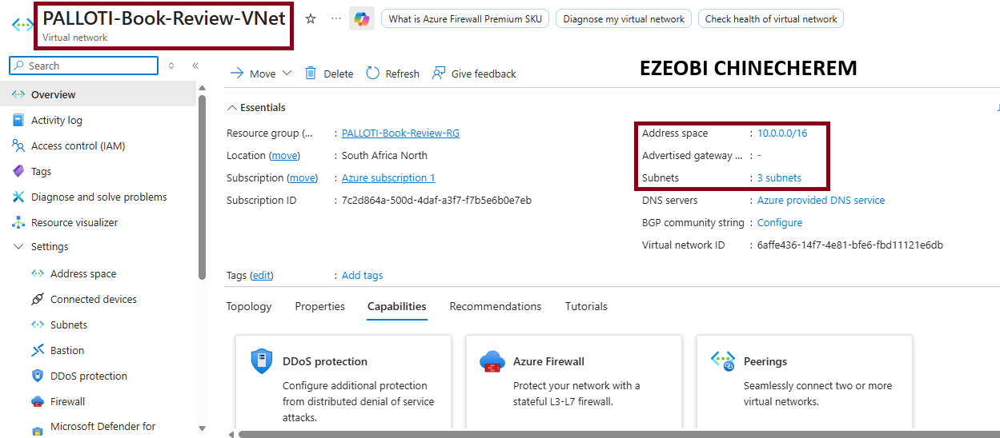

---

#### Screenshot 4 — NAT Gateway configuration showing its Public IP and associations with the web and application subnets

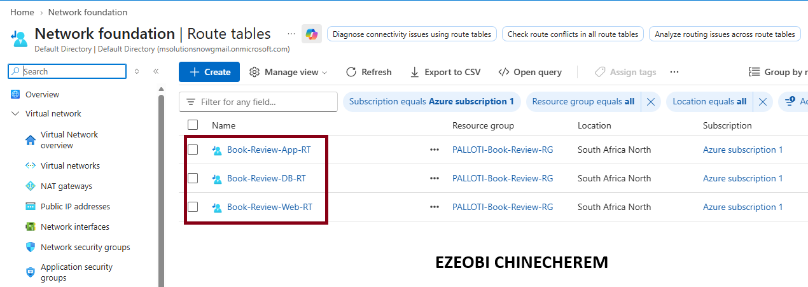

---

# Task 3 — Configure Security and Secret Management

## Goal

Configure NSGs for application, management, and health-probe traffic. Protect database credentials and the JWT signing secret. Create the Web VM with restricted SSH access and use it as the jump host for private App VM administration.

## Evidence

#### Screenshot 5 — Web, application, and database NSG rules showing permitted sources, ports, health-probe access, and applicable deny rules

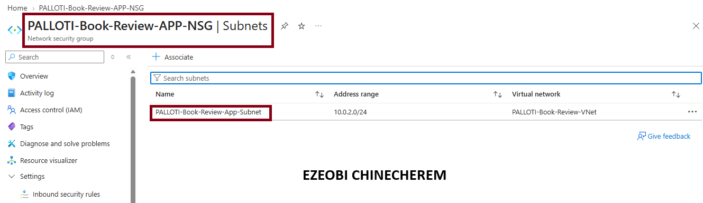

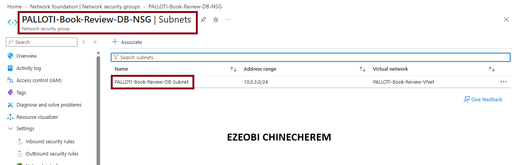

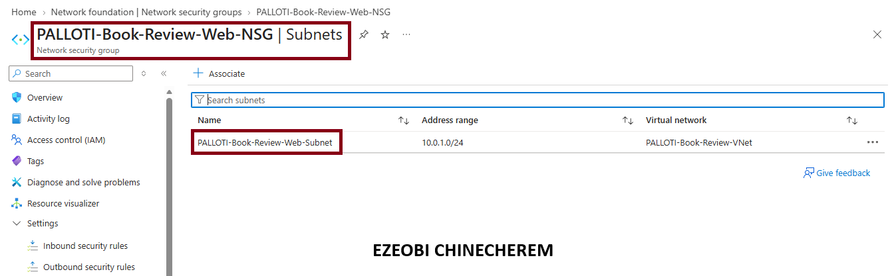

---

#### Screenshot 6 — Key Vault or the selected secret-management configuration, without displaying secret values

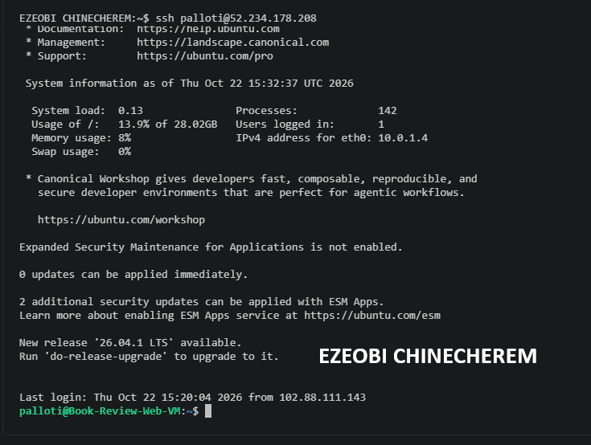

---

# Task 4 — Deploy the Managed Database Tier

## Goal

Create Azure Database for MySQL Flexible Server using private access in the delegated database subnet. Configure Private DNS, keep secure transport enabled, disable public access, and document backup and availability settings.

## Evidence

#### Screenshot 7 — MySQL Flexible Server networking configuration showing the private subnet and Private DNS configuration

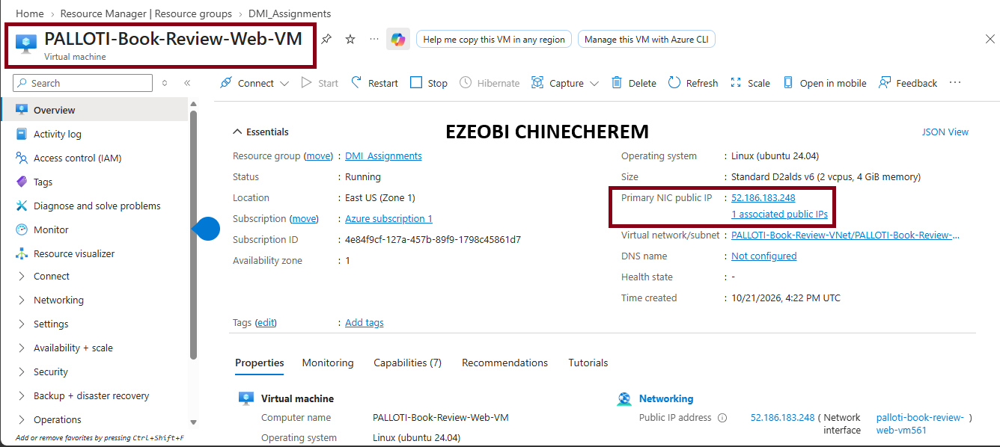

---

#### Screenshot 8 — Database backup-retention and availability settings

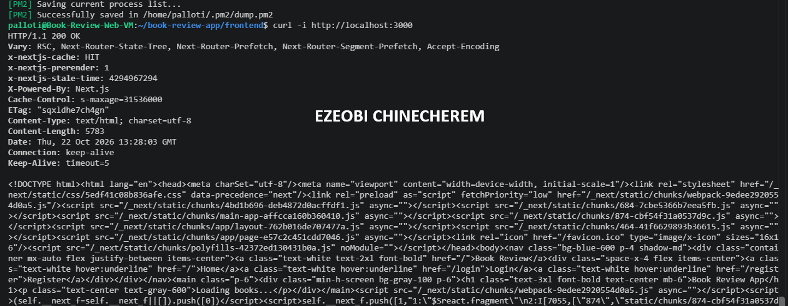

---

#### Database Notes

Record the database service, selected capacity, backup-retention period, and recovery approach. Do not include passwords.

Write your answer here.

---

# Task 5 — Deploy the Business or Application Tier

## Goal

Deploy the backend on one private Ubuntu VM using port **3001**. Connect to Azure MySQL over TLS, create `book_review_db` and the application database user, verify startup schema and sample-data initialization, and configure PM2 for automatic recovery.

## Evidence

#### Screenshot 9 — App VM networking configuration showing placement in the application subnet and no Public IP

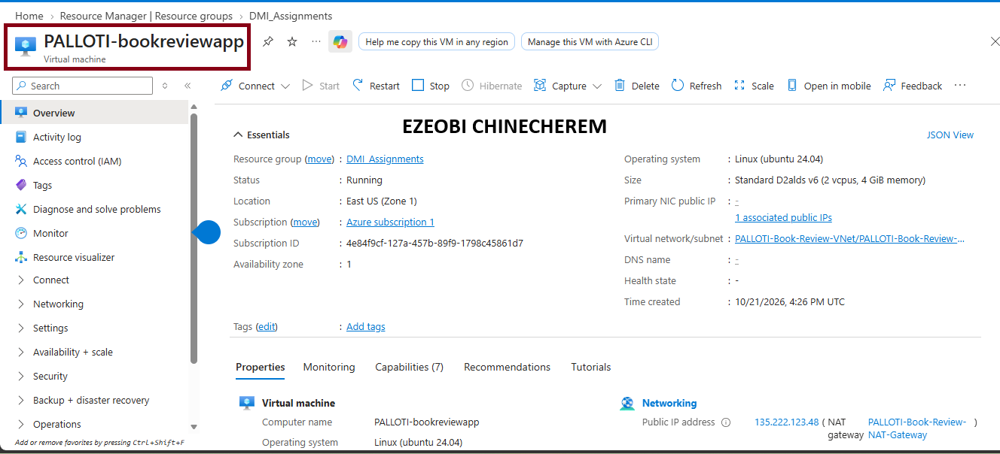

---

#### Screenshot 10 — Successful database connection and schema verification from the App VM, without displaying credentials

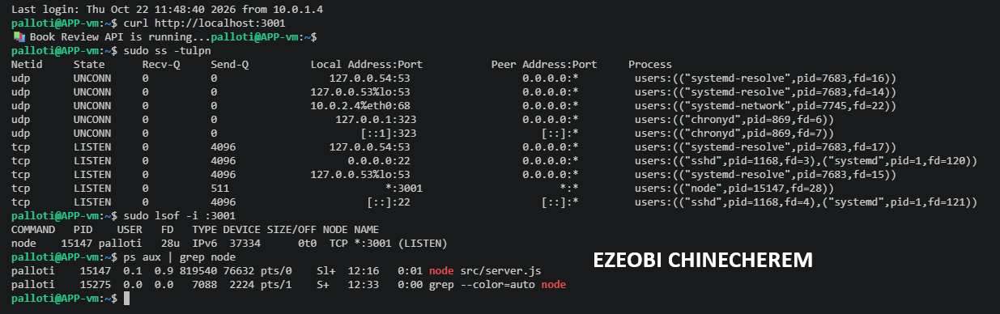

---

#### Screenshot 11 — PM2 showing `book-review-backend` online after reboot

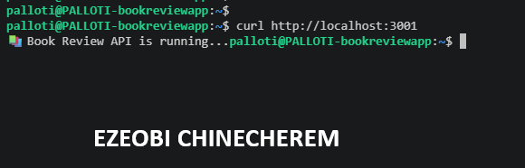

---

#### Screenshot 12 — Successful backend health or API response from the Web VM through the App VM’s private IP

Add your screenshot here.

---

# Task 6 — Deploy the Presentation or Web Tier

## Goal

Deploy the Next.js frontend on the existing Web VM on port **3000**. Configure Nginx on port **80** to forward page requests to the frontend and `/api/` requests to the Internal Load Balancer on port **3001**. Configure PM2 and verify recovery after reboot.

## Evidence

#### Screenshot 13 — Web VM overview or networking configuration showing its subnet and VM details

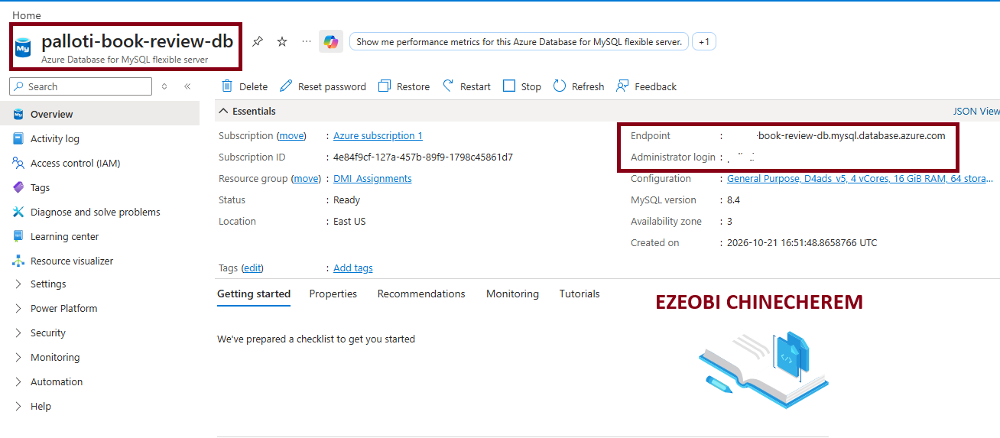

---

#### Screenshot 14 — Nginx site configuration showing frontend and API routing, together with successful `sudo nginx -t` output

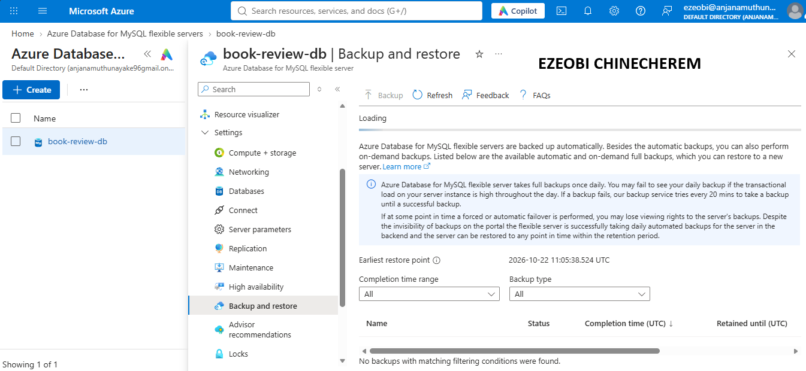

---

#### Screenshot 15 — PM2 showing `book-review-frontend` online after reboot, with Nginx active and a successful local HTTP response

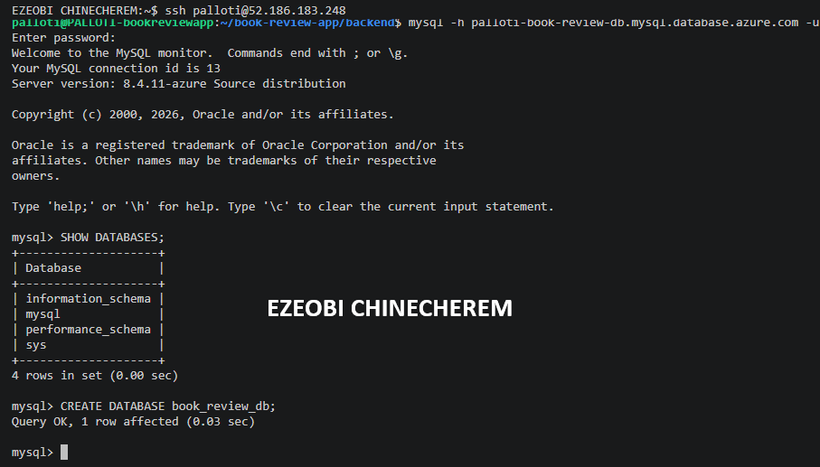

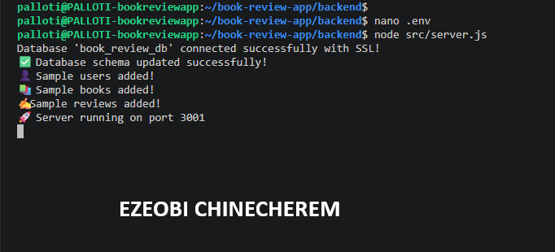
---

# Task 7 — Configure Load Balancers, Health Checks, and Monitoring

## Goal

Configure a Standard Public Load Balancer using TCP **80 → 80** and a Standard Internal Load Balancer using TCP **3001 → 3001**. Verify backend health, update the allowed frontend origin, and configure monitoring and at least one alert rule.

## Evidence

#### Screenshot 16 — Public Load Balancer frontend IP, web backend membership, TCP 80 → 80 rule, and health-probe status

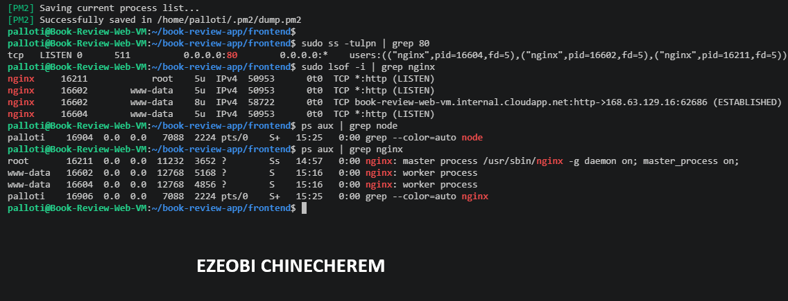

---

#### Screenshot 17 — Internal Load Balancer private frontend IP, application backend membership, TCP 3001 → 3001 rule, and health-probe status

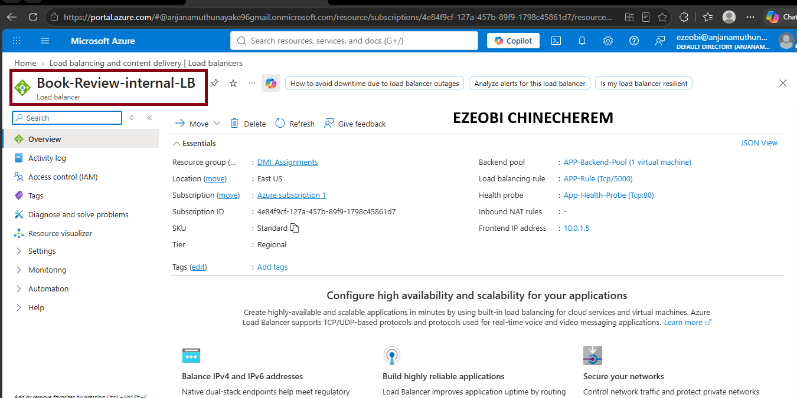

---

#### Screenshot 18 — Monitoring evidence showing a relevant metric or collected log and the configured alert rule

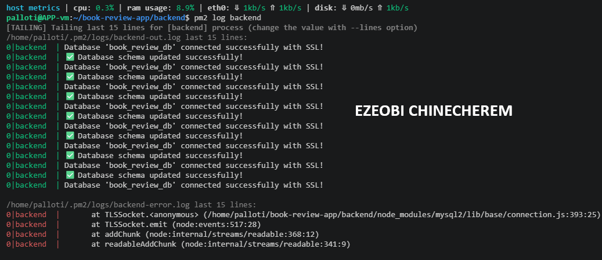

---

# Task 8 — Validate the Production-Style Deployment

## Goal

Verify registration, login, book viewing, and persistent review creation through the Public Load Balancer. Confirm private-tier restrictions and automatic service recovery after controlled App VM and Web VM restarts. Downtime is expected during these single-instance restart tests.

## Evidence

#### Screenshot 19 — Browser showing the Book Review App through the Public Load Balancer endpoint, with the address bar visible

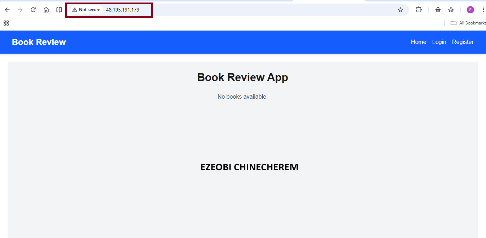

---

#### Screenshot 20 — Successful registration/login, book viewing, and review creation, with database evidence that the review persists

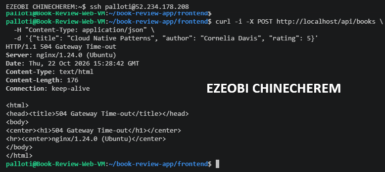

---

#### Screenshot 21 — App VM networking showing no Public IP, MySQL private-access settings, and relevant NSG restrictions

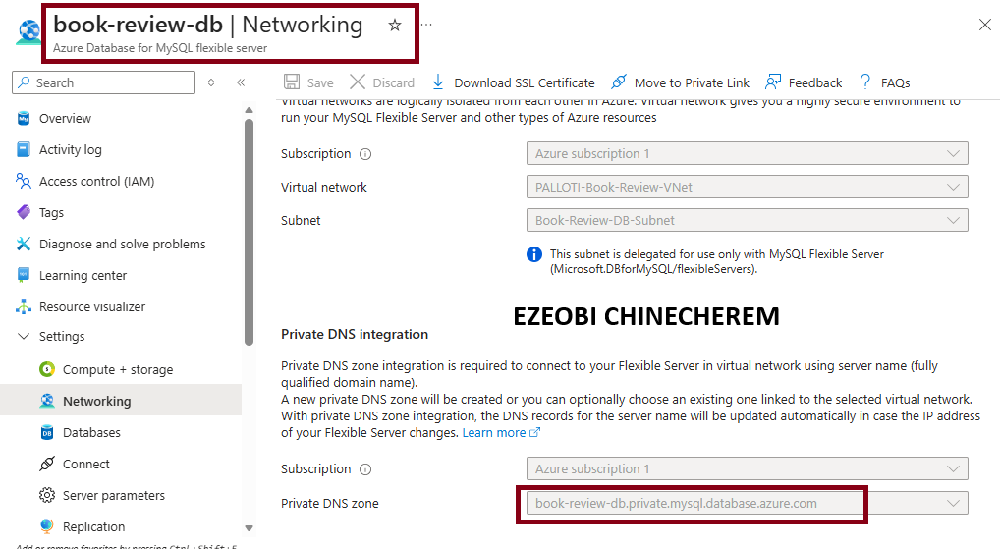

---

#### Screenshot 22 — Post-restart PM2/service status, healthy Load Balancer backends, and a successful application response

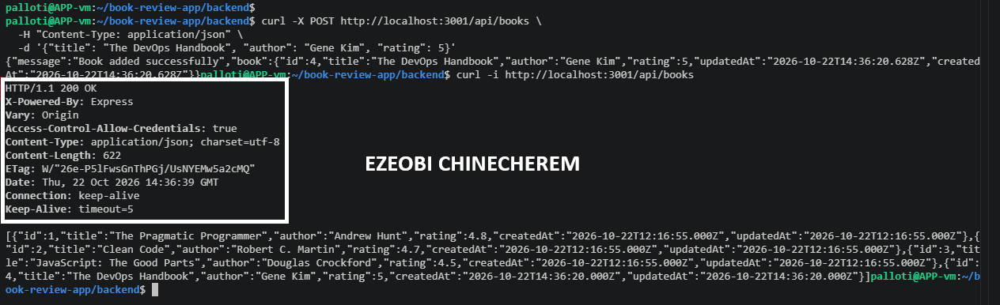

---

#### Public Endpoint

Paste your Public Load Balancer website URL here:

<<<<<<< HEAD
http://48.195.191.179 
=======
`http://<PUBLIC-LB-IP>`
>>>>>>> upstream

---

#### Recovery Notes

Record which VM was restarted, the observed interruption, recovery time, and whether services recovered without manual startup.

1. The Diagnostic Turning Point: curl http://localhost:3001/api/books
The command curl http://localhost:3001/api/books (and its loopback variant [http://127.0.0.1:3001/api/books](http://127.0.0.1:3001/api/books)) served as the ultimate isolation and validation tool throughout your deployment:

Bypassing the Proxy Layer: By hitting port 3001 directly, you completely bypassed Nginx and the public entry point. This allowed you to test the Express backend in isolation.

Proving End-to-End Database Connectivity: When this command returned records (or successful 201/200 responses on POST), it delivered undeniable proof that:

Your Node.js/Express application was running and healthy.

Sequelize successfully authenticated and communicated with your cloud-hosted Azure MySQL Flexible Server.

Read and write operations were functioning correctly at the application and database tiers.

Isolating Nginx Bottlenecks: When external or proxy requests returned 504 Gateway Time-out errors while curl http://localhost:3001/api/books responded instantly, it conclusively proved that your database and backend were fine, and the issue was strictly isolated to Nginx upstream routing configuration.

2. What Worked Successfully
Process Management: PM2 successfully maintained background uptime for your Node.js/Express services on port 3001.

Cloud Database Provisioning: Azure MySQL Flexible Server successfully provisioned and accepted authenticated database connections from your Azure VM.

Static Assets & Routing Structure: The separation of concerns between your Next.js frontend (port 3000), Express API (port 3001), and Nginx reverse proxy (port 80) was successfully mapped.

3. Issues Encountered & How They Were Fixed
Issue 1: Database Crash (ER_TOO_MANY_KEYS)

Cause: Sequelize was configured with alter: true, which repeatedly tried to alter table schemas on startup, generating duplicate unique index constraints that crashed MySQL.

Fix: Disabled automatic schema alterations by shifting to alter: false, ensuring stable database boots.

Issue 2: Nginx 504 Gateway Time-outs

Cause: Nginx was misconfigured to forward upstream traffic to an incorrect internal IP (10.0.2.50:3001) or experienced timeout stalls due to loopback resolution quirks.

Fix: Updated the Nginx sites-available configuration (/etc/nginx/sites-available/default) to cleanly route /api traffic directly to the local IPv4 loopback address ([http://127.0.0.1:3001](http://127.0.0.1:3001)) without trailing slashes, followed by sudo nginx -t and sudo systemctl reload nginx.

4. Production Architectural Choices
Availability: Utilized PM2 on the Azure VM for automatic process restarts and crash recovery, paired with Azure MySQL Flexible Server's built-in cloud high-availability features.

Security: Deployed Nginx as a reverse proxy on port 80 to act as the single secure gatekeeper. This shields your internal application ports (3000 and 3001) from direct public exposure while cleanly routing client traffic.

Secrets Management: Environment variables (.env) securely stored sensitive database connection strings, credentials, and endpoints locally on the VM without hardcoding them into source control.

Monitoring & Diagnostics: Leveraged system logs (/var/log/nginx/error.log), systemctl service checks, and targeted curl requests to observe real-time health and trace latency bottlenecks.

Backup Strategy: Leveraged Azure MySQL Flexible Server's managed automated backups, ensuring point-in-time recovery and persistent data safety in the cloud.

---

#### Deployment Notes

Summarize what worked, issues encountered, fixes applied, and sources used. Identify the backend route used for direct and Internal Load Balancer verification, including its expected response.

Write your answer here.

---

# LinkedIn Post (Required)

## Goal

Publish a LinkedIn post with an application screenshot, your public website URL, and a caption explaining what you deployed, what you learned, one challenge you resolved, and how you verified database-backed functionality and recovery after VM restarts.

Include **#DMIByPravinMishra #Azure #DevOps #CloudComputing**. Add the credit note and tags for your track as specified in the assignment guidelines.

## Evidence

#### LinkedIn Post URL

Paste your published LinkedIn post URL here:

`Add your URL here`

---

#### Screenshot 23 — Published LinkedIn post showing your caption, website URL, and application screenshot

Add your screenshot here.

---

# Submission Instructions

- Include your full name and Screenshots **1–23** under the corresponding evidence headings.
- Use multiple captures under an evidence heading where needed for readability.
- Include the working **public endpoint URL** and published **LinkedIn post URL**.
- Complete the architecture, database, recovery, and deployment notes.
- Ensure screenshots are readable and show your own environment.
- Do not expose passwords, private keys, tokens, connection strings containing credentials, subscription IDs, or other sensitive information.
- Submit your work using the method specified in the assignment guidelines.

---

# Completion Checklist

- [ ] Task 1: Architecture diagram and required notes completed (Screenshot 1)
- [ ] Task 2: VNet, subnets, database delegation, and NAT Gateway configured (Screenshots 2–4)
- [ ] Task 3: NSGs and secret management configured; Web VM created for administration and frontend hosting (Screenshots 5–6)
- [ ] Task 4: Private Azure MySQL server, Private DNS, and backup settings configured (Screenshots 7–8)
- [ ] Task 5: Private backend deployed, database initialized, and PM2 recovery verified (Screenshots 9–12)
- [ ] Task 6: Frontend and Nginx routing configured, with recovery verified (Screenshots 13–15)
- [ ] Task 7: Public and Internal Load Balancers healthy; monitoring and alert configured (Screenshots 16–18)
- [ ] Task 8: Application workflows, private-tier restrictions, and restart recovery verified (Screenshots 19–22)
- [ ] Architecture, database, recovery, and deployment notes completed
- [ ] LinkedIn post published with required hashtags, credit note, and tags (Screenshot 23)
- [ ] Full name, public endpoint URL, and LinkedIn post URL included
- [ ] All screenshots readable and no sensitive information exposed

---

## 📌 About DMI & CloudAdvisory

DevOps Micro Internship (DMI) is a project-based DevOps program run by Pravin Mishra (The CloudAdvisory) focused on real-world execution, systems thinking, and career readiness.

It helps learners build strong DevOps foundations with hands-on experience.

---

## 📌 Resources

- 🌐 DMI Official Website: https://dmi.pravinmishra.com?utm_source=github&utm_medium=readme  
- 🎓 University: https://university.pravinmishra.com?utm_source=github&utm_medium=readme  
- 💬 Discord Community: https://discord.pravinmishra.com?utm_source=github&utm_medium=readme  
- 📝 Blog: https://dmi.pravinmishra.com/blog?utm_source=github&utm_medium=readme  
- ▶️ YouTube Playlist: https://www.youtube.com/playlist?list=PLFeSNDtI4Cho  
- 🔗 Pravin Mishra (LinkedIn): https://www.linkedin.com/in/pravin-mishra-aws-trainer/  
- 🏢 CloudAdvisory (LinkedIn): https://www.linkedin.com/company/thecloudadvisory/

---

*This submission is part of DevOps Micro Internship (DMI) — Agentic AI Track.*
