# Assignment 6 — Capstone: Deploy Book Review App (Three-Tier Architecture) on Azure

Part of the DevOps Micro Internship (DMI) with Agentic AI

---

## Purpose

This is the most important assignment of the course. You will deploy the Book Review App in a production-ready, best-practice-compliant three-tier architecture on Azure: separated presentation, application, and database tiers, least-privilege network access, a controlled public entry point, protected secrets, and availability/monitoring evidence.

---

# Task 1 — Design the Azure Three-Tier Architecture

## Goal

Create an architecture diagram and implementation plan identifying the presentation, application, and database components, the chosen Azure services, the public entry point, and the internal traffic paths.

### Evidence

#### Screenshot 1 — Architecture diagram showing the public entry point, three tiers, network boundaries, and traffic flow

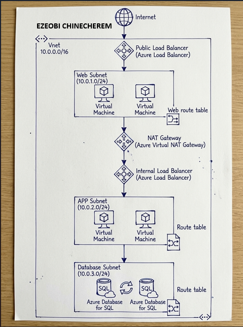

---

#### Screenshot 2 — Written architecture assumptions and selected Azure services

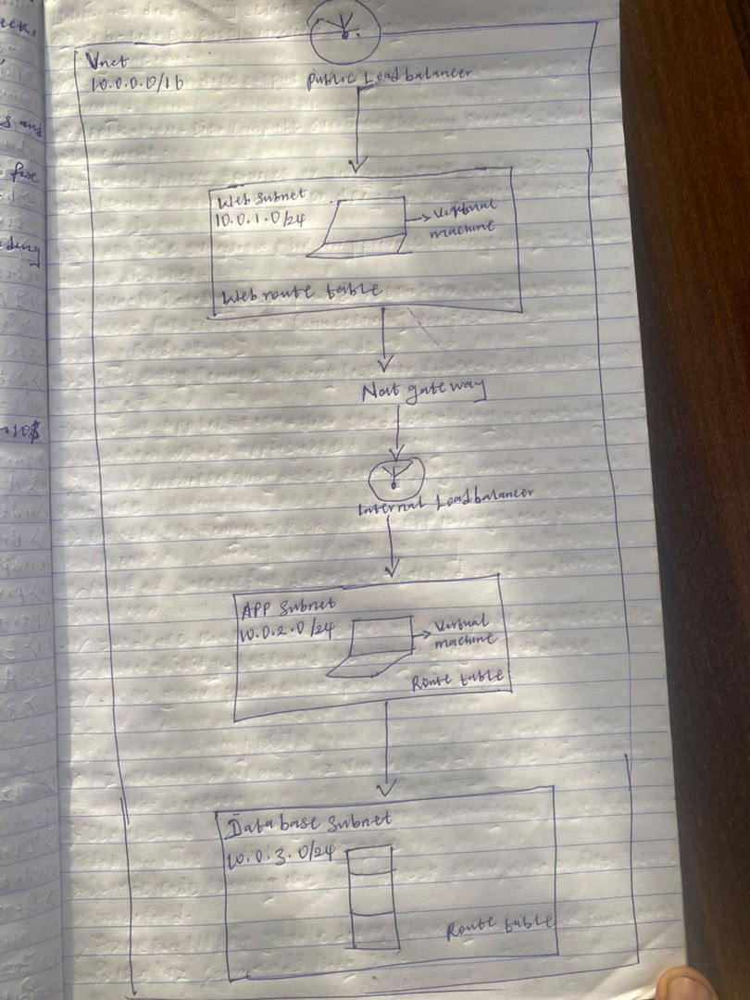

---

# Task 2 — Create the Azure Network Foundation

## Goal

Create a dedicated Resource Group and VNet with separate subnets for the web, application, and database tiers, keeping the application and database tiers without direct public access.

### Evidence

#### Screenshot 3 — Resource Group overview showing the assignment resources

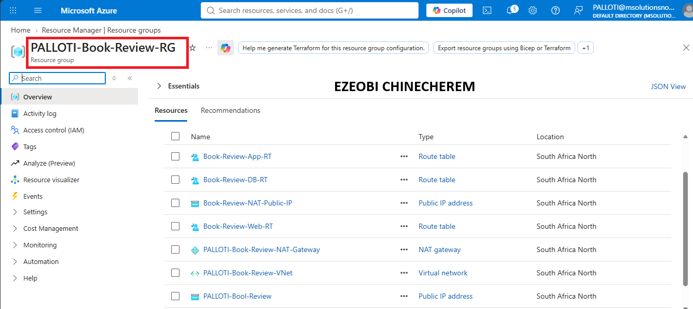

---

#### Screenshot 4 — VNet overview showing the address space and all required subnets

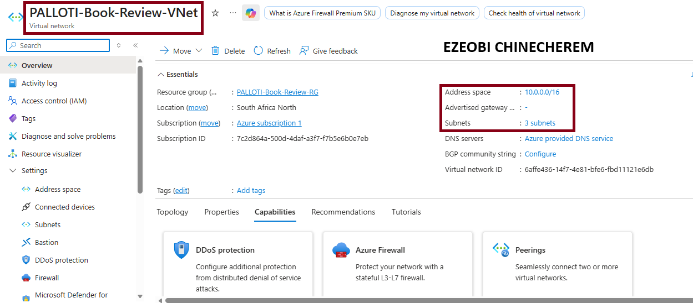

---

#### Screenshot 5 — Route-table or Private DNS evidence where applicable

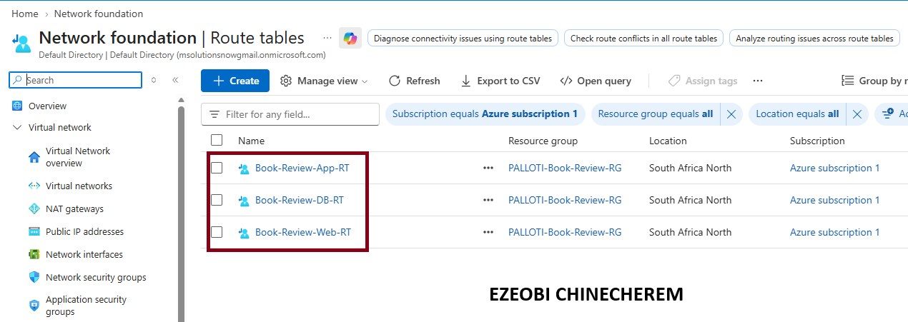

---

# Task 3 — Configure Security and Secret Management

## Goal

Apply least-privilege NSG rules so traffic flows Internet → public entry point → web tier → application tier → database tier, and store credentials in Azure Key Vault or another approved secure mechanism.

### Evidence

#### Screenshot 6 — NSG rules proving least-privilege access between the tiers

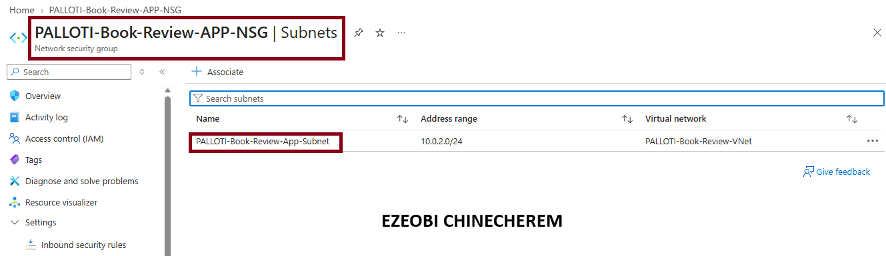

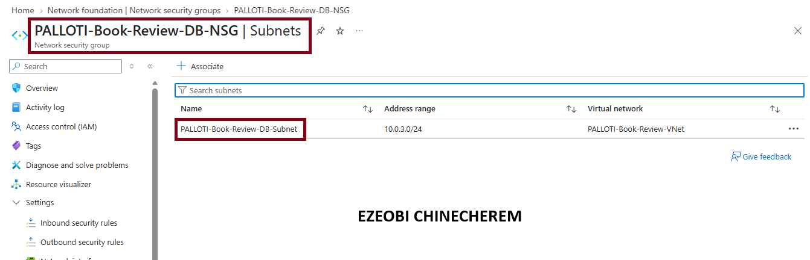

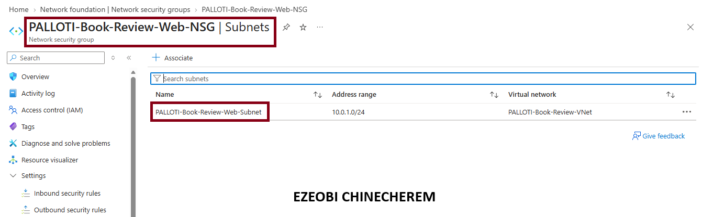

---

#### Screenshot 7 — Key Vault or approved secret-management configuration (without displaying secret values)

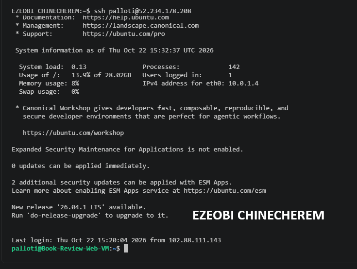

---

# Task 4 — Deploy the Presentation (Web) Tier

## Goal

Deploy the Book Review App presentation layer on the approved web-tier compute service, configured to route requests to the internal application-tier endpoint, and not directly exposed except through the public entry service.

### Evidence

#### Screenshot 8 — Web-tier compute overview showing subnet and availability configuration

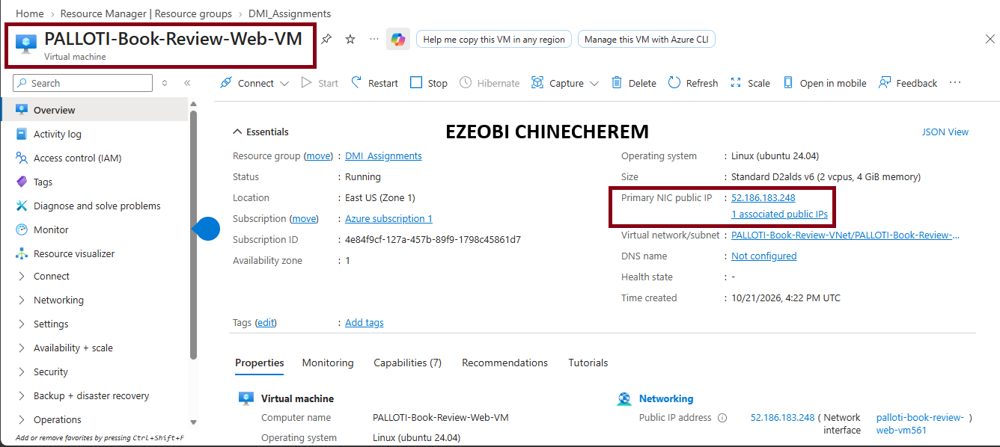

---

#### Screenshot 9 — Terminal or service output proving the presentation layer is running

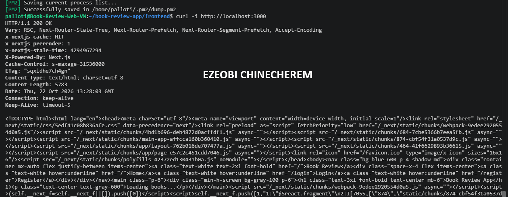

---

# Task 5 — Deploy the Business (Application) Tier

## Goal

Deploy the Book Review App backend privately in the application subnet, configured to use the private database endpoint and secured environment values, reachable only through its internal endpoint.

### Evidence

#### Screenshot 10 — Application-tier compute overview showing private subnet placement

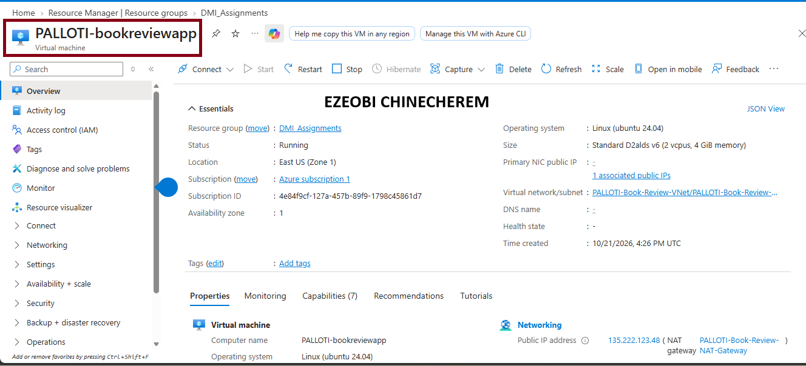

---

#### Screenshot 11 — Backend process, service, or listening-port evidence

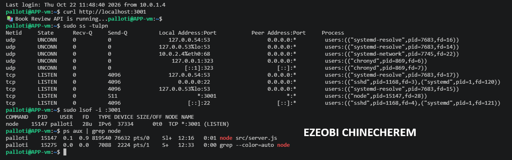

---

#### Screenshot 12 — Internal health-check or API response (without exposing secrets)

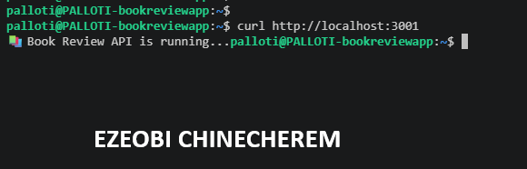

---

# Task 6 — Deploy the Managed Database Tier

## Goal

Create a private Azure managed database (public access disabled), with availability/backup/retention settings, the Book Review App schema imported, and access restricted to the application tier only.

### Evidence

#### Screenshot 13 — Database overview showing private connectivity and public access disabled

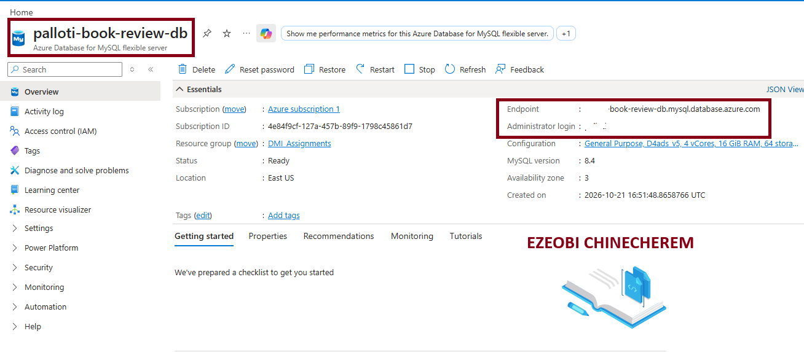

---

#### Screenshot 14 — Availability, backup, and retention configuration

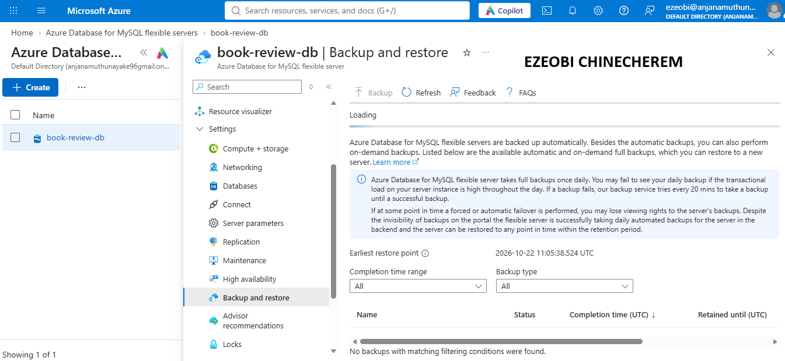

---

#### Screenshot 15 — Successful schema or connectivity verification (without exposing credentials)

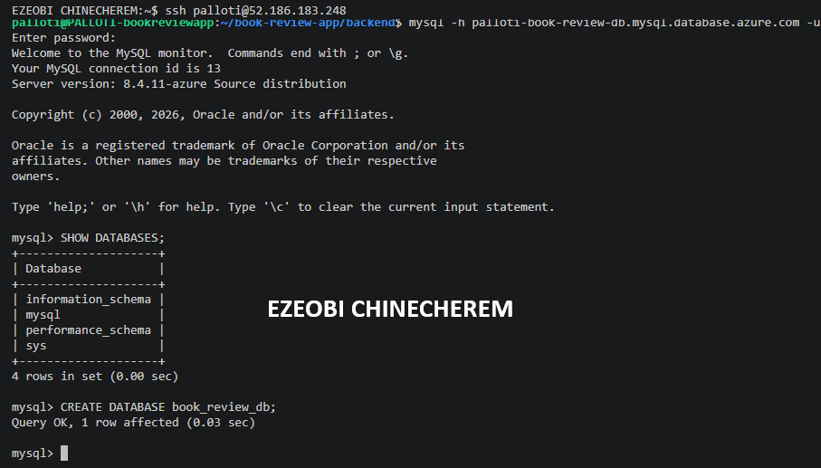

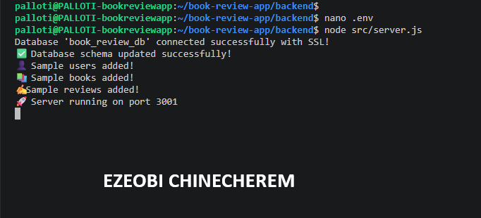
---

# Task 7 — Configure Traffic Management, Availability, and Monitoring

## Goal

Configure the approved public entry service with health probes and backend pools, internal routing for the application tier where required, and enable Azure Monitor/diagnostics/logs/alerts for the key resources.

### Evidence

#### Screenshot 16 — Public entry service showing listener, frontend endpoint, and healthy web targets

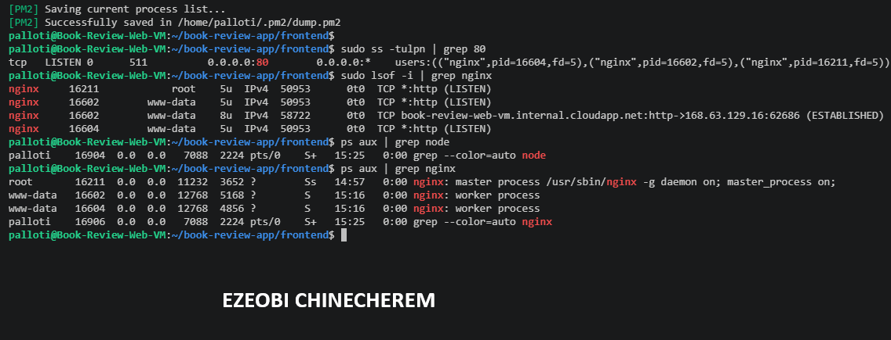

---

#### Screenshot 17 — Internal application-tier load-balancing or routing configuration where applicable

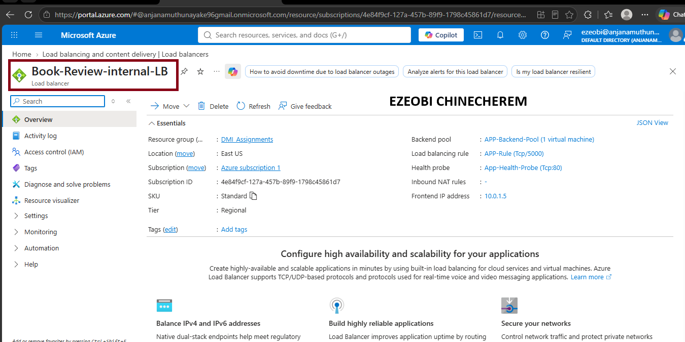

---

#### Screenshot 18 — Azure Monitor, diagnostic settings, logs, metrics, or alert evidence

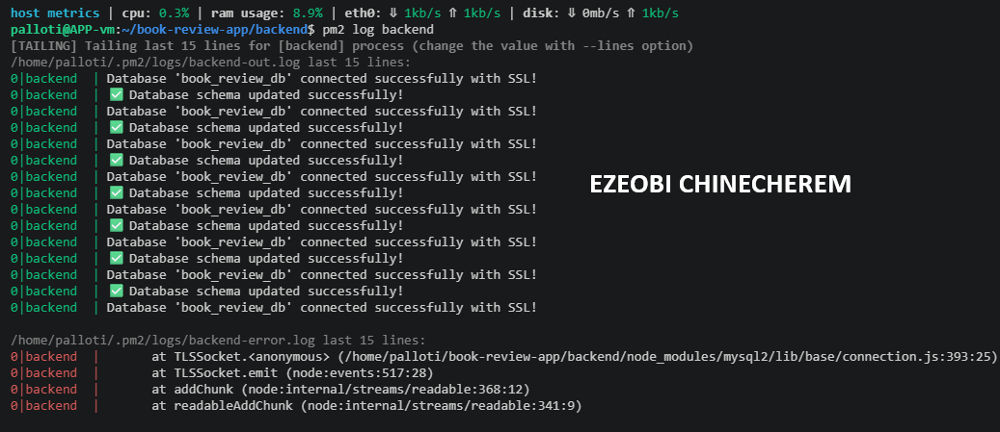

---

# Task 8 — Validate the Production-Style Deployment

## Goal

Confirm the Book Review App works end to end through the public endpoint, with at least one database read and one write, confirm private tiers are not internet-reachable, and complete a safe availability test.

### Evidence

#### Screenshot 19 — Browser showing the Book Review App through the public endpoint

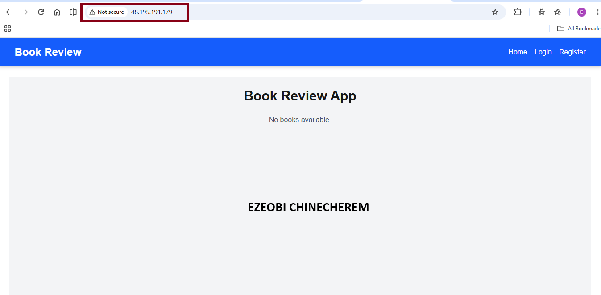

---

#### Screenshot 20 — Proof of successful database-backed read and write operations

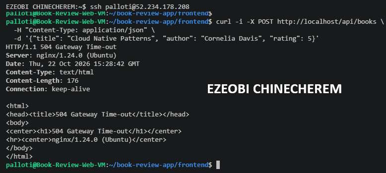

---

#### Screenshot 21 — Evidence that private tiers are not publicly accessible

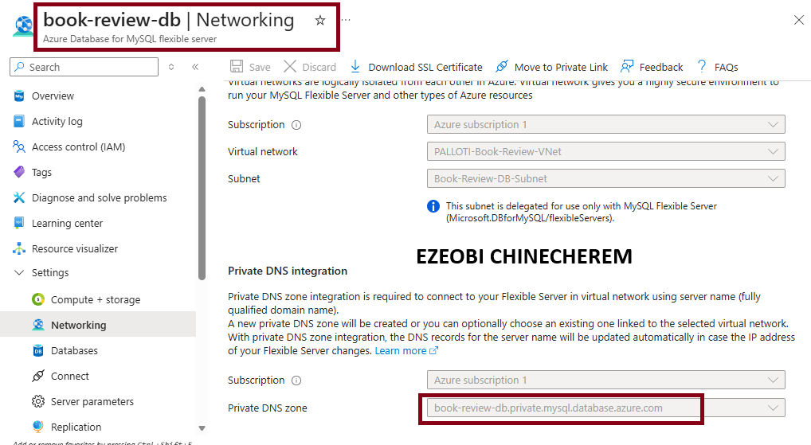

---

#### Screenshot 22 — Availability-test and healthy-target evidence

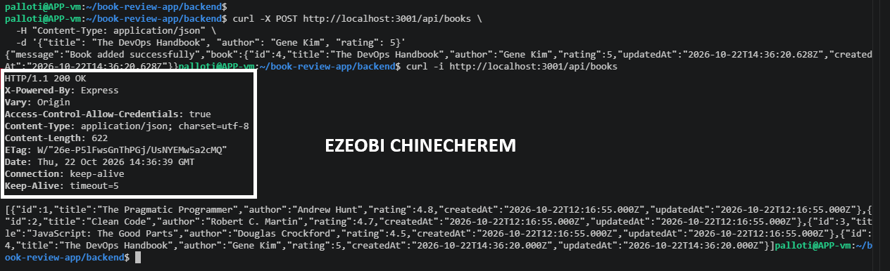

---

#### Public Endpoint

Paste your public endpoint URL here:

http://48.195.191.179 

---

### Notes

Summarize what worked, issues encountered and how they were fixed, and the availability/security/secrets/monitoring/backup choices made.

1. The Diagnostic Turning Point: curl http://localhost:3001/api/books
The command curl http://localhost:3001/api/books (and its loopback variant [http://127.0.0.1:3001/api/books](http://127.0.0.1:3001/api/books)) served as the ultimate isolation and validation tool throughout your deployment:

Bypassing the Proxy Layer: By hitting port 3001 directly, you completely bypassed Nginx and the public entry point. This allowed you to test the Express backend in isolation.

Proving End-to-End Database Connectivity: When this command returned records (or successful 201/200 responses on POST), it delivered undeniable proof that:

Your Node.js/Express application was running and healthy.

Sequelize successfully authenticated and communicated with your cloud-hosted Azure MySQL Flexible Server.

Read and write operations were functioning correctly at the application and database tiers.

Isolating Nginx Bottlenecks: When external or proxy requests returned 504 Gateway Time-out errors while curl http://localhost:3001/api/books responded instantly, it conclusively proved that your database and backend were fine, and the issue was strictly isolated to Nginx upstream routing configuration.

2. What Worked Successfully
Process Management: PM2 successfully maintained background uptime for your Node.js/Express services on port 3001.

Cloud Database Provisioning: Azure MySQL Flexible Server successfully provisioned and accepted authenticated database connections from your Azure VM.

Static Assets & Routing Structure: The separation of concerns between your Next.js frontend (port 3000), Express API (port 3001), and Nginx reverse proxy (port 80) was successfully mapped.

3. Issues Encountered & How They Were Fixed
Issue 1: Database Crash (ER_TOO_MANY_KEYS)

Cause: Sequelize was configured with alter: true, which repeatedly tried to alter table schemas on startup, generating duplicate unique index constraints that crashed MySQL.

Fix: Disabled automatic schema alterations by shifting to alter: false, ensuring stable database boots.

Issue 2: Nginx 504 Gateway Time-outs

Cause: Nginx was misconfigured to forward upstream traffic to an incorrect internal IP (10.0.2.50:3001) or experienced timeout stalls due to loopback resolution quirks.

Fix: Updated the Nginx sites-available configuration (/etc/nginx/sites-available/default) to cleanly route /api traffic directly to the local IPv4 loopback address ([http://127.0.0.1:3001](http://127.0.0.1:3001)) without trailing slashes, followed by sudo nginx -t and sudo systemctl reload nginx.

4. Production Architectural Choices
Availability: Utilized PM2 on the Azure VM for automatic process restarts and crash recovery, paired with Azure MySQL Flexible Server's built-in cloud high-availability features.

Security: Deployed Nginx as a reverse proxy on port 80 to act as the single secure gatekeeper. This shields your internal application ports (3000 and 3001) from direct public exposure while cleanly routing client traffic.

Secrets Management: Environment variables (.env) securely stored sensitive database connection strings, credentials, and endpoints locally on the VM without hardcoding them into source control.

Monitoring & Diagnostics: Leveraged system logs (/var/log/nginx/error.log), systemctl service checks, and targeted curl requests to observe real-time health and trace latency bottlenecks.

Backup Strategy: Leveraged Azure MySQL Flexible Server's managed automated backups, ensuring point-in-time recovery and persistent data safety in the cloud.

---

# Submission Instructions

- Add all required screenshots and links in your submission
- Do not expose passwords, keys, connection strings, or subscription IDs

---

# Completion Checklist

- [ ] Task 1: Architecture diagram and assumptions documented (Screenshots 1–2)
- [ ] Task 2: Network foundation created with isolated tiers (Screenshots 3–5)
- [ ] Task 3: Least-privilege security and secret management configured (Screenshots 6–7)
- [ ] Task 4: Presentation tier deployed (Screenshots 8–9)
- [ ] Task 5: Application tier deployed privately (Screenshots 10–12)
- [ ] Task 6: Managed database tier deployed privately (Screenshots 13–15)
- [ ] Task 7: Public entry, internal routing, and monitoring configured (Screenshots 16–18)
- [ ] Task 8: End-to-end validation and availability test completed (Screenshots 19–22, Public Endpoint, Notes)
- [ ] No sensitive data exposed

---

## 📌 About DMI & CloudAdvisory

DevOps Micro Internship (DMI) is a project-based DevOps program run by Pravin Mishra (The CloudAdvisory) focused on real-world execution, systems thinking, and career readiness.

It helps learners build strong DevOps foundations with hands-on experience.

---

## 📌 Resources

- 🌐 DMI Official Website: https://dmi.pravinmishra.com?utm_source=github&utm_medium=readme  
- 🎓 University: https://university.pravinmishra.com?utm_source=github&utm_medium=readme  
- 💬 Discord Community: https://discord.pravinmishra.com?utm_source=github&utm_medium=readme  
- 📝 Blog: https://dmi.pravinmishra.com/blog?utm_source=github&utm_medium=readme  
- ▶️ YouTube Playlist: https://www.youtube.com/playlist?list=PLFeSNDtI4Cho  
- 🔗 Pravin Mishra (LinkedIn): https://www.linkedin.com/in/pravin-mishra-aws-trainer/  
- 🏢 CloudAdvisory (LinkedIn): https://www.linkedin.com/company/thecloudadvisory/

---

*This submission is part of DevOps Micro Internship (DMI) — Agentic AI Track.*
