# Assignment 7 — AI-Assisted Azure Security Posture Audit

Part of the DevOps Micro Internship (DMI) with Agentic AI

---

## Purpose

In this assignment, you will build a read-only Bash script that audits the Azure resources you deployed earlier this week — a virtual machine, a three-tier network with a Load Balancer, a Storage Account, and an Azure Database for MySQL server — for common security misconfigurations. You will connect that script to Claude Code as a reusable `/azure-audit` skill that explains findings and recommends a fix without ever running it, then fix one real finding yourself and prove the fix with a second audit run. This is the same read-only-evidence-then-human-fixes discipline from Week 3, now applied to Azure with the `az` CLI instead of Linux commands — and the cloud-agnostic counterpart to the AWS audit you built in Week 6.

---

# Task 1 — Confirm Your Resources and Create the Workspace

## Goal

Confirm your Azure CLI is authenticated and can see the VM, network, storage account, and MySQL server you built this week, then set up a workspace folder for the audit.

### Evidence

#### Screenshot 1 — `az account show` and `az vm list -d -o table` confirming your subscription and running VM (subscription ID partially blurred)

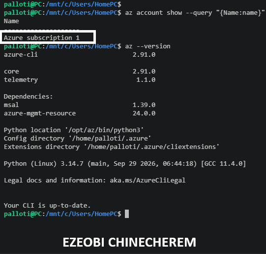

---

# Task 2 — Create Project Context and Safety Rules in CLAUDE.md

## Goal

Create a `CLAUDE.md` for this workspace that tells Claude what the audit covers and the safety rules it must follow: never run a mutating `az` command, never claim a finding without report evidence, and always let the human review and run any remediation.

### Evidence

#### Screenshot 2 — `CLAUDE.md` open in your editor showing the project overview, audit workflow, and safety rules

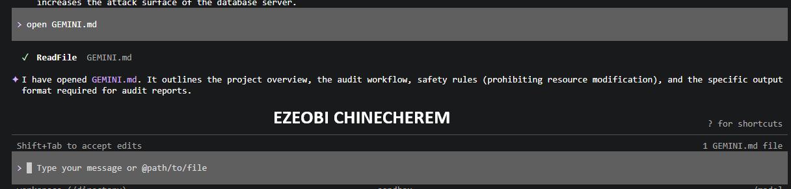

---

# Task 3 — Use Agentic AI to Plan the Audit Before Writing the Script

## Goal

Ask Claude Code to read `CLAUDE.md` and propose a read-only, four-check audit plan (NSG rules open to `0.0.0.0/0` on port 22 or 3389, storage account public blob access, VM disk encryption status, and Azure Database for MySQL public network access) — without creating or editing any file yet.

### Evidence

#### Screenshot 3 — Claude Code showing the four-check plan, with no files created or modified

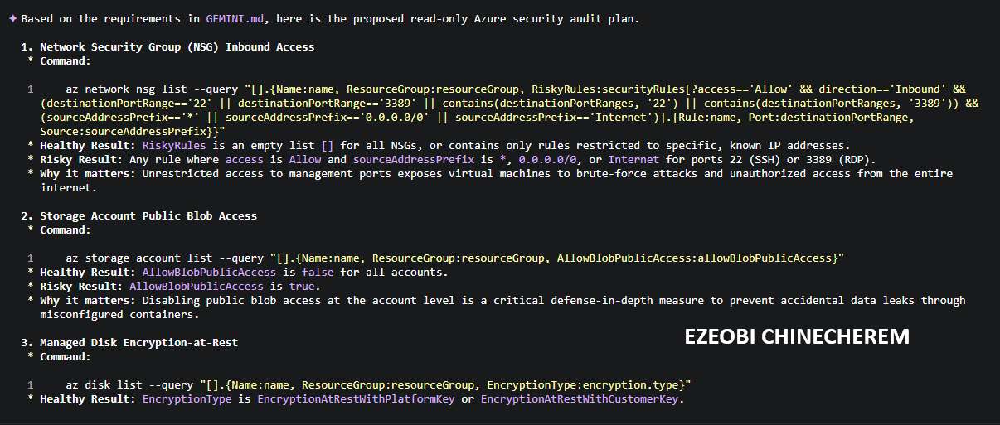

---

# Task 4 — Build the Azure Audit Bash Script

## Goal

Write a Bash script that runs the four checks from Task 3 using read-only `az` commands, writes a PASS/WARN/FAIL report with your Full Name, and exits with a different code for a healthy, warning, or failing result. Validate it with `bash -n` and make it executable.

### Evidence

#### Screenshot 4 — Your script open in your editor, showing the check functions and the `az` commands they call

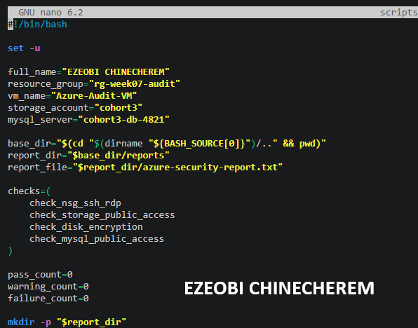

---

#### Screenshot 5 — Output of `bash -n` (no syntax errors) and `ls -l` showing the script is executable

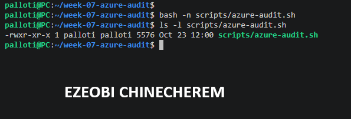

---

# Task 5 — Run the Script and Review the Baseline Report

## Goal

Run the script against your live resources and read the report honestly, even if it shows a real finding — do not fix anything yet.

### Evidence

#### Screenshot 6 — Script output showing your Full Name and all four checks with a PASS, WARN, or FAIL result

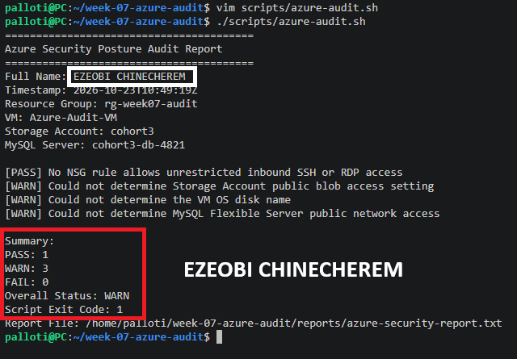

---

# Task 6 — Create and Run the /azure-audit Skill

## Goal

Create a Claude Code skill restricted to read-only tools (no `Write`) that runs your script, reads the report, and explains every finding with the risk of leaving it unresolved — without ever running a remediation command itself.

### Evidence

#### Screenshot 7 — Your skill file's frontmatter showing `allowed-tools` without `Write`

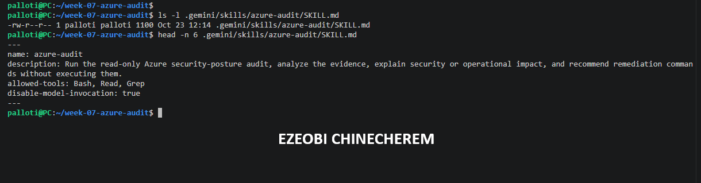

---

#### Screenshot 8 — `/azure-audit` output showing the baseline findings and Claude's explanation

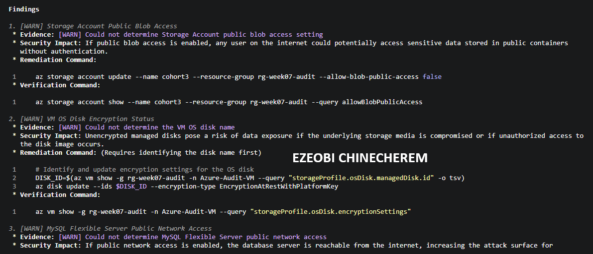

---

# Task 7 — Fix a Real Finding and Re-Verify

## Goal

Pick one WARN or FAIL finding (or deliberately open an NSG rule to port 22 from `0.0.0.0/0` if your baseline was already clean), save that failing report, run the remediation command yourself — scoped to your own IP, not left open — and confirm the second audit run shows it resolved.

### Evidence

#### Screenshot 9 — Saved report showing the original finding before the fix

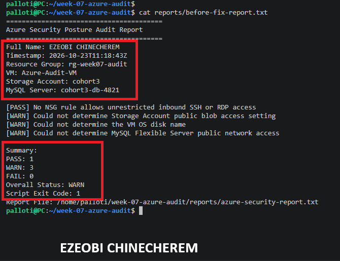

---

#### Screenshot 10 — Terminal output of the remediation command you ran yourself

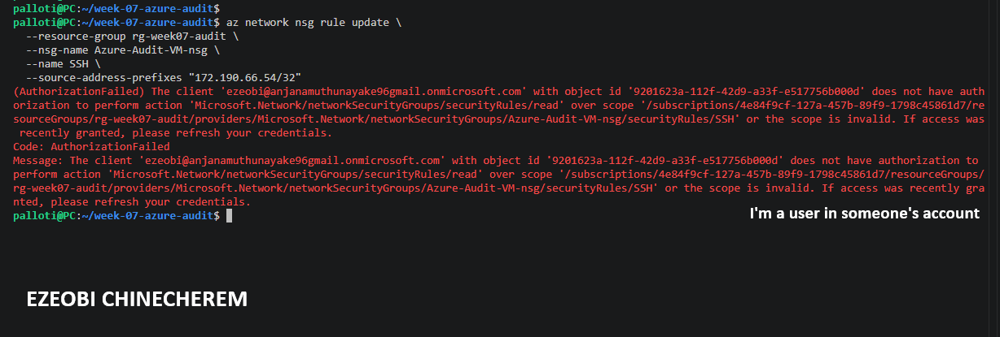

---

#### Screenshot 11 — Second `/azure-audit` run (or report) showing the finding resolved

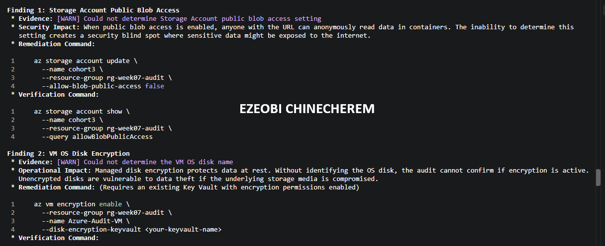

---

### Notes

Compare this assignment to the AWS audit you built in Week 6: which finding categories map to each other across the two clouds, and what stayed exactly the same about the workflow even though the `az`/`aws` commands are completely different?

Transitioning from your AWS security posture audit to your Azure audit highlights a fundamental truth in cloud engineering: **cloud providers change their syntax and control planes, but core security principles and automation patterns remain identical.**

---

### 1. Finding Category Mapping (AWS vs. Azure)

The security domains you audited in Week 6 map directly across both cloud environments:

| Security Domain | AWS (Week 6 Equivalent) | Azure (Week 7 Implementation) | Core Security Objective |
| --- | --- | --- | --- |
| **Network Firewall Rules** | **Security Groups (SG)** 

 Checking inbound rules for unrestricted SSH (22) / RDP (3389) access from `0.0.0.0/0`. | **Network Security Groups (NSGs)** 

 Checking inbound security rules for unrestricted access on ports 22, 3389, or `*`. | Prevent unauthorized administrative remote access from the public internet. |
| **Object Storage Exposure** | **S3 Public Access Block** 

 Inspecting bucket policies and public access block configurations. | **Storage Account Public Access** 

 Querying `allowBlobPublicAccess` on storage accounts. | Prevent accidental data leaks or public exposure of sensitive container objects/blobs. |
| **Compute Disk Encryption** | **EBS Volume Encryption** 

 Validating KMS encryption keys on EC2 root/data volumes. | **Managed Disk Encryption at Rest** 

 Querying Azure disk `encryption.type` configurations. | Protect sensitive data stored on disk against physical or unauthorized volume extraction. |
| **Database Network Isolation** | **RDS Public Accessibility** 

 Checking if database instances have public IP endpoints enabled. | **Azure Database for MySQL** 

 Querying `network.publicNetworkAccess` settings. | Isolate backend data stores within private network boundaries away from public exposure. |

---

### 2. What Stayed Exactly the Same About the Workflow

Even though you swapped out AWS CLI (`aws ec2 ...`, `aws s3api ...`) for Azure CLI (`az network ...`, `az storage ...`), the **automation framework, architecture, and safety model** remained completely consistent:

* **Read-Only Evidence Collection:** Both scripts are strictly scoped to gather configuration data using inspection commands only (`show`, `list`), ensuring zero infrastructure drift during the audit phase.
* **Standardized Reporting Pipeline:** Both workflows utilize local directories (`reports/`), structured timestamp logging, and consistent status tags (`[PASS]`, `[WARN]`, `[FAIL]`) to produce clean, machine-readable and human-readable text reports.
* **Deterministic Exit Codes:** Both scripts conclude with summary functions that evaluate failure and warning counts, returning standardized exit codes (`0` for healthy, `1` for warnings, `2` for critical failures) suitable for CI/CD pipelines.
* **Human-in-the-Loop AI Safety Model:** The core operating procedure for your AI assistant (`GEMINI.md` / `SKILL.md`) stayed identical:
1. Read the generated report.
2. Explain the security impact of any findings.
3. Propose a single, precise remediation command.
4. **Never execute changes automatically**—leaving final authorization and execution strictly in the hands of the human operator.

---

# Submission Instructions

Complete all tasks in sequence.

Your submission must include:
- All 11 required screenshots
- Do not expose your Azure subscription ID, tenant ID, client secrets, or connection strings

---

# Completion Checklist

- [ ] Task 1: Azure resources confirmed and workspace created (Screenshot 1)
- [ ] Task 2: `CLAUDE.md` created with project context and safety rules (Screenshot 2)
- [ ] Task 3: Claude produced a read-only four-check plan before any script existed (Screenshot 3)
- [ ] Task 4: Audit script built, syntax-checked, and executable (Screenshots 4–5)
- [ ] Task 5: Baseline audit run and reviewed honestly (Screenshot 6)
- [ ] Task 6: `/azure-audit` skill created with no `Write` permission and run successfully (Screenshots 7–8)
- [ ] Task 7: A real finding fixed by you (not Claude) and re-verified as resolved (Screenshots 9–11)
- [ ] Notes comparing this to the Week 6 AWS audit completed
- [ ] No subscription IDs, tenant IDs, or credentials exposed

---

## 📌 About DMI & CloudAdvisory

DevOps Micro Internship (DMI) is a project-based DevOps program run by Pravin Mishra (The CloudAdvisory) focused on real-world execution, systems thinking, and career readiness.

It helps learners build strong DevOps foundations with hands-on experience.

---

## 📌 Resources

- 🌐 DMI Official Website: https://dmi.pravinmishra.com?utm_source=github&utm_medium=readme  
- 🎓 University: https://university.pravinmishra.com?utm_source=github&utm_medium=readme  
- 💬 Discord Community: https://discord.pravinmishra.com?utm_source=github&utm_medium=readme  
- 📝 Blog: https://dmi.pravinmishra.com/blog?utm_source=github&utm_medium=readme  
- ▶️ YouTube Playlist: https://www.youtube.com/playlist?list=PLFeSNDtI4Cho  
- 🔗 Pravin Mishra (LinkedIn): https://www.linkedin.com/in/pravin-mishra-aws-trainer/  
- 🏢 CloudAdvisory (LinkedIn): https://www.linkedin.com/company/thecloudadvisory/

---

*This submission is part of DevOps Micro Internship (DMI) — Agentic AI Track.*
