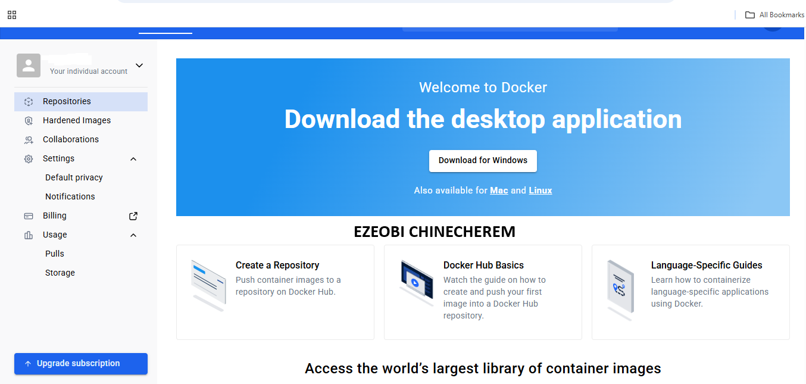
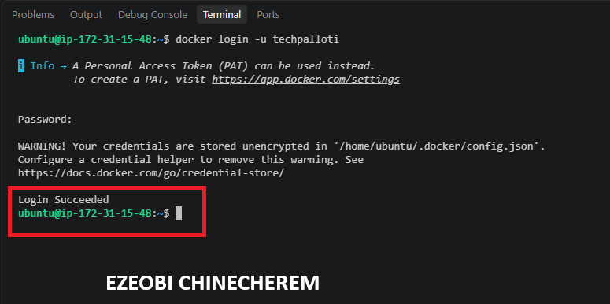
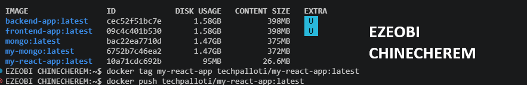
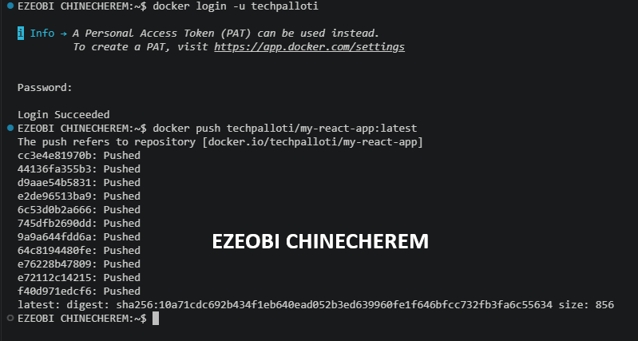
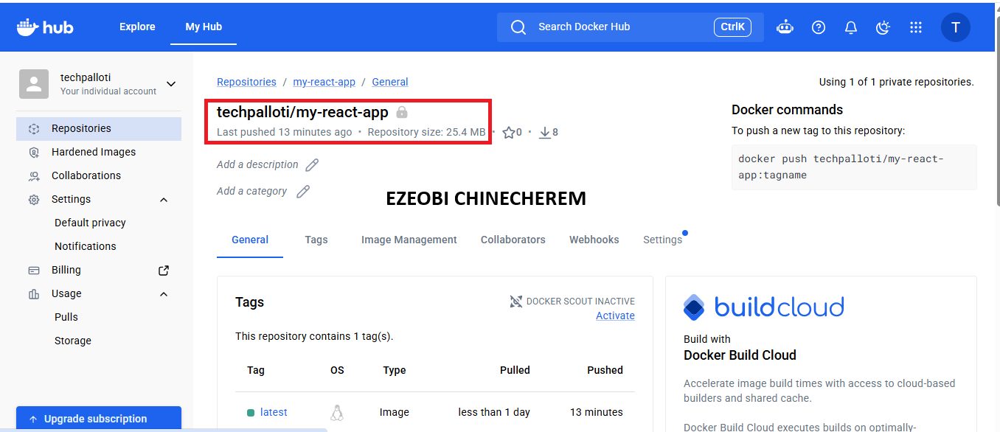
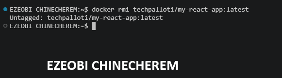
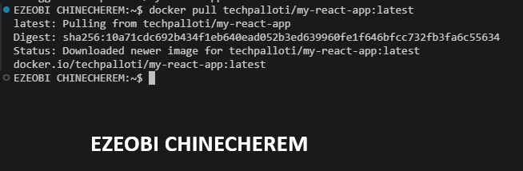
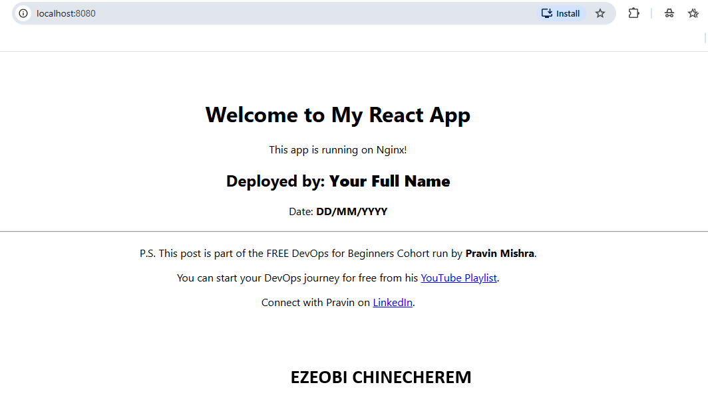
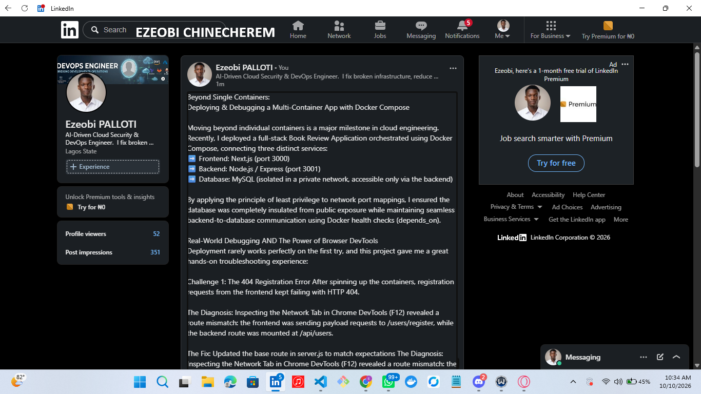

# Assignment 5 — Publish a Docker Container on Docker Hub

Part of the DevOps Micro Internship (DMI) with Agentic AI

---

## Purpose

In this assignment, you will publish a Dockerized React application to Docker Hub, remove the local image tags, pull the image again from Docker Hub, and run it to verify that it can be downloaded and deployed from a container registry.

---

# Task 1 — Publish a Docker Image to Docker Hub

## Goal

Tag a locally built React image, publish it to Docker Hub, remove the local copy, pull it again from Docker Hub, and run it successfully.

### Evidence

#### Screenshot 1 — Public Docker Hub Repository

Add a screenshot of Docker Hub showing your newly created public repository:

```text
my-react-app
```



---

#### Screenshot 2 — Successful Docker Login

Add a screenshot of the terminal showing:

```text
Login Succeeded
```

Ensure that your full name is visible and that no password, Personal Access Token, or device code is exposed.



---

#### Screenshot 3 — Correctly Tagged Image

Add a screenshot of the terminal showing:

```bash
docker image ls <YOUR_DOCKERHUB_USERNAME>/my-react-app
```

The output must show the `latest` tag.



---

#### Screenshot 4 — Successful Docker Push

Add a screenshot of the terminal showing successful completion of:

```bash
docker push <YOUR_DOCKERHUB_USERNAME>/my-react-app:latest
```

The output must include a pushed status or image digest.



---

#### Screenshot 5 — Published `latest` Tag in Docker Hub

Add a screenshot of your Docker Hub repository showing the uploaded `latest` image tag.



---

#### Screenshot 6 — Local Image Removed and Pulled Again

Add a screenshot of the terminal showing:

- The targeted local image tags removed
- Successful `docker pull` output
- `docker image ls` showing the pulled image



---

#### Screenshot 7 — Running Pulled Image

Add a screenshot of the terminal showing:

```bash
docker ps
```

The output must show the running `react-container` with:

```text
0.0.0.0:80->80/tcp
```



---

#### Screenshot 8 — React Application in Browser

Add a browser screenshot showing the React application at:

```text
http://<YOUR-VM-PUBLIC-IP>
```

Ensure that the VM public IP is visible in the address bar. Add your full name as a clear caption directly below the screenshot.



---

# Docker Hub Repository URL

**Repository URL:** https://app.docker.com/accounts/techpalloti

---

# Registry and Image Tagging Notes

Write a short explanation covering:

- Why image tagging is required before pushing to Docker Hub
- Why a container registry is useful in DevOps workflows
- Why production deployments should use versioned image tags instead of relying only on `latest`


### Container Registries, Image Tagging & Versioning

* **Why Image Tagging is Required Before Pushing to Docker Hub:**
Docker Hub relies on image tags to route and store images under the correct repository namespace. Tagging an image with your Docker Hub username and repository name (e.g., `docker tag local-image:1.0 username/repository:1.0`) tells Docker exactly where to upload the image on the remote registry and links it to your account authorization.
* **Why Container Registries are Essential in DevOps Workflows:**
A container registry acts as a centralized, secure repository for storing, versioning, and distributing application container images across different environments. In modern CI/CD pipelines, automated build systems compile code into immutable container images and push them to a registry. Deployments on staging, testing, or production servers then pull those exact pre-built images, eliminating environment inconsistencies ("it worked on my machine") and speeding up deployment times.
* **Why Production Deployments Should Use Versioned Tags Instead of `latest`:**
Relying on the implicit `latest` tag in production environments introduces unpredictability and deployment risk:
* **Lack of Immutability:** The `latest` tag is simply a pointer to the most recent upload. Pushing a new image silently overwrites `latest`, making it difficult to guarantee which exact code version a production node is running.
* **Broken Rollbacks:** If a bad build breaks production, rolling back to `latest` is impossible because `latest` now points to the broken release. Specific version tags (e.g., `v1.2.4` or Git commit hashes) allow instant, reliable rollbacks.
* **Inconsistent Scaling:** When auto-scaling or restarting instances, new nodes pulling `latest` might fetch a newer image than existing running nodes, leading to version drift across your cluster.

---

# LinkedIn Requirement

## Goal

Create a LinkedIn post about publishing a Docker container image to Docker Hub.

Include:

- Assignment title: **Publish a Docker Container Image to Docker Hub**
- Your Docker Hub repository URL
- What you published
- How you verified the remote image by pulling and running it
- Key learning outcomes

### Evidence

#### LinkedIn Post URL

Paste your LinkedIn post URL here:

https://lnkd.in/p/eq2N-f_W

---

#### LinkedIn Post Screenshot



---

# Submission Instructions

- Complete all steps in sequence.
- Include Screenshots 1–8 exactly as specified.
- Include your Docker Hub repository URL.
- Include the Registry and Image Tagging Notes.
- Include the LinkedIn post URL and screenshot.
- Ensure that your full name is visible in all terminal screenshots.
- Add your full name as a clear caption below the browser screenshot.
- Do not expose passwords, Personal Access Tokens, device codes, credentials, or other sensitive information.

---

# Completion Checklist

- [ ] Public `my-react-app` repository created
- [ ] Docker login completed successfully
- [ ] `react-multistage:latest` tagged correctly
- [ ] Image pushed to Docker Hub
- [ ] `latest` tag verified in Docker Hub
- [ ] Targeted local image tags removed
- [ ] Image pulled again from Docker Hub
- [ ] Pulled image runs successfully
- [ ] React application is accessible through the VM public IP
- [ ] Docker Hub repository URL included
- [ ] Registry and image-tagging notes completed
- [ ] LinkedIn post URL and screenshot included
- [ ] All required screenshots included
- [ ] Full name visible in terminal screenshots
- [ ] Browser screenshot has a full-name caption
- [ ] No passwords, tokens, or credentials exposed
---

## 📌 About DMI & CloudAdvisory

DevOps Micro Internship (DMI) is a project-based DevOps program run by Pravin Mishra (The CloudAdvisory) focused on real-world execution, systems thinking, and career readiness.

It helps learners build strong DevOps foundations with hands-on experience.

---

## 📌 Resources

- 🌐 DMI Official Website: https://dmi.pravinmishra.com?utm_source=github&utm_medium=readme  
- 🎓 University: https://university.pravinmishra.com?utm_source=github&utm_medium=readme  
- 💬 Discord Community: https://discord.pravinmishra.com?utm_source=github&utm_medium=readme  
- 📝 Blog: https://dmi.pravinmishra.com/blog?utm_source=github&utm_medium=readme  
- ▶️ YouTube Playlist: https://www.youtube.com/playlist?list=PLFeSNDtI4Cho  
- 🔗 Pravin Mishra (LinkedIn): https://www.linkedin.com/in/pravin-mishra-aws-trainer/  
- 🏢 CloudAdvisory (LinkedIn): https://www.linkedin.com/company/thecloudadvisory/

---

*This submission is part of DevOps Micro Internship (DMI) — Agentic AI Track.*
