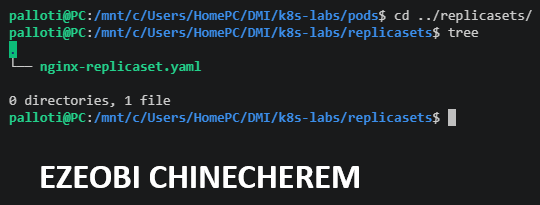
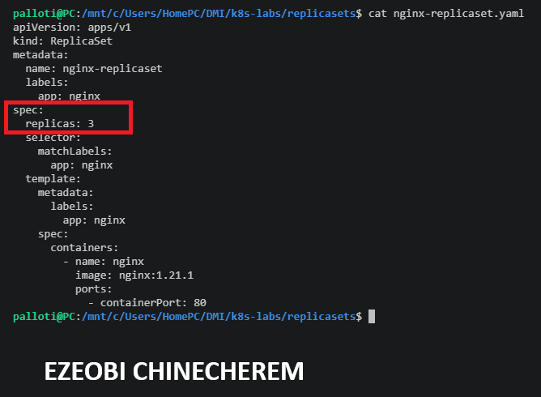
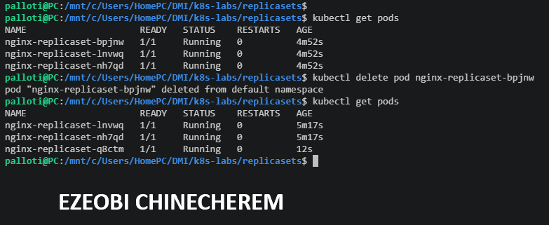
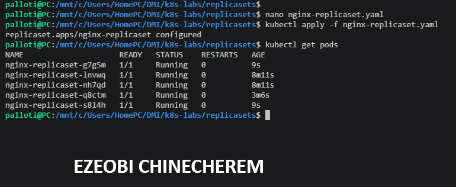
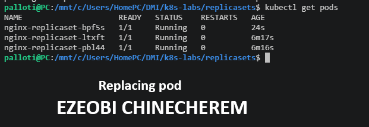
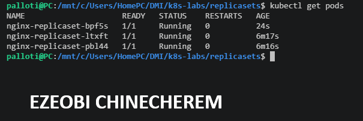
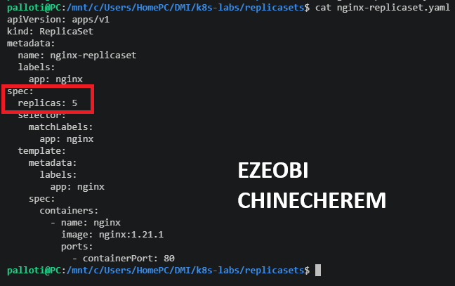
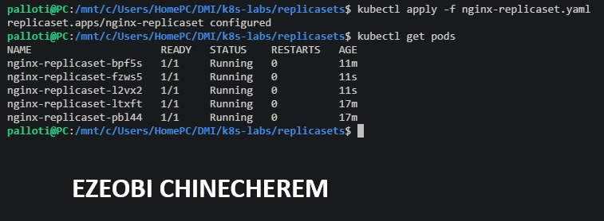
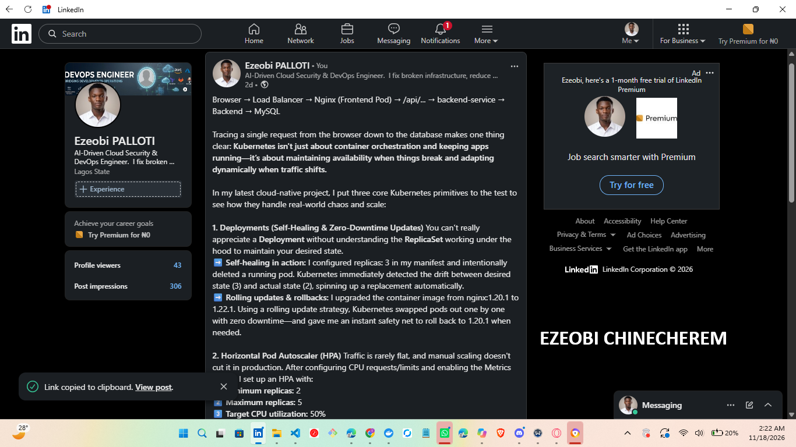

# Assignment 02 — ReplicaSets: Keeping Your Pods Alive

Part of the DevOps Micro Internship (DMI) with Agentic AI

---

## Purpose

In this assignment, you will create three NGINX Pods using a ReplicaSet, test auto-healing by deleting one Pod, and scale the ReplicaSet from three to five Pods.

---

# Task 0 — Pre-check: Remove the Pod from Assignment 01

## Goal

Confirm that you are connected to your learning cluster and remove the previous standalone Pod to prevent the ReplicaSet from adopting it.

### Evidence

No screenshots required.

---

# Task 1 — Set Up Your Working Directory

## Goal

Create and enter a dedicated directory for this ReplicaSet lab.

### Evidence

#### Screenshot 01 — Output of `pwd` showing the working directory ending in `/k8s-labs/replicasets`



---

### Notes

**1. Why is it useful to keep Kubernetes manifests in organized directories?**

Organizing Kubernetes manifests into structured directories (such as grouping by resource type like `pods/`, `replicasets/`, `deployments/`, or by application tier and environment) turns a collection of YAML files into a maintainable, production-ready codebase.

* **Batch Deployment and Cleanup:** You can apply or delete an entire stack or module with a single command (`kubectl apply -f deployments/` or `kubectl delete -f deployments/`) instead of running commands file by file.
* **Clear Separation of Concerns:** Isolating workloads (Deployments, StatefulSets), networking (Services, Ingress), and configuration (ConfigMaps, Secrets) makes it immediately obvious where specific settings live during debugging or incident triage.
* **Cleaner GitOps & Version Control:** Structured directories produce readable Git diffs, simplify code reviews, and allow CI/CD pipelines or GitOps tools (like ArgoCD or Flux) to watch specific paths and sync changes automatically.
* **Multi-Environment Management:** Separating base configurations from environment-specific overrides (e.g., `base/` vs. `overlays/dev/` and `overlays/prod/` with Kustomize) prevents accidental production changes while eliminating copy-paste duplication.
* **Safer Access Control & Blast-Radius Reduction:** Teams can enforce granular CODEOWNERS rules or RBAC policies on sensitive directories (such as `security/` or `database/`), ensuring critical manifests require peer approval before merging.

---

**2. What file will you create in this directory for this assignment?**

For decalarative means of pod creation file
nginx-pod.yaml


For replicaset file
nginx-replicaset.yaml

---

# Task 2 — Create and Apply the NGINX ReplicaSet

## Goal

Create a ReplicaSet that maintains three NGINX Pods.

### Evidence

#### Screenshot 02 — Completed `nginx-replicaset.yaml` manifest showing `replicas: 3`




---

#### Screenshot 03 — Output of `kubectl apply -f nginx-replicaset.yaml`



---

#### Screenshot 04 — Output of `kubectl get pods` showing three NGINX Pods with `1/1` under `READY` and `Running` under `STATUS`



---

### Notes

**1. What does `replicas: 3` mean in this manifest?**

It means the desired pod number will always be 3

---

**2. Why must `selector.matchLabels` match `template.metadata.labels`?**

In Kubernetes, a Deployment (or other workload resource like a StatefulSet) acts as a controller that manages a set of Pods. For the controller to know which Pods belong to it, it relies on labels.

The requirement that `selector.matchLabels` must match `template.metadata.labels` is fundamental to how the **Deployment Controller** links its desired state (the Pod template) to its actual state (the running Pods).

---

### Why the Match is Required

1. **The Controller's Lookup Mechanism**
The Deployment controller queries the Kubernetes API server for all Pods in the cluster that match the labels defined in `spec.selector.matchLabels`. It uses these matched Pods to calculate the current replica count (e.g., *“Are there 3 running Pods matching my selector, or only 2?”*).
2. **Tagging the Created Pods**
When the Deployment needs to create new Pods, it generates them using the blueprint defined in `spec.template`. The labels specified in `spec.template.metadata.labels` are automatically stamped onto every Pod created from that template.
3. **Closing the Loop**
If `selector.matchLabels` did not match `template.metadata.labels`:
* The Deployment would create Pods with one set of labels (from the template).
* But it would search for Pods using a completely different set of labels (from the selector).
* As a result, the Deployment would see **0 matching Pods**, assume it needs to create more, and endlessly spawn new Pods until your cluster runs out of resources (a classic runaway creation loop).


---

### Visualizing the Link

```yaml
apiVersion: apps/v1
kind: Deployment
metadata:
  name: my-app
spec:
  replicas: 3
  selector:
    matchLabels:
      app: web     # <-- 1. Controller uses this to FIND existing pods
  template:
    metadata:
      labels:
        app: web   # <-- 2. Controller STAMPS this onto newly created pods
    spec:
      containers:
      - name: nginx
        image: nginx

```

---

 What Happens If They Don't Match?

Kubernetes protects you from configuration errors through validation:

* **API Rejection:** If you try to apply a Deployment where `selector.matchLabels` and `template.metadata.labels` do not align, the Kubernetes API server will reject the manifest outright with a validation error (typically: *`Deployment.spec.selector does not match Deployment.spec.template.metadata.labels`*).
* **Immutability:** Once a Deployment is created, the `selector` field is **immutable** (it cannot be changed). This prevents you from accidentally or maliciously "orphaning" existing Pods or hijacking Pods belonging to other Deployments.

---

**3. What image and image tag are used for the NGINX container?**

Add your answer here.

---

# Task 3 — Test ReplicaSet Auto-Healing

## Goal

Delete one Pod managed by the ReplicaSet and observe Kubernetes automatically create a replacement.

### Evidence

#### Screenshot 05 — Output of the command deleting one ReplicaSet-managed Pod


---

#### Screenshot 06 — Output of `kubectl get pods` showing the replacement Pod with a different name from the deleted Pod



---

#### Screenshot 07 — Output showing three NGINX Pods with `1/1` under `READY` and `Running` under `STATUS` again



---

### Notes

**1. What happened after you deleted one Pod?**

Immediately a new pod was created to mtch the desire state of pod, as decleared in the nginx-replicaset.yaml

---

**2. How does the ReplicaSet know that a replacement Pod is needed?**

The ReplicaSet doesn't "detect" a pod's deletion through polling or a direct ping. Instead, it relies on Kubernetes' core architectural pattern: **the control loop and the Watch mechanism**.

Here is the exact sequence of how the ReplicaSet controller knows a replacement is needed:

---

 1. The Watch and Informer Pattern

Inside the `kube-controller-manager`, the ReplicaSet controller doesn’t constantly query the API server with expensive `GET` requests. Instead, it uses a **List-Watch** mechanism via client-go informers:

* **Initial List:** When the controller starts up, it lists all Pods in the cluster to build an in-memory cache.
* **Continuous Watch:** It establishes a long-lived HTTP stream (a watch) with the Kubernetes API server. The API server instantly pushes an event notification whenever a Pod matching the ReplicaSet's `selector` is added, modified, or deleted.

 2. The Reconciliation Loop (Desired vs. Actual State)

The ReplicaSet controller runs a continuous control loop that follows a simple logic: **Compare Desired State to Actual State.**

1. **The Event Arrives:** When you delete a Pod, the API server sends a `DELETED` event for that Pod over the watch stream.
2. **Cache Update:** The ReplicaSet controller updates its local cache, removing that Pod from its list of active matching pods.
3. **The Delta Check:** The controller calculates the state:
* **Desired Replicas (`spec.replicas`):** e.g., `3`
* **Actual Matching Pods:** e.g., `2` (since one was just deleted)


4. **Triggering Action:** Because Actual ($2$) < Desired ($3$), the controller identifies a deficit of `1` Pod.

 3. Spawning the Replacement

Once the controller registers the deficit, it immediately takes corrective action:

1. It pulls the blueprint from its `spec.template`.
2. It constructs a new Pod object manifest (stamping it with the correct owner reference pointing back to the ReplicaSet).
3. It sends a `POST` request to the Kubernetes API server to create the new Pod.
4. The scheduler picks up the new Pod and assigns it to a node.

---

### Key Takeaway

The ReplicaSet controller is entirely reactive to events streaming from the API server. It continuously ensures that **Active Pods matching the selector == `spec.replicas**`. If that equation breaks due to deletion, node failure, or eviction, the reconciliation loop instantly fires to restore balance.

---

**3. What proves that auto-healing worked successfully?**

To prove that Kubernetes auto-healing (reconciliation) has successfully restored your application state after a Pod deletion, you look for a combination of exact replica counts, new identifiers, and controller events.

Here is the exact evidence that confirms auto-healing worked:

---

1. Replica Count Equilibrium

Run `kubectl get deployment` (or `kubectl get rs`) and check that the actual state matches the desired state:

* **`READY` / `UP-TO-DATE` / `AVAILABLE**` equal **`DESIRED`** (e.g., `3/3`).
* If you see the counts dip momentarily and then return to match the desired replica count, the control loop has successfully closed the gap.

2. New Pod Identifiers (`UID` and IP Address)

Run `kubectl get pods -o wide` and compare the active Pods against your baseline before the deletion:

* **Different Hash Suffix:** Because the ReplicaSet generates Pods from a template hash, the replacement Pod will have a brand-new name (e.g., `my-app-798b5f97bc-abc12` instead of the old `...-xyz89`).
* **Fresh `AGE`:** The `AGE` column for the replacement Pod will show a few seconds or minutes, proving it was freshly spawned.
* **New IP Address:** The Pod will be assigned a new internal cluster IP address by the CNI plugin.

3. Controller Events (`kubectl describe`)

Run `kubectl describe deployment <deployment-name>` or `kubectl get events --sort-by='.metadata.creationTimestamp'`. Successful auto-healing leaves a clear audit trail in the Kubernetes events:

* `ScalingReplicaSet`: Scaled up replica set `<name>` from `2` to `3`
* `SuccessfulCreate`: Created pod: `<new-pod-name>`

4. Lifecycle Progression (`Status`)

By inspecting the new Pod (`kubectl get pod <new-pod-name>`), you can verify it successfully traversed the standard health phases:

1. `Pending` (scheduled by the `kube-scheduler` to a node).
2. `ContainerCreating` (images pulled, volumes attached).
3. `Running` (containers started).
4. `Ready` (liveness and readiness probes passed, clearing it to receive traffic).

---

# Task 4 — Manually Scale the ReplicaSet

## Goal

Scale the ReplicaSet from three NGINX Pods to five NGINX Pods by changing the YAML manifest.

### Evidence

#### Screenshot 08 — Updated `nginx-replicaset.yaml` showing `replicas: 5`



---

#### Screenshot 09 — Output of `kubectl get pods` showing five NGINX Pods with `1/1` under `READY` and `Running` under `STATUS`



---

### Notes

**1. What change did you make to scale the ReplicaSet?**

Changing the replicaset from 3 to 5

replica: 3 to replica: 5

---

**2. Did you manually create the additional Pods? Explain why or why not.**

No there was no manual pod creation, Changing the replica count from 3 to 5 and applying the change, triggers an automatic pod scale up from 3 to 5. The control node will verify and balance the desire pod state and the actual pod state and the the make both are balanced. 

---

**3. What would happen if you changed the replica count from five back to three?**

This is the autoscaling feature of kubernetes

When you scale a Deployment down from five replicas back to three, the ReplicaSet controller performs a **scale-down reconciliation** to match the new desired state.

Here is the exact sequence of events that takes place:

---

1. The Controller Detects a Surplus

The controller's control loop evaluates the current state against your update:

* **Desired Replicas:** `3`
* **Actual Running Pods:** `5`
* **Delta:** A surplus of `2` Pods.

2. Pod Selection and Termination

The controller must prune two Pods to bridge the gap. By default, Kubernetes prioritizes terminating **youngest pods first** (along with unready or unscheduled pods) to minimize disruption to stable, long-running instances.

* The controller issues a `DELETE` request for the selected Pods to the API server.

 3. Graceful Shutdown

When a Pod is marked for deletion, Kubernetes executes a graceful shutdown rather than pulling the plug instantly:

* **`SIGTERM` Signal:** Kubelet sends a `SIGTERM` to the container processes, giving your application a window (controlled by `terminationGracePeriodSeconds`, which defaults to 30 seconds) to finish active requests, close database connections, and save state.
* **Service Deregistration:** Simultaneously, endpoints controllers remove the terminating Pods from the corresponding Service endpoints, halting new incoming traffic.
* **`SIGKILL`:** Once the grace period expires (or the app shuts down early), Kubelet sends a `SIGKILL` to terminate any remaining processes, and the Pod is fully removed.

### 4. Equilibrium Restored

Once the two excess Pods are fully terminated, the active count matches your new desired replica count of `3`, and the reconciliation loop returns to steady state.

---

---

# LinkedIn Requirement

Create a LinkedIn post that includes:

- A short explanation of what a Kubernetes ReplicaSet does.
- What happened when you deleted one NGINX Pod.
- How Kubernetes automatically created a replacement Pod to maintain the desired replica count.
- What you learned by changing the replica count from three to five.
- One screenshot showing either:
  - Three Pods running after the auto-healing test, or
  - Five Pods running after scaling the ReplicaSet.

Do not share sensitive information, cluster credentials, tokens, or kubeconfig details in your post.

### Evidence

#### Screenshot 10 — Published LinkedIn post showing your name, the required explanation, and the attached Pod screenshot



---

### Post Link

https://lnkd.in/p/efqZJhS3

---

# Submission Instructions

- Add all required screenshots, numbered 01–10, to this template.
- Full Name must be visible in required screenshots.
- Ensure screenshots are clear and readable.
- Submit the final `nginx-replicaset.yaml` file showing `replicas: 5`. Screenshot 02 provides evidence of the initial manifest with `replicas: 3`.
- Complete the Notes sections in Tasks 1–4 in your own words.
- Include the published LinkedIn post URL.
- Do not expose tokens, passwords, private keys, kubeconfig files, or account IDs.

---

# Completion Checklist

- [ ] Completed Task 0 and confirmed that the previous `nginx-pod` is no longer listed
- [ ] Created and entered the ReplicaSet working directory (Screenshot 01)
- [ ] Created `nginx-replicaset.yaml` with an initial replica count of three (Screenshot 02)
- [ ] Applied the ReplicaSet manifest successfully (Screenshot 03)
- [ ] Confirmed three NGINX Pods are running (Screenshot 04)
- [ ] Deleted one ReplicaSet-managed Pod (Screenshot 05)
- [ ] Observed the automatically created replacement Pod (Screenshot 06)
- [ ] Confirmed three NGINX Pods are running again (Screenshot 07)
- [ ] Changed the replica count from three to five (Screenshot 08)
- [ ] Confirmed five NGINX Pods are running (Screenshot 09)
- [ ] Submitted the final `nginx-replicaset.yaml` file with `replicas: 5`
- [ ] Completed the Notes sections in Tasks 1–4
- [ ] Published the LinkedIn post with the required explanation and Pod screenshot (Screenshot 10)
- [ ] Included the published LinkedIn post URL
- [ ] Included all required screenshots
- [ ] No sensitive data exposed

---

## 📌 About DMI & CloudAdvisory

DevOps Micro Internship (DMI) is a project-based DevOps program run by Pravin Mishra (The CloudAdvisory) focused on real-world execution, systems thinking, and career readiness.

It helps learners build strong DevOps foundations with hands-on experience.

---

## 📌 Resources

- 🌐 DMI Official Website: https://dmi.pravinmishra.com?utm_source=github&utm_medium=readme  
- 🎓 University: https://university.pravinmishra.com?utm_source=github&utm_medium=readme  
- 💬 Discord Community: https://discord.pravinmishra.com?utm_source=github&utm_medium=readme  
- 📝 Blog: https://dmi.pravinmishra.com/blog?utm_source=github&utm_medium=readme  
- ▶️ YouTube Playlist: https://www.youtube.com/playlist?list=PLFeSNDtI4Cho  
- 🔗 Pravin Mishra (LinkedIn): https://www.linkedin.com/in/pravin-mishra-aws-trainer/  
- 🏢 CloudAdvisory (LinkedIn): https://www.linkedin.com/company/thecloudadvisory/

---

*This submission is part of DevOps Micro Internship (DMI) — Agentic AI Track.*
