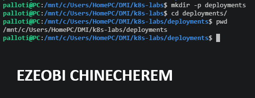
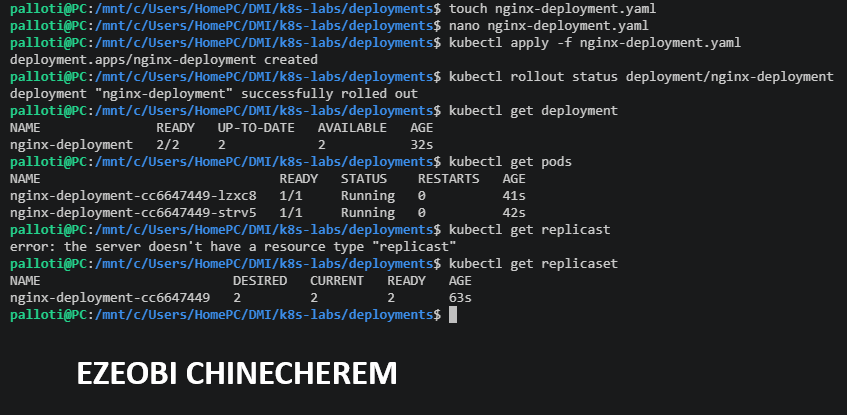
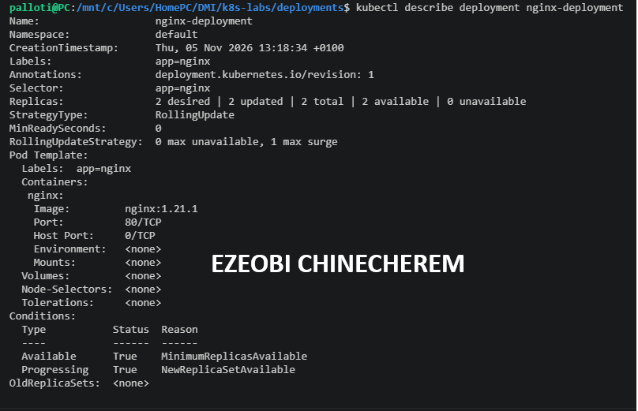
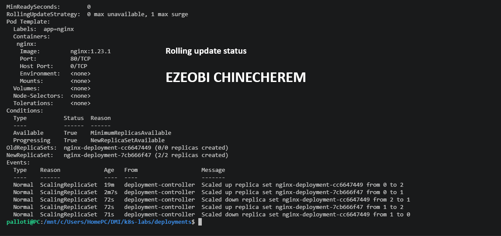
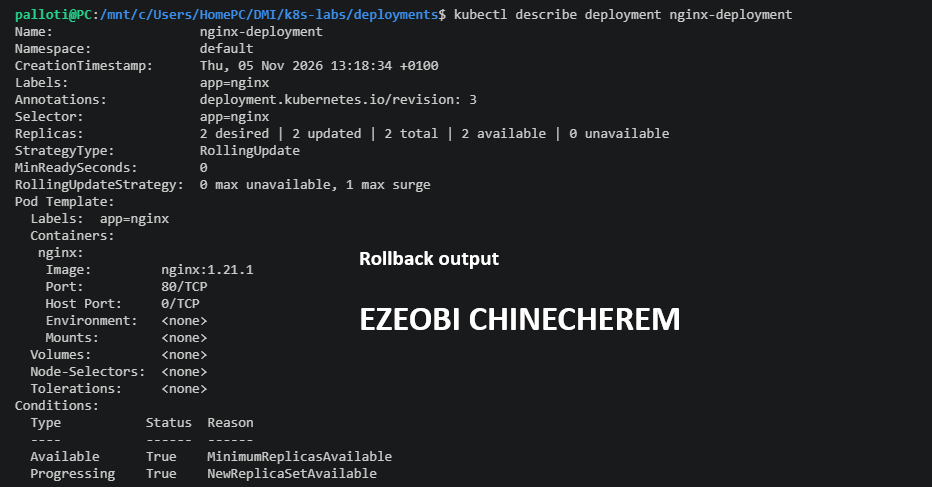
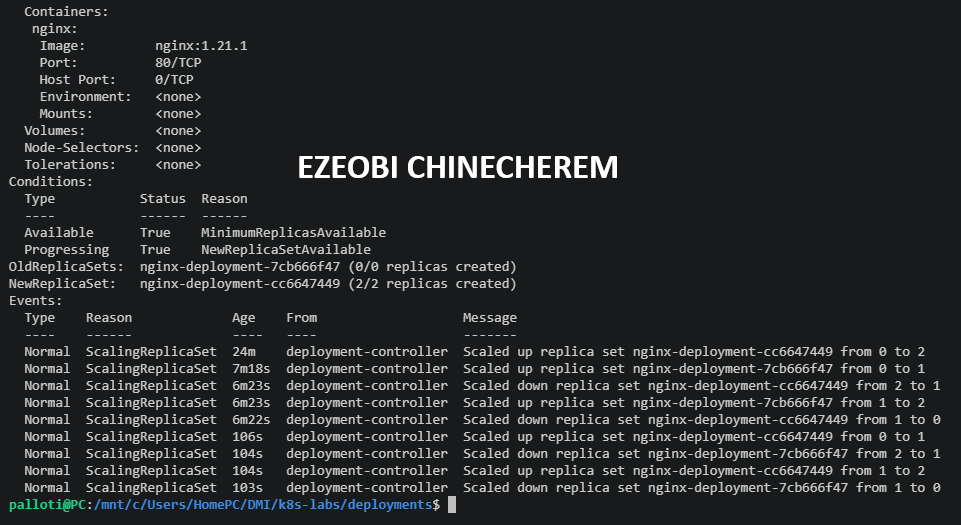

# Assignment 3 — Deployments: From Basics to Rolling Updates

Part of the DevOps Micro Internship (DMI) with Agentic AI

---

## Purpose

Create an NGINX Deployment, configure RollingUpdate, update the container image, roll back to the previous revision, and scale the workload.

---

# Task 0 — Pre-check: Remove the Assignment 02 ReplicaSet

## Goal

Confirm that you are connected to your learning cluster and remove the previous ReplicaSet and its managed Pods before starting this lab.

### Evidence

No screenshots required.

---

# Task 1 — Set Up the Working Directory

## Goal

Create and enter the dedicated Deployment lab directory.

### Evidence

#### Screenshot 01 — Output of `pwd` showing the directory ending in `/k8s-labs/deployments`

---

# Task 2 — Create the Basic Deployment

## Goal

Create a two-replica NGINX Deployment and verify the automatically managed ReplicaSet and Pods.

### Evidence

#### Screenshot 2 — Manifest plus `kubectl` output showing the Deployment, ReplicaSet, and two Pods

---

# Task 3 — Configure the RollingUpdate Strategy

## Goal

Configure RollingUpdate to maintain the desired available replica count during an image update.

### Evidence

#### Screenshot 3 — Deployment YAML showing the RollingUpdate strategy and successful apply output

---

# Task 4 — Perform and Roll Back an Image Update

## Goal

Update NGINX to 1.23.1, observe the rollout, and return to the previous stable revision.

### Evidence

#### Screenshot 4 — Rolling-update status, multiple ReplicaSets, and successful rollback/history output

---

# Task 5 — Scale the Deployment

## Goal

Scale the workload to five replicas and return it to two.

### Evidence

#### Screenshot 5 — Terminal showing the scale-up and scale-down results

---

### Notes

Write a short note describing what the lab demonstrated.

This lab demonstrated how to use a Kubernetes Deployment as a production-oriented controller for NGINX workloads. Specifically, it covered:   Basic Deployment Creation: Setting up and applying an NGINX deployment manifest with multiple replicas.   Rolling Updates & Strategies: Configuring a RollingUpdate strategy using maxSurge and maxUnavailable parameters to ensure continuous availability during updates.   Rollbacks: Updating an application image (nginx:1.23.1) and successfully rolling back to a previous revision (nginx:1.21.1) using rollout history.   Scaling: Dynamically scaling the workload up (to 5 replicas) and back down (to 2 replicas) while maintaining pod health and availability.   

---

# Submission Instructions

- Include all required screenshots, numbered 01–12.
- Ensure screenshots are clear and readable.
- Submit the final `nginx-deployment.yaml` containing two replicas, the initial NGINX image, and the configured RollingUpdate strategy.
- Complete the Lab Summary in your own words.
- Include evidence of your published WhatsApp Status.
- Do not expose passwords, tokens, private keys, or kubeconfig credentials.

---

# Completion Checklist

- [ ] Completed Task 0
- [ ] Created the deployments directory (Screenshot 01)
- [ ] Created the basic two-replica NGINX Deployment manifest (Screenshot 02)
- [ ] Applied the Deployment and verified its ReplicaSet and two running Pods (Screenshot 03)
- [ ] Added RollingUpdate with `maxSurge: 1` and `maxUnavailable: 0` (Screenshot 04)
- [ ] Applied and verified the rolling-update strategy (Screenshot 05)
- [ ] Updated NGINX to 1.23.1 and confirmed rollout completion (Screenshot 06)
- [ ] Inspected the ReplicaSets and verified the updated image (Screenshot 07)
- [ ] Rolled back the update and confirmed rollout completion (Screenshot 08)
- [ ] Reviewed rollout history and verified the restored image (Screenshot 09)
- [ ] Scaled to five running Pods (Screenshot 10)
- [ ] Scaled back to two running Pods (Screenshot 11)
- [ ] Published the WhatsApp Status with the generated leaderboard progress link (Screenshot 12)
- [ ] Submitted the final `nginx-deployment.yaml`
- [ ] Included screenshots 01–12
- [ ] Completed the Lab Summary
- [ ] No sensitive data exposed

---

## 📌 About DMI & CloudAdvisory

DevOps Micro Internship (DMI) is a project-based DevOps program run by Pravin Mishra (The CloudAdvisory) focused on real-world execution, systems thinking, and career readiness.

It helps learners build strong DevOps foundations with hands-on experience.

---

## 📌 Resources

- 🌐 DMI Official Website: https://dmi.pravinmishra.com?utm_source=github&utm_medium=readme  
- 🎓 University: https://university.pravinmishra.com?utm_source=github&utm_medium=readme  
- 💬 Discord Community: https://discord.pravinmishra.com?utm_source=github&utm_medium=readme  
- 📝 Blog: https://dmi.pravinmishra.com/blog?utm_source=github&utm_medium=readme  
- ▶️ YouTube Playlist: https://www.youtube.com/playlist?list=PLFeSNDtI4Cho  
- 🔗 Pravin Mishra (LinkedIn): https://www.linkedin.com/in/pravin-mishra-aws-trainer/  
- 🏢 CloudAdvisory (LinkedIn): https://www.linkedin.com/company/thecloudadvisory/

---

*This submission is part of DevOps Micro Internship (DMI) — Agentic AI Track.*
