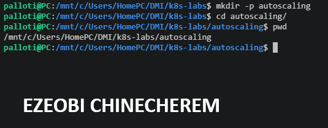
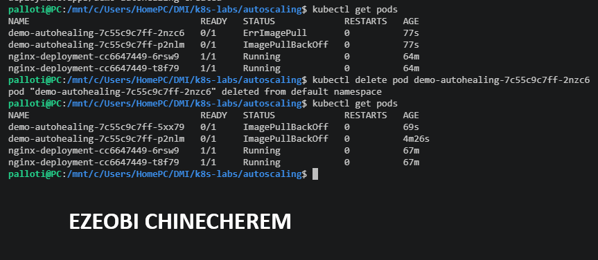
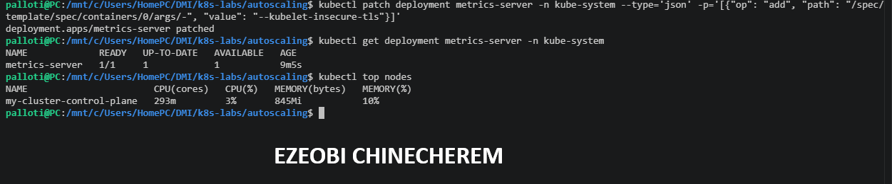
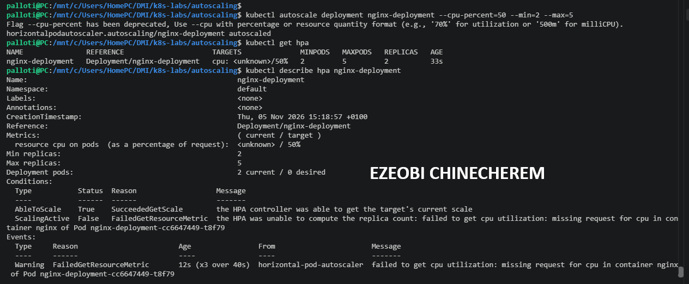
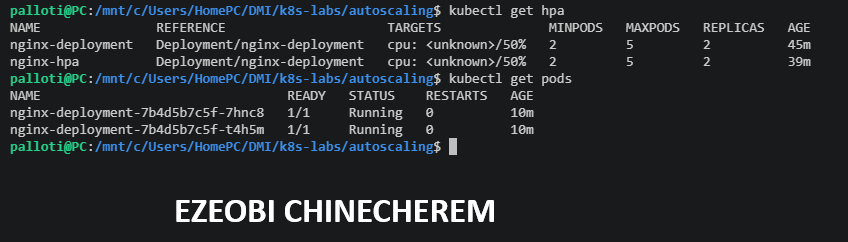

# Assignment 4 — Auto-Scaling & Auto-Healing: Let Kubernetes React for You

Part of the DevOps Micro Internship (DMI) with Agentic AI

---

## Purpose

Create Deployments, test Pod auto-healing, configure CPU requests and limits, verify Metrics Server, and create a Horizontal Pod Autoscaler.

Optionally generate CPU load to observe how the HPA responds.

---

# Task 0 — Check the Existing Cluster Resources

## Goal

Confirm that you are connected to your learning cluster and inspect existing Deployments and HPAs.

### Evidence

No screenshots required.

---

# Task 1 — Set Up Your Lab Directory

## Goal

Create and enter a dedicated directory for the auto-scaling lab.

### Evidence

#### Screenshot 1 — Terminal showing the `autoscaling` directory

---

# Task 2 — Prove Deployment Auto-Healing

## Goal

Create a Deployment with two replicas, delete one Pod, and observe Kubernetes create a replacement Pod.

### Evidence

#### Screenshot 2 — Deleted Pod and replacement Pod with the replica count restored

---

# Task 3 — Create the HPA-Ready Deployment and Enable Metrics

## Goal

Create a Deployment with CPU resource requests and limits so that HPA can calculate CPU utilization.

### Evidence

#### Screenshot 3 — Deployment resources plus successful Metrics Server status

---

# Task 4 — Create and Inspect the HPA

## Goal

Ensure the cluster can collect resource metrics for the HPA.

### Evidence

#### Screenshot 4 — `kubectl get hpa` and `kubectl describe hpa nginx-hpa` output

---

# Task 5 — Optionally Generate CPU Load

## Goal

Create an HPA that keeps at least two Pods running and can scale up to five Pods when average CPU utilization exceeds 50%.

### Evidence

#### Screenshot 5 — HPA output showing current metrics and any replica increase

---

### Notes

Write a short note describing what the lab demonstrated.

Here is a short note describing what the lab demonstrated:Kubernetes Deployment Lifecycle: Demonstrated how to create, configure, and manage standard deployment manifests using declarative YAML files.   Rolling Updates & Rollbacks: Showcased zero-downtime rolling update strategies (controlling maxSurge and maxUnavailable) alongside rolling back image versions.   Manual Scaling Operations: Illustrated how to scale pod replicas up and down manually to handle fluctuating workloads.   Autoscaling & Metric Collection: Highlighted the integration of the metrics-server and Horizontal Pod Autoscalers (HPA) to dynamically monitor resource utilization and adjust cluster capacity based on CPU load. 

---

# Submission Instructions

- Include required Screenshots 1–10 and Screenshot 13.
- Include Screenshots 11–12 only if you complete Task 6.
- Full Name must be visible in required screenshots.
- Ensure screenshots are clear and readable.
- Include the completed `autohealing-deployment.yaml` and `hpa-deployment.yaml` files.
- Include `hpa-nginx.yaml` if you selected the declarative HPA method.
- Complete the Notes sections for Tasks 1–5 in your own words.
- Complete Task 6 notes only if you perform the optional test.
- Do not expose passwords, tokens, private keys, kubeconfig files, or account IDs.

---

# Completion Checklist

- [ ] Checked the active context and existing cluster resources
- [ ] Created the autoscaling working directory (Screenshot 1)
- [ ] Created `autohealing-deployment.yaml` (Screenshot 2)
- [ ] Confirmed two auto-healing Pods were running (Screenshot 3)
- [ ] Deleted one managed Pod (Screenshot 4)
- [ ] Confirmed that the Pod was automatically replaced (Screenshot 5)
- [ ] Created `hpa-deployment.yaml` with CPU requests and limits (Screenshot 6)
- [ ] Verified `nginx-deployment` and its running Pods (Screenshot 7)
- [ ] Verified Metrics Server and confirmed Pod metrics are available (Screenshot 8)
- [ ] Created one HPA using the selected method (Screenshot 9)
- [ ] Verified minimum replicas of 2, maximum replicas of 5, and a CPU target of 50% (Screenshot 10)
- [ ] Completed Notes for Tasks 1–5
- [ ] Completed Task 6 evidence and notes, or marked it “Not completed — optional”
- [ ] Stopped the CPU-load command and exited the container shell, if Task 6 was completed
- [ ] Published the LinkedIn post with the required explanation and attached screenshot (Screenshot 13)
- [ ] Included the required manifest files
- [ ] No sensitive data exposed

---

## 📌 About DMI & CloudAdvisory

DevOps Micro Internship (DMI) is a project-based DevOps program run by Pravin Mishra (The CloudAdvisory) focused on real-world execution, systems thinking, and career readiness.

It helps learners build strong DevOps foundations with hands-on experience.

---

## 📌 Resources

- 🌐 DMI Official Website: https://dmi.pravinmishra.com?utm_source=github&utm_medium=readme  
- 🎓 University: https://university.pravinmishra.com?utm_source=github&utm_medium=readme  
- 💬 Discord Community: https://discord.pravinmishra.com?utm_source=github&utm_medium=readme  
- 📝 Blog: https://dmi.pravinmishra.com/blog?utm_source=github&utm_medium=readme  
- ▶️ YouTube Playlist: https://www.youtube.com/playlist?list=PLFeSNDtI4Cho  
- 🔗 Pravin Mishra (LinkedIn): https://www.linkedin.com/in/pravin-mishra-aws-trainer/  
- 🏢 CloudAdvisory (LinkedIn): https://www.linkedin.com/company/thecloudadvisory/

---

*This submission is part of DevOps Micro Internship (DMI) — Agentic AI Track.*
