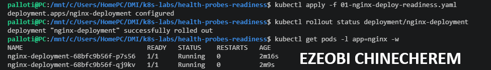
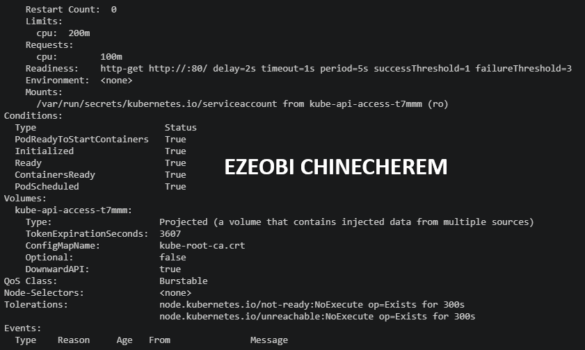
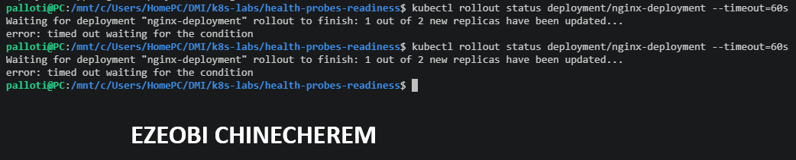
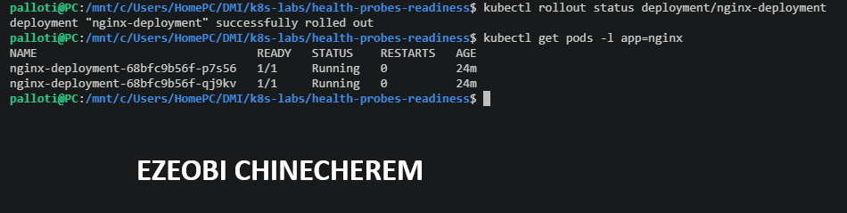
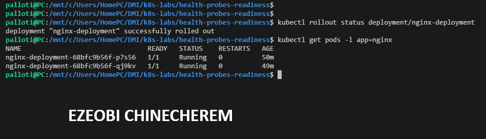

# Assignment 5 — Kubernetes Health Probes (Readiness)

Part of the DevOps Micro Internship (DMI) with Agentic AI

---

## Purpose

In this assignment, you will configure and test a Kubernetes readiness probe. You will create a baseline NGINX Deployment, add an HTTP readiness probe, intentionally break it, observe a stalled rollout, and restore the working configuration.

You will also demonstrate how readiness probes protect rolling updates.

---

# Task 0 — Prepare the Lab Environment

## Goal

Confirm that you are connected to your learning cluster and remove the previous assignment’s HPA and NGINX Deployment before starting this lab.

No screenshot or written notes are required for this pre-check.

---

# Task 1 — Set Up Your Lab Directory

## Goal

Create and enter a dedicated directory for the readiness-probe lab.

### Evidence

#### Screenshot 1 — Baseline manifest and healthy two-Pod rollout output

---

# Task 2 — Add the Readiness Probe

## Goal

Create a baseline NGINX Deployment with two replicas and no readiness probe.

### Evidence

#### Screenshot 2 — Pod description showing the readiness probe and `Ready=True`

---

# Task 3 — Break and Fix Readiness

## Goal

Add an HTTP readiness probe so Kubernetes checks whether each NGINX container is ready to accept requests.

### Evidence

#### Screenshot 3 — `NotReady` conditions followed by a successful fixed rollout

---

# Task 4 — Prove Readiness-Gated Rolling Updates

## Goal

Intentionally fail the readiness probe, observe the NotReady behavior, and then restore the working probe configuration.

### Evidence

#### Screenshot 4 — Successful good rollout, stalled broken rollout, and successful recovery

---

# Task 5 — Review Tuning and Optional Cleanup

## Goal

Observe how readiness prevents a bad new Pod from replacing healthy Pods during a rolling update.

### Evidence

#### Screenshot 5 — Final healthy Pod state or optional cleanup output

---

### Notes

Write a short note describing what the lab demonstrated.

Here is a short note describing what the lab demonstrated:
Kubernetes Deployment Lifecycle: 
Showcased how to create, configure, and manage standard deployment manifests using declarative YAML files.   Rolling Updates: Demonstrated zero-downtime rolling update strategies by modifying deployment configurations and controlling rollout progression.   Resource Management: Highlighted the importance of defining CPU resource requests and limits to properly support monitoring and autoscaling features.Autoscaling & Metric Collection: Illustrated the integration of the metrics-server and Horizontal Pod Autoscalers (HPA) to monitor container resource usage and dynamically scale pod replicas based on load.   

---

# Submission Instructions

- Add all required screenshots numbered 1–18.
- Ensure your full name is visible in required screenshots.
- Use clear, readable screenshots showing the relevant manifest or output.
- Include the completed baseline and readiness-probe manifests in your repository.
- Answer all Notes questions for Tasks 1–5 in your own words.
- Include evidence of the intentional readiness failure and successful recovery.
- Do not expose tokens, passwords, kubeconfig files, account IDs, or other sensitive information.

---

# Completion Checklist

- [ ] Learning cluster confirmed and previous assignment resources removed where applicable
- [ ] Readiness-probe lab directory created (Screenshot 1)
- [ ] Baseline Deployment created successfully (Screenshot 2)
- [ ] Two baseline Pods running and successful rollout verified (Screenshot 3)
- [ ] Baseline Deployment details reviewed (Screenshot 4)
- [ ] Readiness probe added successfully (Screenshot 5)
- [ ] Successful readiness rollout verified (Screenshot 6)
- [ ] Pod readiness conditions and probe details inspected (Screenshot 7)
- [ ] Broken readiness configuration created (Screenshot 8)
- [ ] Stalled rollout or timeout observed (Screenshot 9)
- [ ] NotReady status or readiness-probe failure events captured (Screenshot 10)
- [ ] Working readiness configuration restored (Screenshot 11)
- [ ] Successful image update completed (Screenshot 12)
- [ ] ReplicaSets and Pods inspected after the update (Screenshot 13)
- [ ] Broken-readiness patch created (Screenshot 14)
- [ ] Stalled rollout observed after the patch (Screenshot 15)
- [ ] Effect of broken readiness captured (Screenshot 16)
- [ ] Final recovery completed (Screenshot 17)
- [ ] LinkedIn post published (Screenshot 18)
- [ ] Notes for Tasks 1–5 completed
- [ ] Required manifests included
- [ ] All screenshots are clear and readable
- [ ] No sensitive data exposed

---

## 📌 About DMI & CloudAdvisory

DevOps Micro Internship (DMI) is a project-based DevOps program run by Pravin Mishra (The CloudAdvisory) focused on real-world execution, systems thinking, and career readiness.

It helps learners build strong DevOps foundations with hands-on experience.

---

## 📌 Resources

- 🌐 DMI Official Website: https://dmi.pravinmishra.com?utm_source=github&utm_medium=readme  
- 🎓 University: https://university.pravinmishra.com?utm_source=github&utm_medium=readme  
- 💬 Discord Community: https://discord.pravinmishra.com?utm_source=github&utm_medium=readme  
- 📝 Blog: https://dmi.pravinmishra.com/blog?utm_source=github&utm_medium=readme  
- ▶️ YouTube Playlist: https://www.youtube.com/playlist?list=PLFeSNDtI4Cho  
- 🔗 Pravin Mishra (LinkedIn): https://www.linkedin.com/in/pravin-mishra-aws-trainer/  
- 🏢 CloudAdvisory (LinkedIn): https://www.linkedin.com/company/thecloudadvisory/

---

*This submission is part of DevOps Micro Internship (DMI) — Agentic AI Track.*
