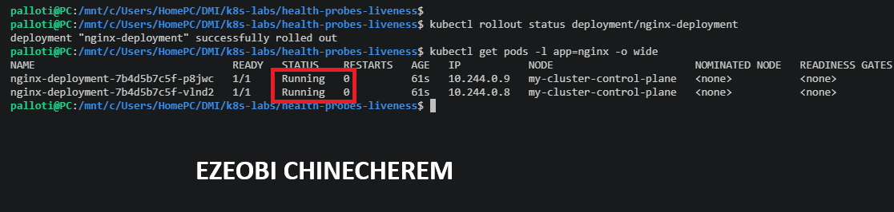
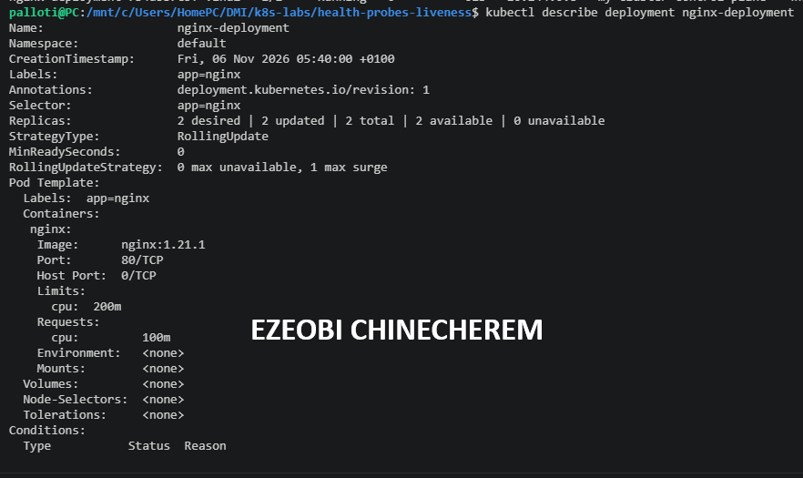
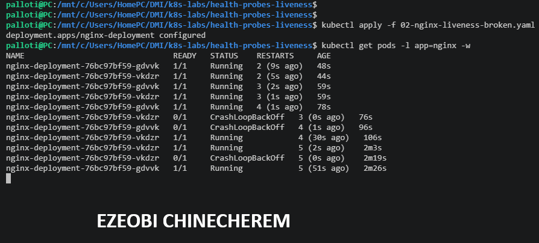
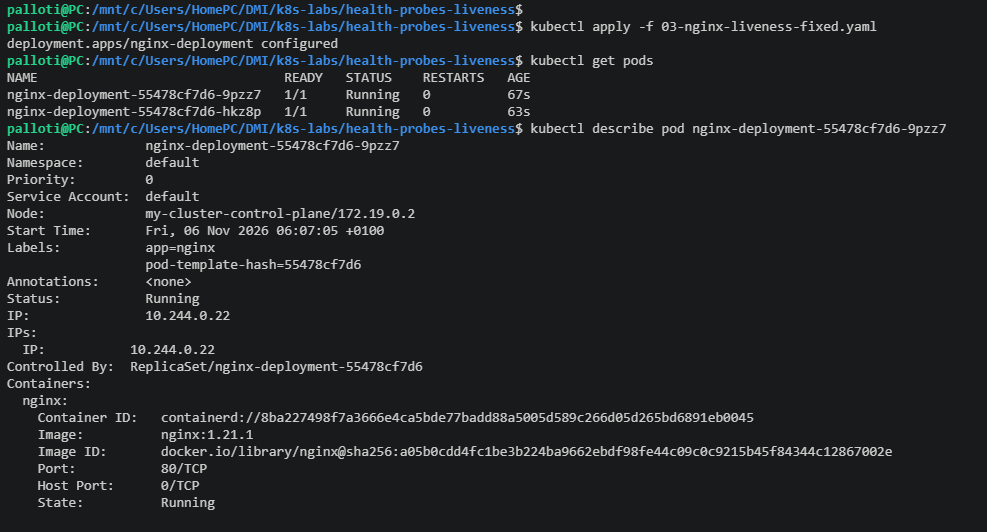
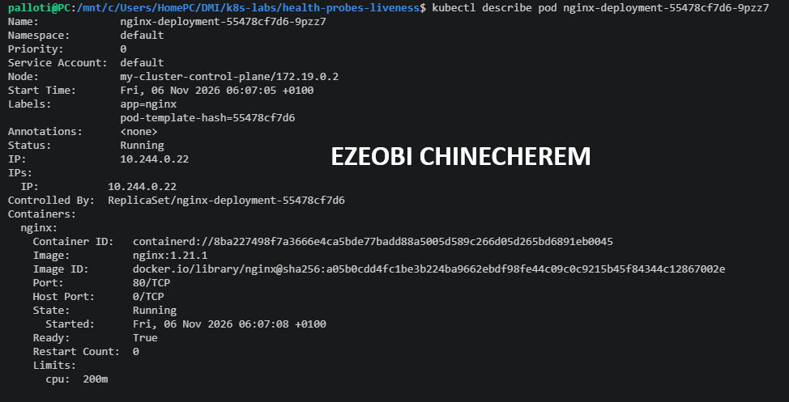

# Assignment 6 — Kubernetes Health Probes (Liveness)

Part of the DevOps Micro Internship (DMI) with Agentic AI

---

## Purpose

In this assignment, you will configure and test a Kubernetes liveness probe. You will create a baseline NGINX Deployment, add an HTTP liveness probe, intentionally make it fail, observe container restarts, and restore the working configuration.

---

# Task 0 — Prepare the Lab Environment

## Goal

Confirm that you are connected to your learning cluster and remove the previous HPA and NGINX Deployment before starting this lab.

No screenshot or written notes are required for this pre-check.

---

# Task 1 — Set Up Your Lab Directory

## Goal

Create and enter a dedicated directory for the liveness-probe lab.

### Evidence

#### Screenshot 1 — Baseline Deployment and two running Pods

---

# Task 2 — Add the Liveness Probe

## Goal

Create a baseline NGINX Deployment with two replicas and no health probes.

### Evidence

#### Screenshot 2 — Pod description showing the liveness probe

---

# Task 3 — Trigger and Observe a Liveness Restart

## Goal

Add an HTTP liveness probe so Kubernetes can periodically check whether the NGINX container is still responsive.

### Evidence

#### Screenshot 3 — Pod RESTARTS increment and the corresponding liveness failure events

---

# Task 4 — Restore and Stabilize the Probe

## Goal

Intentionally make the liveness probe fail and observe Kubernetes restart the unhealthy container.

### Evidence

#### Screenshot 4 — Stable Pod state after the fixed manifest is applied

---

# Task 5 — Review Tuning, Troubleshooting, and Cleanup

## Goal

Review recommended probe ranges and retain or delete the Deployment.

### Evidence

#### Screenshot 5 — Final healthy state and any troubleshooting evidence used

---

### Notes

Write a short note describing what the lab demonstrated.

Here is a short note describing what the lab demonstrated:

* **Kubernetes Deployment & Lifecycle**: Showcased how to create, configure, and manage standard deployment manifests using declarative YAML files.

* **Rolling Updates**: Demonstrated zero-downtime update strategies by modifying deployment configurations and controlling rollout progression.
* **Health Probes & Self-Healing**: Highlighted how to configure `livenessProbe` checks to monitor application health, trigger automated container restarts upon failures, and inspect restart counts and events.
* **Autoscaling & Resource Collection**: Illustrated the integration of the `metrics-server` and Horizontal Pod Autoscalers (HPA) to monitor container resource usage and dynamically scale pod replicas based on CPU load.

---

# Submission Instructions

- Add all required screenshots numbered 1–12.
- Include the optional Task 5 screenshot only if you attempt that task.
- Ensure your full name is visible in required screenshots.
- Use clear, readable screenshots showing the relevant manifest or output.
- Include the completed baseline and liveness-probe manifests in your repository.
- Answer all Notes questions for Tasks 1–4 in your own words.
- If you attempt Task 5, complete its Notes and restore the working configuration afterward.
- Do not expose tokens, passwords, kubeconfig files, account IDs, or other sensitive information.

---

# Completion Checklist

- [ ] Learning cluster confirmed and previous assignment resources removed where applicable
- [ ] Liveness-probe lab directory created (Screenshot 1)
- [ ] Baseline Deployment manifest completed (Screenshot 2)
- [ ] Successful rollout and two baseline Pods verified (Screenshot 3)
- [ ] Baseline Deployment details reviewed (Screenshot 4)
- [ ] Liveness probe added successfully (Screenshot 5)
- [ ] Successful liveness-probe rollout verified (Screenshot 6)
- [ ] Liveness-probe details inspected (Screenshot 7)
- [ ] Broken liveness configuration created (Screenshot 8)
- [ ] Increased container restart count observed (Screenshot 9)
- [ ] Liveness-probe failure events or restart details captured (Screenshot 10)
- [ ] Working liveness configuration restored and stable Pods verified (Screenshot 11)
- [ ] Optional Task 5 evidence and Notes completed, if attempted
- [ ] Working configuration restored after Task 5, if attempted
- [ ] LinkedIn post published (Screenshot 12)
- [ ] Notes for Tasks 1–4 completed
- [ ] Required manifests included
- [ ] All required screenshots are clear and readable
- [ ] No sensitive data exposed

---

## 📌 About DMI & CloudAdvisory

DevOps Micro Internship (DMI) is a project-based DevOps program run by Pravin Mishra (The CloudAdvisory) focused on real-world execution, systems thinking, and career readiness.

It helps learners build strong DevOps foundations with hands-on experience.

---

## 📌 Resources

- 🌐 DMI Official Website: https://dmi.pravinmishra.com?utm_source=github&utm_medium=readme  
- 🎓 University: https://university.pravinmishra.com?utm_source=github&utm_medium=readme  
- 💬 Discord Community: https://discord.pravinmishra.com?utm_source=github&utm_medium=readme  
- 📝 Blog: https://dmi.pravinmishra.com/blog?utm_source=github&utm_medium=readme  
- ▶️ YouTube Playlist: https://www.youtube.com/playlist?list=PLFeSNDtI4Cho  
- 🔗 Pravin Mishra (LinkedIn): https://www.linkedin.com/in/pravin-mishra-aws-trainer/  
- 🏢 CloudAdvisory (LinkedIn): https://www.linkedin.com/company/thecloudadvisory/

---

*This submission is part of DevOps Micro Internship (DMI) — Agentic AI Track.*
