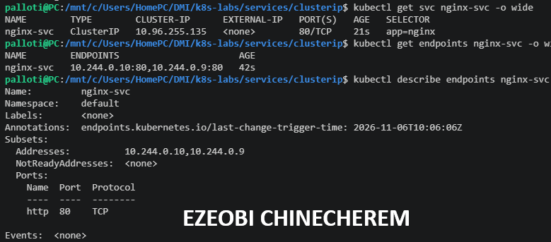
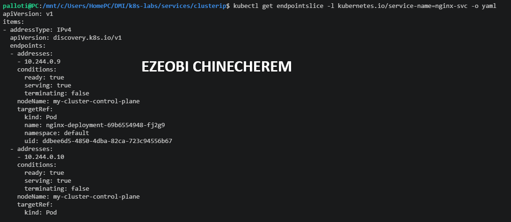
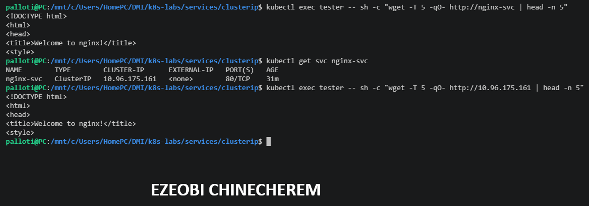
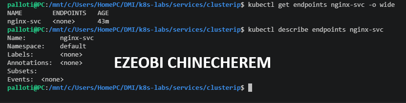
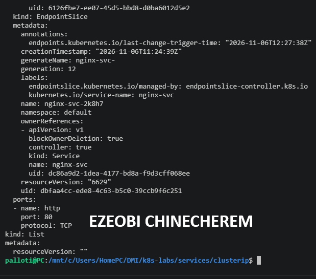
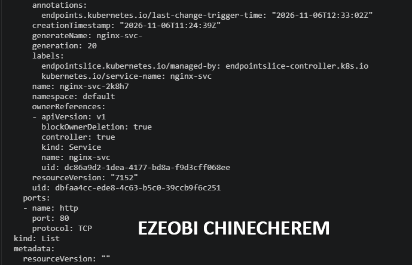

# Assignment 7 — Kubernetes Services (ClusterIP)

Part of the DevOps Micro Internship (DMI) with Agentic AI

---

## Purpose

In this assignment, you will create and test a Kubernetes ClusterIP Service. You will connect it to a healthy NGINX Deployment, access it using DNS and its ClusterIP, break and restore its selector, and observe how readiness affects Service routing.

---

# Task 0 — Prepare the Lab Environment

## Goal

Confirm your learning-cluster context and remove previous lab resources where applicable before starting this assignment.

No screenshot or written notes are required for this pre-check.

---

# Task 1 — Set Up Your Lab Directory

## Goal

Create and enter a dedicated directory for the ClusterIP Service lab.

### Evidence

#### Screenshot 1 — Two Ready Pods with labels and IPs

---

# Task 2 — Create and Inspect the ClusterIP Service

## Goal

Create an NGINX Deployment with labels, readiness probes, and liveness probes that can act as the backend for a Service.

### Evidence

#### Screenshot 2 — Service ClusterIP plus populated Endpoints and EndpointSlices

---

# Task 3 — Call the Service from a Client Pod

## Goal

Create a stable internal Service that routes traffic to the NGINX Pods.

### Evidence

#### Screenshot 3 — Successful `wget` responses and `nslookup` output

---

# Task 4 — Break and Fix the Selector Contract

## Goal

Create a client Pod and access the NGINX Service using DNS and its ClusterIP.

### Evidence

#### Screenshot 4 — Empty endpoints during failure and restored endpoints after the fix

---

# Task 5 — Prove Readiness-Aware Routing

## Goal

Break the Service selector, observe that usable endpoints disappear, and then restore the correct selector.

### Evidence

#### Screenshot 5 — NotReady Pod with excluded endpoint, followed by restored endpoint membership

---

# Task 6 — Troubleshoot and Optionally Clean Up

## Goal

Observe how a new Pod that fails readiness is excluded from ready Service backends while the existing healthy Pod continues serving traffic.

### Evidence

#### Screenshot 6 — Final verification or optional cleanup output

---

### Notes

Write a short note describing what the lab demonstrated.

Here is a short note summarizing what the lab demonstrated:

* **Deployment Management**: Created, configured, and managed application deployments using declarative YAML manifests within a local Kubernetes cluster.

* **Health Probes & Self-Healing**: Configured `livenessProbe` health checks to monitor container availability, intentionally triggered failures, and observed Kubernetes automatically restart unhealthy containers.

* **Internal Network Connectivity**: Provisioned `ClusterIP` services to route internal traffic and validated successful pod-to-service communication using lightweight testing pods.

* **Image Lifecycle & Cluster Operations**: Managed container image pulling, local node loading, and troubleshooting within a `kind` environment.

---

# Submission Instructions

- Add all required screenshots numbered 1–18.
- Ensure your full name is visible in required screenshots.
- Use clear, readable screenshots showing the relevant manifest or output.
- Include the completed NGINX Deployment and ClusterIP Service manifests in your repository.
- Answer all Notes questions for Tasks 1–6 in your own words.
- Include evidence of the intentional failures and successful recovery.
- Do not expose tokens, passwords, kubeconfig files, account IDs, or other sensitive information.

---

# Completion Checklist

- [ ] Learning-cluster context confirmed and previous lab resources removed where applicable
- [ ] ClusterIP lab directory created (Screenshot 1)
- [ ] Healthy NGINX Deployment manifest completed (Screenshot 2)
- [ ] Successful rollout and two ready NGINX Pods verified (Screenshot 3)
- [ ] ClusterIP Service manifest completed (Screenshot 4)
- [ ] Service and backend endpoints or EndpointSlices verified (Screenshot 5)
- [ ] Client Pod created and running (Screenshot 6)
- [ ] Service accessed using DNS name and ClusterIP (Screenshot 7)
- [ ] Service DNS resolution verified (Screenshot 8)
- [ ] Broken selector manifest created (Screenshot 9)
- [ ] Empty endpoints observed (Screenshot 10)
- [ ] Failed Service request captured (Screenshot 11)
- [ ] Original selector restored and connectivity verified (Screenshot 12)
- [ ] Deployment scaled to one ready Pod (Screenshot 13)
- [ ] Broken readiness patch created (Screenshot 14)
- [ ] Incomplete rollout or NotReady Pod observed (Screenshot 15)
- [ ] Readiness effect on Service backends verified (Screenshot 16)
- [ ] Deployment restored and ready Service backends verified (Screenshot 17)
- [ ] LinkedIn post published (Screenshot 18)
- [ ] Notes for Tasks 1–6 completed
- [ ] Required manifests included
- [ ] All required screenshots are clear and readable
- [ ] No sensitive data exposed

---

## 📌 About DMI & CloudAdvisory

DevOps Micro Internship (DMI) is a project-based DevOps program run by Pravin Mishra (The CloudAdvisory) focused on real-world execution, systems thinking, and career readiness.

It helps learners build strong DevOps foundations with hands-on experience.

---

## 📌 Resources

- 🌐 DMI Official Website: https://dmi.pravinmishra.com?utm_source=github&utm_medium=readme  
- 🎓 University: https://university.pravinmishra.com?utm_source=github&utm_medium=readme  
- 💬 Discord Community: https://discord.pravinmishra.com?utm_source=github&utm_medium=readme  
- 📝 Blog: https://dmi.pravinmishra.com/blog?utm_source=github&utm_medium=readme  
- ▶️ YouTube Playlist: https://www.youtube.com/playlist?list=PLFeSNDtI4Cho  
- 🔗 Pravin Mishra (LinkedIn): https://www.linkedin.com/in/pravin-mishra-aws-trainer/  
- 🏢 CloudAdvisory (LinkedIn): https://www.linkedin.com/company/thecloudadvisory/

---

*This submission is part of DevOps Micro Internship (DMI) — Agentic AI Track.*
