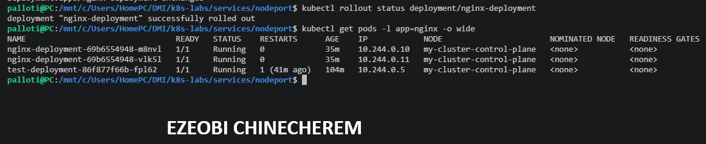
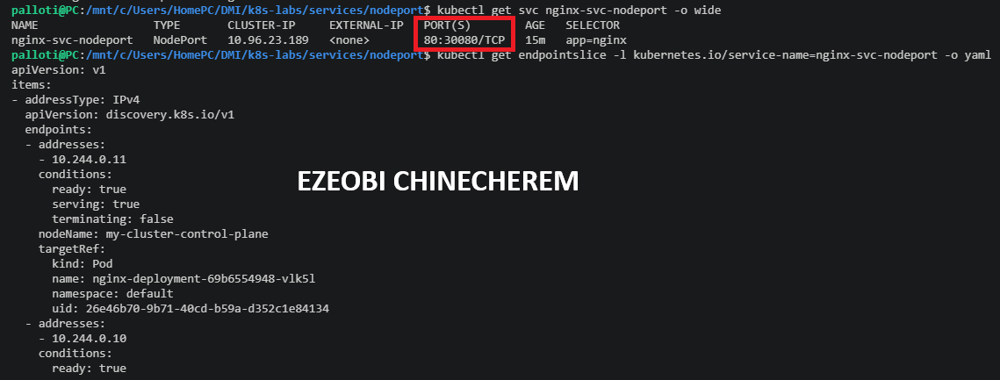
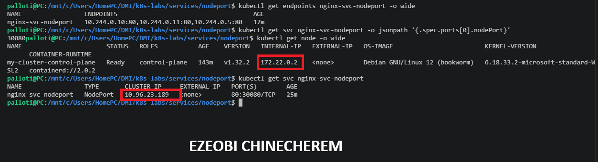
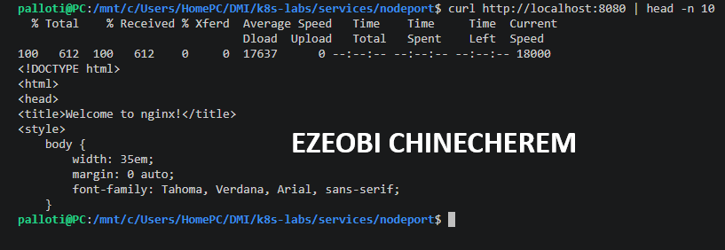
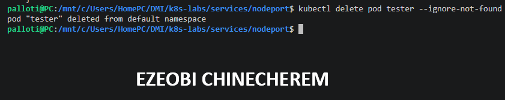
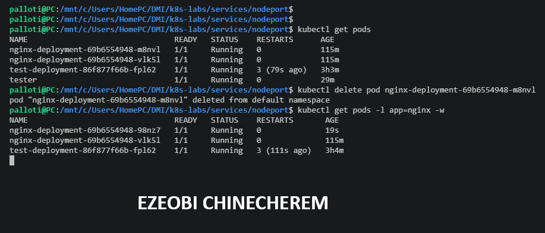

# Assignment 8 — Kubernetes Services (NodePort)

Part of the DevOps Micro Internship (DMI) with Agentic AI

---

## Purpose

Create a healthy NGINX Deployment, expose it through a NodePort Service, test access using a node IP and NodePort, and observe how the Service behaves when a backend Pod is replaced.

---

# Task 1 — Set Up Your Lab Directory

## Goal

Create and enter a dedicated directory for the NodePort Service lab.

### Evidence

#### Screenshot 1 — Terminal showing that you are working inside `~/k8s-labs/services/nodeport`

<<<<<<< HEAD
---

# Task 2 — Create the NodePort Service

## Goal

Create `nginx-svc-nodeport` (type `NodePort`, port 80, `nodePort: 30080`) and inspect the Service and endpoints.

### Evidence

#### Screenshot 2 — Service output showing `80:30080` and populated endpoints

---

# Task 3 — Find a Node IP and Test Access

## Goal

Find a reachable node IP and test `<NODE_IP>:30080` externally (curl) and internally (from a `tester` Pod).

### Evidence

#### Screenshot 3 — Successful external or internal NodePort response

---

# Task 4 — Use the Environment-Specific Access Method

## Goal

Use the appropriate fallback for your cluster environment (`minikube service --url`, or port-forward for kind/Docker Desktop) to validate the Service.

### Evidence

#### Screenshot 4 — Minikube helper URL or local validation result

---

# Task 5 — Break and Fix the Selector

## Goal

Change the selector to `app: does-not-match`, confirm endpoints empty and the request fails, then restore the good selector.

### Evidence

#### Screenshot 5 — Empty then restored endpoint output

---

# Task 6 — Test Pod Churn and Clean Up

## Goal

Delete one backend Pod while calling the NodePort from another terminal, confirm the Service remains available, then optionally clean up.

### Evidence

#### Screenshot 6 — Pod replacement while NodePort remains available

---

=======
>>>>>>> upstream
### Notes

**1. What is the difference between ClusterIP and NodePort?**

<<<<<<< HEAD
Here is a concise note summarizing what the lab demonstrated:

NodePort Service Exposure: Successfully deployed and configured an NGINX application exposed via a Kubernetes NodePort service on port 30080.

Traffic Routing & Endpoints: Verified that the Kubernetes service correctly discovered and routed traffic across active pod endpoints.

Network Diagnostics & Access: Explored cluster networking mechanics within a kind environment, utilizing kubectl port-forward for local host access and a tester pod to validate internal cluster connectivity and HTTP response headers.
=======
Add your answer here.

**2. What does a NodePort Service allow users to do?**

Add your answer here.

---

# Task 2 — Create a Healthy NGINX Deployment

## Goal

Create a healthy NGINX Deployment that can act as the backend for the NodePort Service.

### Evidence

#### Screenshot 2 — Completed `00-nginx-deploy.yaml` manifest

Add your screenshot here.

---

#### Screenshot 3 — Output showing successful rollout and two ready NGINX Pods

Add your screenshot here.

### Notes

**1. Which label will the NodePort Service use to find the NGINX Pods?**

Add your answer here.

**2. Why must the Pods be ready before they can receive Service traffic?**

Add your answer here.

**3. What port does the NGINX container listen on?**

Add your answer here.

---

# Task 3 — Create the NodePort Service

## Goal

Create a NodePort Service that exposes the NGINX application through a port on every cluster node.

### Evidence

#### Screenshot 4 — Completed `01-nginx-svc-nodeport.yaml` manifest

Add your screenshot here.

---

#### Screenshot 5 — Output showing the NodePort Service and its endpoints or EndpointSlices

Add your screenshot here.

### Notes

**1. What is the purpose of `type: NodePort`?**

Add your answer here.

**2. What is the difference between `port`, `targetPort`, and `nodePort`?**

Add your answer here.

**3. What NodePort was assigned or selected in your environment?**

Add your answer here.

**4. Why do Service endpoints need ready Pods?**

Add your answer here.

---

# Task 4 — Find a Node IP and Test the NodePort

## Goal

Find a reachable node IP and access the NodePort Service.

### Evidence

#### Screenshot 6 — Output of `kubectl get nodes -o wide`

Add your screenshot here.

---

#### Screenshot 7 — Output showing the `tester` Pod running

Add your screenshot here.

---

#### Screenshot 8 — Successful NodePort response from the laptop or the `tester` Pod

If neither route is supported by your environment, include the failed request output and ready endpoint evidence, and explain the limitation in your Notes.

Add your screenshot here.

### Notes

**1. Which node IP and NodePort did you test?**

Add your answer here.

**2. Was your laptop able to reach the NodePort directly? Explain your result.**

Add your answer here.

**3. Why can external NodePort access behave differently in Minikube, kind, Docker Desktop, and cloud clusters?**

Add your answer here.

---

# Task 5 — Optional: Test the Label-Selector Contract

## Goal

Break the Service selector, observe that usable endpoints disappear, and restore the correct selector.

Complete the Evidence and Notes below only if you attempted this optional task.

### Evidence

#### Screenshot 9 — `02-nginx-svc-selector-broken.yaml` showing the incorrect selector

Add your screenshot here.

---

#### Screenshot 10 — Empty endpoints or EndpointSlice output after applying the broken selector

Add your screenshot here.

---

#### Screenshot 11 — Restored endpoints or EndpointSlices after applying the original Service manifest

Add your screenshot here.

### Notes

**1. Why did the Service endpoints become empty?**

Add your answer here.

**2. Why is NodePort only useful when matching ready Pods exist?**

Add your answer here.

**3. How did you restore the backend connectivity?**

Add your answer here.

---

# Task 6 — Observe Resilience During Pod Churn

## Goal

Delete one NGINX Pod and observe its replacement while the Service continues routing traffic to available Pods.

### Evidence

#### Screenshot 12 — Output of the Pod deletion command

Add your screenshot here.

---

#### Screenshot 13 — Output showing the replacement Pod and two running, ready Pods

Add your screenshot here.

### Notes

**1. What happened after you deleted one Pod?**

Add your answer here.

**2. Which Kubernetes resource created the replacement Pod?**

Add your answer here.

**3. Why can the NodePort Service continue working during Pod churn?**

Add your answer here.

---

# Task 7 — Share Your NodePort Learning on LinkedIn

## Goal

Share what you learned about NodePort Services, backend Pods, and network access in your Kubernetes environment.

### Evidence

#### Screenshot 14 — Published LinkedIn post about your NodePort Service lab

Add your screenshot here.

#### Linkedin post link

Add your Linkdin post link.
>>>>>>> upstream

---

# Submission Instructions

- Include the completed YAML manifests created during the lab.
- Add all required screenshots: Screenshots 1–8 and 12–14.
- Include Screenshots 9–11 only if you attempted optional Task 5.
- Complete the Notes for Tasks 1–4 and Task 6.
- Complete Task 5 Notes only if you attempted that task.
- Use clear, readable screenshots showing the relevant commands and outputs.
- Ensure your full name is visible in the required screenshots.
- If NodePort access is restricted by your environment, include the failed request output, ready endpoint evidence, and an explanation.
- Do not expose passwords, access tokens, private keys, kubeconfig contents, or account IDs.

---

# Completion Checklist

- [ ] Created and entered `~/k8s-labs/services/nodeport` (Screenshot 1)
- [ ] Created and applied the NGINX Deployment manifest (Screenshot 2)
- [ ] Confirmed successful rollout and two ready NGINX Pods (Screenshot 3)
- [ ] Created the NodePort Service manifest (Screenshot 4)
- [ ] Verified the Service and its endpoints or EndpointSlices (Screenshot 5)
- [ ] Recorded the assigned or selected NodePort
- [ ] Identified a node IP (Screenshot 6)
- [ ] Confirmed that the `tester` Pod is running (Screenshot 7)
- [ ] Tested NodePort access, or documented the environment limitation with evidence (Screenshot 8)
- [ ] Optional: Tested and restored the Service selector (Screenshots 9–11)
- [ ] Deleted one NGINX Pod (Screenshot 12)
- [ ] Confirmed the replacement Pod and two running, ready Pods (Screenshot 13)
- [ ] Completed all required Notes
- [ ] Published the LinkedIn post (Screenshot 14)
- [ ] No sensitive data exposed

---

## 📌 About DMI & CloudAdvisory

DevOps Micro Internship (DMI) is a project-based DevOps program run by Pravin Mishra (The CloudAdvisory) focused on real-world execution, systems thinking, and career readiness.

It helps learners build strong DevOps foundations with hands-on experience.

---

## 📌 Resources

- 🌐 DMI Official Website: https://dmi.pravinmishra.com?utm_source=github&utm_medium=readme  
- 🎓 University: https://university.pravinmishra.com?utm_source=github&utm_medium=readme  
- 💬 Discord Community: https://discord.pravinmishra.com?utm_source=github&utm_medium=readme  
- 📝 Blog: https://dmi.pravinmishra.com/blog?utm_source=github&utm_medium=readme  
- ▶️ YouTube Playlist: https://www.youtube.com/playlist?list=PLFeSNDtI4Cho  
- 🔗 Pravin Mishra (LinkedIn): https://www.linkedin.com/in/pravin-mishra-aws-trainer/  
- 🏢 CloudAdvisory (LinkedIn): https://www.linkedin.com/company/thecloudadvisory/

---

*This submission is part of DevOps Micro Internship (DMI) — Agentic AI Track.*
