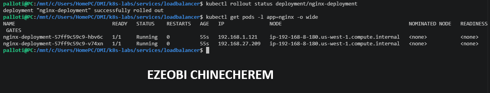
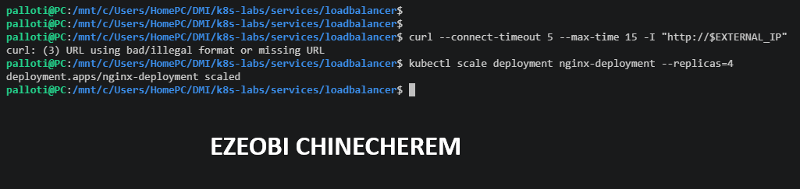
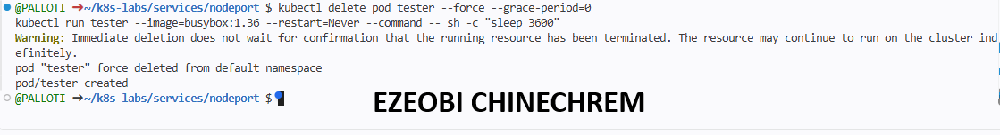

# Assignment 09 — Kubernetes Services: LoadBalancer on AKS

Part of the DevOps Micro Internship (DMI) with Agentic AI

---

## Purpose

Deploy a healthy NGINX application to Azure Kubernetes Service (AKS), expose it publicly using a LoadBalancer Service, observe readiness behavior, and scale the application behind the same public endpoint.

---

# Task 1 — Create or Connect to an AKS Cluster

## Goal

Create a small AKS cluster for this lab, or connect to an existing approved AKS lab cluster.

### Evidence

#### Screenshot 1 — AKS creation result and Ready node output

---

# Task 2 — Set Up Your Lab Directory

## Goal

Create and enter a dedicated directory for the LoadBalancer Service manifests.

### Evidence

#### Screenshot 2 — Successful rollout and two Ready Pods

---

# Task 3 — Create and Test the LoadBalancer Service

## Goal

Create a healthy NGINX Deployment with readiness and liveness probes.

### Evidence

#### Screenshot 3 — Service with public `EXTERNAL-IP` and successful `curl` output

### Notes

**1. Why must Pods be ready before they should receive public traffic?**

Pods must be ready before receiving public traffic because a container starting (Running state) does not mean the application inside it is actually initialized and capable of serving requests. Without readiness checks, Kubernetes Services and Ingress controllers route traffic to unready Pods, causing dropped connections, HTTP 502/503 errors, and degraded user experience.

**2. What is the role of the readiness probe in this Deployment?**

In a Kubernetes Deployment, the readinessProbe acts as a traffic gatekeeper that tells Kubernetes exactly when a Pod is ready to accept incoming network requests—and when traffic should be temporarily paused without restarting the container.

Controls Service Load Balancing: A Kubernetes Service only routes traffic to Pods whose readinessProbe is passing. If a Pod fails its readiness check, Kubernetes removes the Pod's IP from the Service Endpoints list so users never get routed to an unready or overloaded container.

Protects Rolling Updates (RollingUpdate): When you deploy a new image or update configuration in a Deployment, Kubernetes spins up new Pods alongside the old ones. The Deployment controller waits until the new Pods pass their readinessProbe before terminating the older Pods, preventing downtime during releases.

Handles Temporary Slowdowns Without Restarts: Unlike a livenessProbe (which kills and restarts a stuck container), a failing readinessProbe simply takes the Pod out of rotation until it recovers (for example, while waiting for a database connection pool to reconnect or finishing a heavy initialization task).

**3. What is the role of the liveness probe in this Deployment?**

In a Kubernetes Deployment, the livenessProbe acts as an automated health watchdog that detects when an application inside a running container has deadlocked, frozen, or entered an unrecoverable broken state—and triggers a container restart to restore it.

Key Roles of the livenessProbe
Detects Deadlocks and Frozen Processes: A container's main process can stay alive (so Kubernetes sees the container as Running) even when the application inside is hung, stuck in an infinite loop, or out of memory and unable to respond. The livenessProbe periodically checks a health endpoint (such as /healthz or a TCP port) to verify the app is still responsive.

Triggers Self-Healing Restarts: If the probe fails repeatedly beyond its configured failureThreshold, the kubelet terminates and restarts the container according to the Pod's restartPolicy (which defaults to Always in a Deployment).

Complements the readinessProbe: While the readinessProbe controls traffic routing (removing an unready Pod from the Service load balancer without restarting it), the livenessProbe controls container lifecycle (restarting a broken container so it can recover cleanly).

---

# Task 4 — Prove Readiness Affects Public Traffic

## Goal

Create a public LoadBalancer Service and verify that the NGINX application is reachable from the internet.

### Evidence

#### Screenshot 4 — Endpoint changes and public `curl` behavior before and after recovery

---

# Task 5 — Scale Behind the Stable Public Endpoint

## Goal

Intentionally break readiness and observe how Kubernetes excludes unready Pods from ready Service backends while existing healthy Pods continue serving public traffic.

### Evidence

#### Screenshot 5 — Four replicas/endpoints behind the unchanged public endpoint

---

# Task 6 — Troubleshoot and Clean Up

## Goal

Scale the NGINX Deployment and confirm that more ready Pods become available behind the same public endpoint.

### Evidence

#### Screenshot 6 — Clean final verification or resource deletion command output

---

### Notes

Write a short note describing what the lab demonstrated.

This lab demonstrated how to deploy an NGINX application with readiness and liveness probes to an Amazon EKS cluster, expose it publicly using a Kubernetes LoadBalancer service, and route traffic to healthy backend pods.
   Key concepts covered include:
Public Load Balancing: Using a LoadBalancer service to provision an external AWS Elastic Load Balancer (ELB) that routes internet traffic into the cluster.   
Readiness Protection: Observing how readiness probes exclude unready or failing pods from traffic routing during a faulty rollout, ensuring zero downtime while existing healthy pods continue serving requests.
Horizontal Scaling: Scaling the deployment to increase the number of pod replicas and observing how the service automatically incorporates the new endpoints behind the stable public address.

---

# Submission Instructions

- Include the completed YAML files:
  - `00-nginx-deploy.yaml`
  - `01-nginx-svc-loadbalancer.yaml`
  - `02-readiness-broken.yaml`
- Add all required screenshots, numbered 1–14, under their corresponding Evidence sections.
- Use clear, readable screenshots showing the relevant commands, configuration, and outputs.
- Ensure your full name is visible in the required screenshots.
- Complete the Notes for Tasks 1–6 in your own words.
- Capture all required evidence before cleaning up Azure resources.
- Plan or complete Azure cleanup according to your lab ownership and reuse arrangements.
- Do not expose passwords, tokens, private keys, cluster credentials, kubeconfig contents, subscription IDs, account IDs, or infrastructure details you are not permitted to share.

---

# Completion Checklist

- [ ] Created or connected to an approved AKS lab cluster
- [ ] Confirmed ready AKS node(s) (Screenshot 1)
- [ ] Created and entered the LoadBalancer lab directory (Screenshot 2)
- [ ] Created the NGINX Deployment manifest (Screenshot 3)
- [ ] Verified successful rollout and two ready NGINX Pods initially (Screenshot 4)
- [ ] Created the LoadBalancer Service manifest (Screenshot 5)
- [ ] Verified the assigned external IP (Screenshot 6)
- [ ] Verified successful public access using curl (Screenshot 7)
- [ ] Created the broken readiness patch (Screenshot 8)
- [ ] Observed the expected incomplete rollout or readiness failure (Screenshot 9)
- [ ] Inspected EndpointSlices during the readiness failure (Screenshot 10)
- [ ] Restored the healthy Deployment and verified public access (Screenshot 11)
- [ ] Scaled the Deployment to four ready Pods and verified updated Service backends (Screenshot 12)
- [ ] Verified public access after scaling (Screenshot 13)
- [ ] Completed the Notes for Tasks 1–6
- [ ] Published the LinkedIn post (Screenshot 14)
- [ ] Included all required YAML files and screenshots
- [ ] Planned or completed Azure cleanup
- [ ] No sensitive data exposed

---

## 📌 About DMI & CloudAdvisory

DevOps Micro Internship (DMI) is a project-based DevOps program run by Pravin Mishra (The CloudAdvisory) focused on real-world execution, systems thinking, and career readiness.

It helps learners build strong DevOps foundations with hands-on experience.

---

## 📌 Resources

- 🌐 DMI Official Website: https://dmi.pravinmishra.com?utm_source=github&utm_medium=readme  
- 🎓 University: https://university.pravinmishra.com?utm_source=github&utm_medium=readme  
- 💬 Discord Community: https://discord.pravinmishra.com?utm_source=github&utm_medium=readme  
- 📝 Blog: https://dmi.pravinmishra.com/blog?utm_source=github&utm_medium=readme  
- ▶️ YouTube Playlist: https://www.youtube.com/playlist?list=PLFeSNDtI4Cho  
- 🔗 Pravin Mishra (LinkedIn): https://www.linkedin.com/in/pravin-mishra-aws-trainer/  
- 🏢 CloudAdvisory (LinkedIn): https://www.linkedin.com/company/thecloudadvisory/

---

*This submission is part of DevOps Micro Internship (DMI) — Agentic AI Track.*
