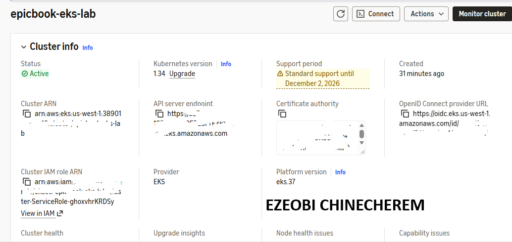
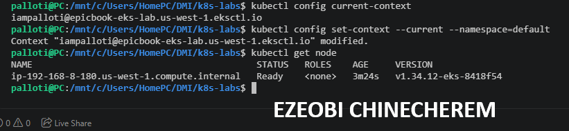
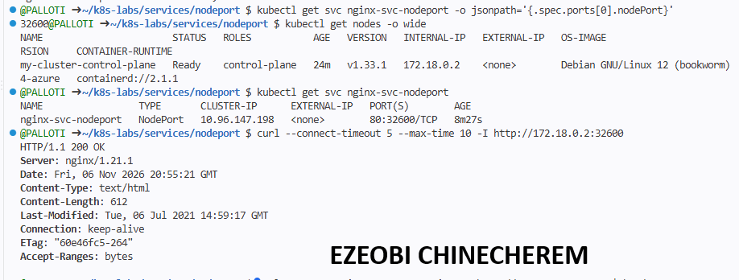
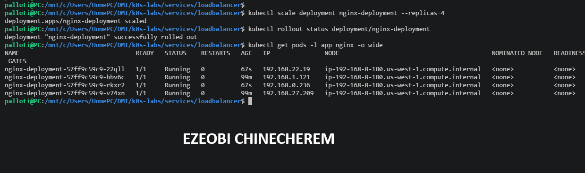
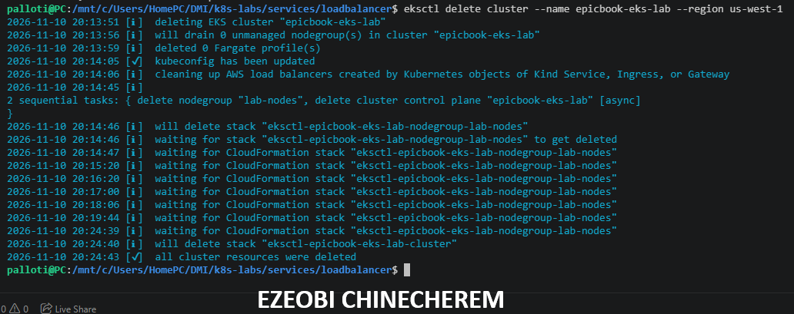

# Assignment 09 — Kubernetes Services: LoadBalancer on AKS

Part of the DevOps Micro Internship (DMI) with Agentic AI

---

## Purpose

Deploy a healthy NGINX application to Azure Kubernetes Service (AKS), expose it publicly using a LoadBalancer Service, observe readiness behavior, and scale the application behind the same public endpoint.

---

# Task 1 — Create or Connect to an AKS Cluster

## Goal

Create a small AKS cluster for this lab, or connect to an existing approved AKS lab cluster.

### Evidence

#### Screenshot 1 — AKS creation result and Ready node output

---

# Task 2 — Set Up Your Lab Directory

## Goal

Create and enter a dedicated directory for the LoadBalancer Service manifests.

### Evidence

#### Screenshot 2 — Successful rollout and two Ready Pods

---

# Task 3 — Create and Test the LoadBalancer Service

## Goal

Create a healthy NGINX Deployment with readiness and liveness probes.

### Evidence

#### Screenshot 3 — Service with public `EXTERNAL-IP` and successful `curl` output

### Notes

**1. Why must Pods be ready before they should receive public traffic?**

Add your answer here.

**2. What is the role of the readiness probe in this Deployment?**

Add your answer here.

**3. What is the role of the liveness probe in this Deployment?**

Add your answer here.

---

# Task 4 — Prove Readiness Affects Public Traffic

## Goal

Create a public LoadBalancer Service and verify that the NGINX application is reachable from the internet.

### Evidence

#### Screenshot 4 — Endpoint changes and public `curl` behavior before and after recovery

---

# Task 5 — Scale Behind the Stable Public Endpoint

## Goal

Intentionally break readiness and observe how Kubernetes excludes unready Pods from ready Service backends while existing healthy Pods continue serving public traffic.

### Evidence

#### Screenshot 5 — Four replicas/endpoints behind the unchanged public endpoint

---

# Task 6 — Troubleshoot and Clean Up

## Goal

Scale the NGINX Deployment and confirm that more ready Pods become available behind the same public endpoint.

### Evidence

#### Screenshot 6 — Clean final verification or resource deletion command output

---

### Notes

Write a short note describing what the lab demonstrated.

This lab demonstrated how to deploy an NGINX application with readiness and liveness probes to an Amazon EKS cluster, expose it publicly using a Kubernetes LoadBalancer service, and route traffic to healthy backend pods.
   Key concepts covered include:
Public Load Balancing: Using a LoadBalancer service to provision an external AWS Elastic Load Balancer (ELB) that routes internet traffic into the cluster.   
Readiness Protection: Observing how readiness probes exclude unready or failing pods from traffic routing during a faulty rollout, ensuring zero downtime while existing healthy pods continue serving requests.
Horizontal Scaling: Scaling the deployment to increase the number of pod replicas and observing how the service automatically incorporates the new endpoints behind the stable public address.

---

# Submission Instructions

- Include the completed YAML files:
  - `00-nginx-deploy.yaml`
  - `01-nginx-svc-loadbalancer.yaml`
  - `02-readiness-broken.yaml`
- Add all required screenshots, numbered 1–14, under their corresponding Evidence sections.
- Use clear, readable screenshots showing the relevant commands, configuration, and outputs.
- Ensure your full name is visible in the required screenshots.
- Complete the Notes for Tasks 1–6 in your own words.
- Capture all required evidence before cleaning up Azure resources.
- Plan or complete Azure cleanup according to your lab ownership and reuse arrangements.
- Do not expose passwords, tokens, private keys, cluster credentials, kubeconfig contents, subscription IDs, account IDs, or infrastructure details you are not permitted to share.

---

# Completion Checklist

- [ ] Created or connected to an approved AKS lab cluster
- [ ] Confirmed ready AKS node(s) (Screenshot 1)
- [ ] Created and entered the LoadBalancer lab directory (Screenshot 2)
- [ ] Created the NGINX Deployment manifest (Screenshot 3)
- [ ] Verified successful rollout and two ready NGINX Pods initially (Screenshot 4)
- [ ] Created the LoadBalancer Service manifest (Screenshot 5)
- [ ] Verified the assigned external IP (Screenshot 6)
- [ ] Verified successful public access using curl (Screenshot 7)
- [ ] Created the broken readiness patch (Screenshot 8)
- [ ] Observed the expected incomplete rollout or readiness failure (Screenshot 9)
- [ ] Inspected EndpointSlices during the readiness failure (Screenshot 10)
- [ ] Restored the healthy Deployment and verified public access (Screenshot 11)
- [ ] Scaled the Deployment to four ready Pods and verified updated Service backends (Screenshot 12)
- [ ] Verified public access after scaling (Screenshot 13)
- [ ] Completed the Notes for Tasks 1–6
- [ ] Published the LinkedIn post (Screenshot 14)
- [ ] Included all required YAML files and screenshots
- [ ] Planned or completed Azure cleanup
- [ ] No sensitive data exposed

---

## 📌 About DMI & CloudAdvisory

DevOps Micro Internship (DMI) is a project-based DevOps program run by Pravin Mishra (The CloudAdvisory) focused on real-world execution, systems thinking, and career readiness.

It helps learners build strong DevOps foundations with hands-on experience.

---

## 📌 Resources

- 🌐 DMI Official Website: https://dmi.pravinmishra.com?utm_source=github&utm_medium=readme  
- 🎓 University: https://university.pravinmishra.com?utm_source=github&utm_medium=readme  
- 💬 Discord Community: https://discord.pravinmishra.com?utm_source=github&utm_medium=readme  
- 📝 Blog: https://dmi.pravinmishra.com/blog?utm_source=github&utm_medium=readme  
- ▶️ YouTube Playlist: https://www.youtube.com/playlist?list=PLFeSNDtI4Cho  
- 🔗 Pravin Mishra (LinkedIn): https://www.linkedin.com/in/pravin-mishra-aws-trainer/  
- 🏢 CloudAdvisory (LinkedIn): https://www.linkedin.com/company/thecloudadvisory/

---

*This submission is part of DevOps Micro Internship (DMI) — Agentic AI Track.*
