# Assignment 10 — Capstone: Deploy the Book Review App to Kubernetes

Part of the DevOps Micro Internship (DMI) with Agentic AI

---

## Purpose

In this capstone assignment, you will deploy the Book Review App as a production-style three-tier application on Kubernetes (EKS, AKS, GKE, Minikube, or k3s): a Next.js frontend behind Nginx exposed publicly, an internal Node.js/Express backend on port 3010, and a persistent or managed MySQL database — configured with ConfigMaps, Secrets, and validated end to end.

---

# Task 1 — Prepare the Kubernetes Cluster and Tooling

## Goal

Select a Kubernetes platform, confirm `kubectl` (and Helm, if used) can communicate with the cluster, and verify nodes are Ready.

### Evidence

#### Screenshot 1 — Terminal showing the active Kubernetes context and Ready nodes

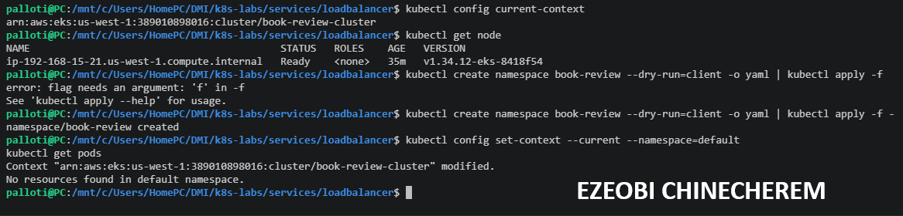

---

#### Screenshot 2 (if using Helm) — Terminal showing `helm version`

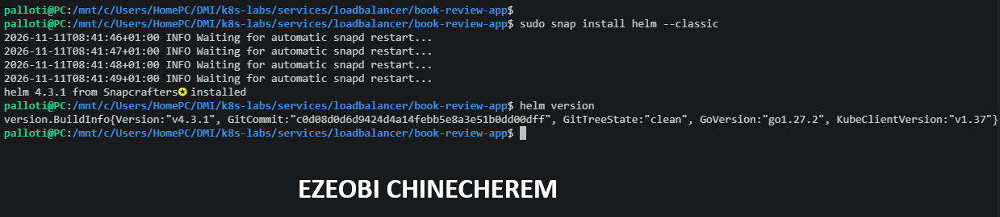

---

# Task 2 — Design the Three-Tier Kubernetes Architecture

## Goal

Create an architecture diagram showing the public entry point, frontend, internal backend, MySQL, ConfigMaps/Secrets, and the permitted traffic flow.

### Evidence

#### Screenshot 3 — Completed Kubernetes architecture diagram

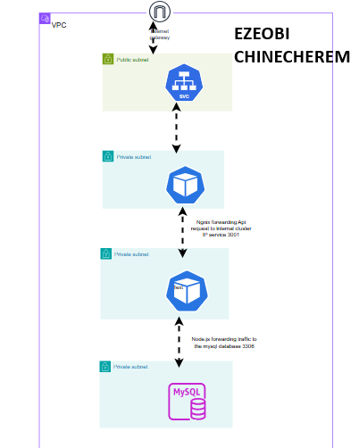

---

# Task 3 — Create ConfigMaps and Secrets

## Goal

Externalize non-sensitive configuration into ConfigMaps and sensitive values (database credentials, JWT secret) into Secrets, referenced from the Pod specs without committing plaintext values.

### Evidence

#### Screenshot 4 — ConfigMap manifest or `kubectl describe configmap` output showing non-sensitive configuration

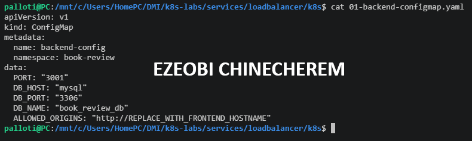

---

#### Screenshot 5 — Secret object usage with sensitive values hidden or redacted

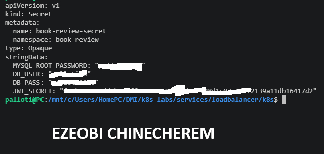

---

# Task 4 — Deploy and Configure the MySQL Data Tier

## Goal

Provide a persistent MySQL database (managed service or StatefulSet + PVC) reachable only by the backend, initialize the schema, and test connectivity.

### Evidence

#### Screenshot 6 — Managed MySQL status or MySQL StatefulSet/PVC status

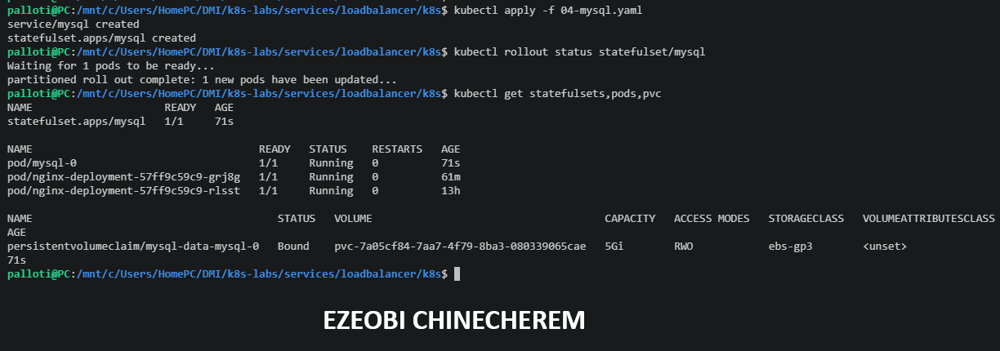

---

#### Screenshot 7 — Successful database connectivity or schema verification with credentials hidden

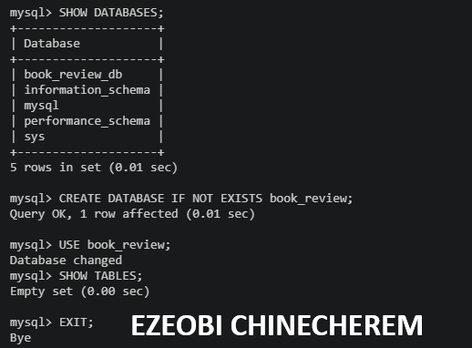

---

# Task 5 — Deploy the Backend Application Tier

## Goal

Run one or two Node.js/Express backend replicas on port 3010, expose them via ClusterIP (or internal LoadBalancer), and connect them to MySQL using ConfigMaps/Secrets.

### Evidence

#### Screenshot 8 — Backend Deployment, Pods, and internal Service

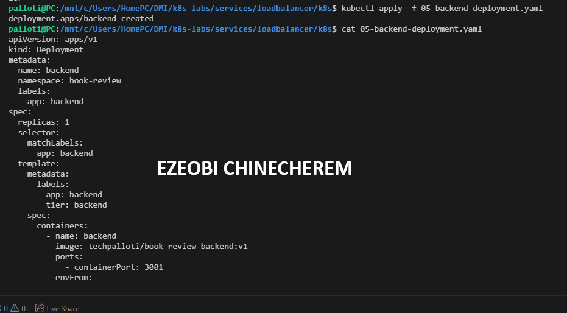

---

#### Screenshot 9 — Backend logs showing successful startup and database connectivity

---

# Task 6 — Deploy the Frontend and Configure Nginx

## Goal

Run one or two Next.js frontend replicas behind Nginx on port 80, reverse-proxying to the backend's internal Service name.

### Evidence

#### Screenshot 10 — Frontend Deployment and Ready Pods

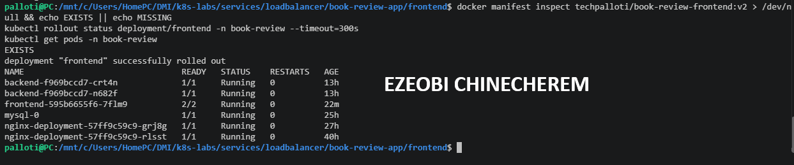

---

#### Screenshot 11 — Nginx reverse-proxy configuration showing the internal backend Service name

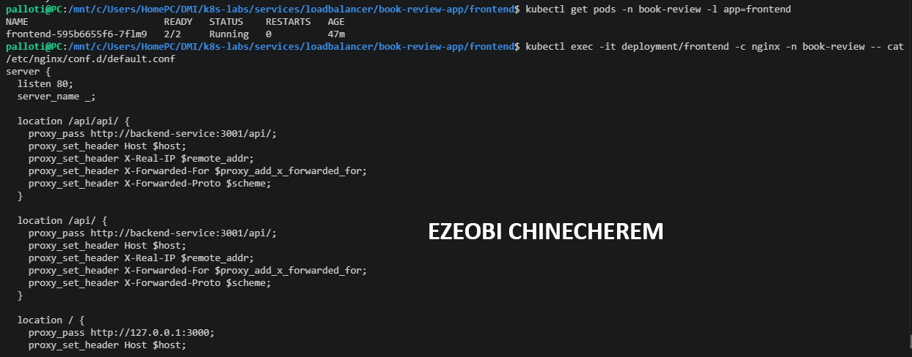

---

# Task 7 — Configure External and Internal Networking

## Goal

Expose only the frontend publicly (LoadBalancer or Ingress), restrict backend access to the frontend path (NetworkPolicy or platform equivalent), and confirm MySQL is not publicly reachable.

### Evidence

#### Screenshot 12 — Frontend LoadBalancer or Ingress showing the public endpoint

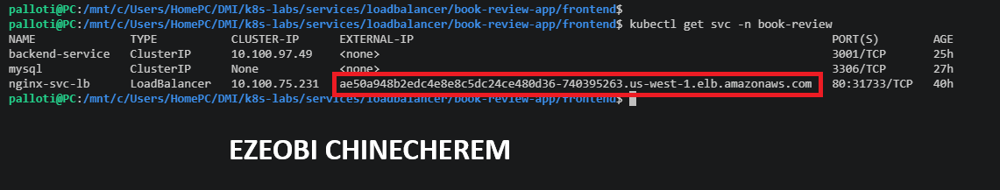

---

#### Screenshot 13 — Internal backend Service and NetworkPolicy (or equivalent restriction)

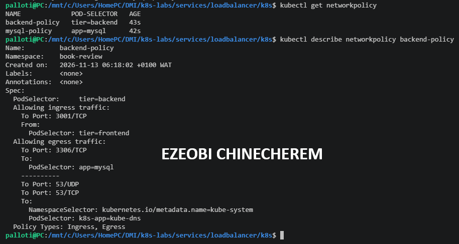

---

# Task 8 — Validate the Application End to End

## Goal

Confirm the frontend loads publicly, a full user flow reaches the backend and MySQL, and collect operational evidence.

### Evidence

#### Screenshot 14 — `kubectl get all` output

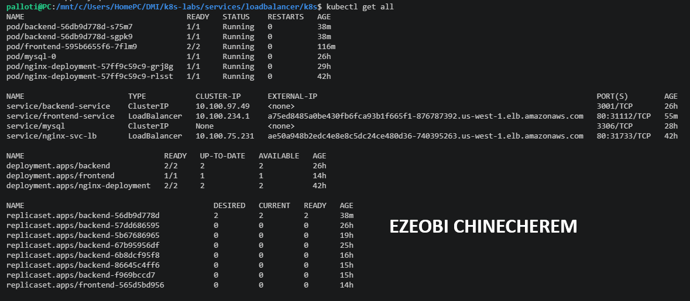

---

#### Screenshot 15 — Functional Book Review App in the browser with the public URL or IP visible

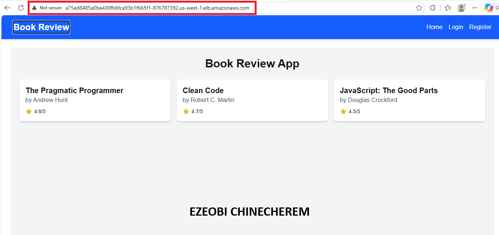

---

#### Screenshot 16 — Frontend Pod logs

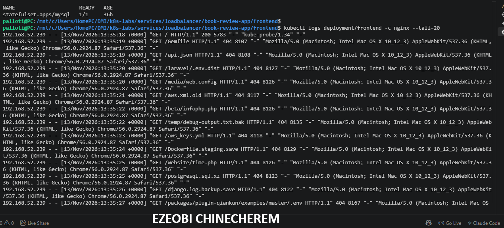

---

#### Screenshot 17 — Backend Pod logs showing successful requests or database activity

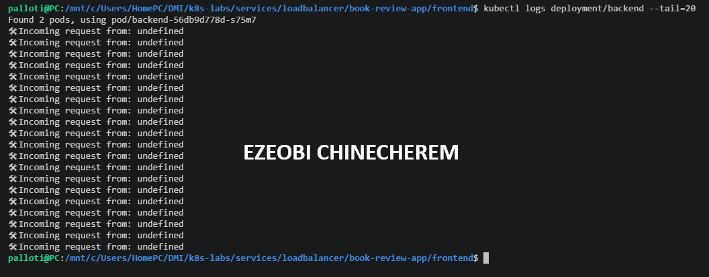

---

#### Screenshot 18 (optional) — Kubernetes dashboard

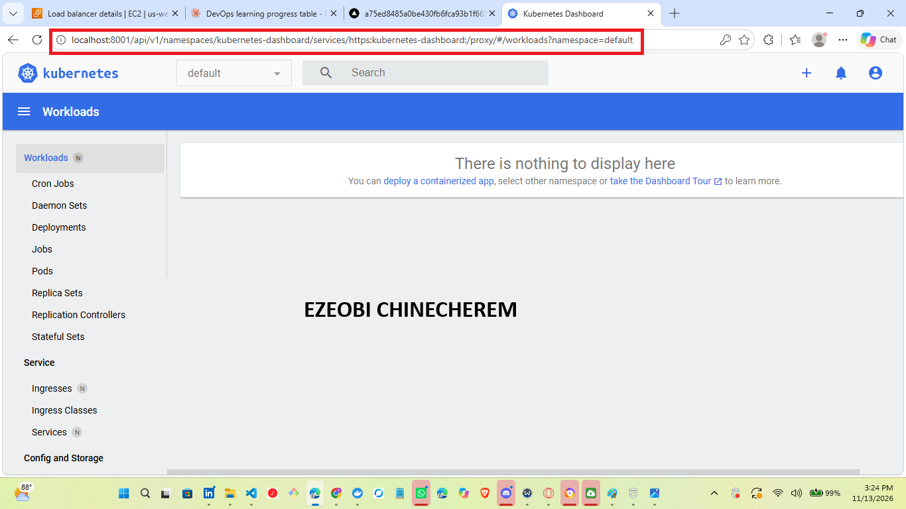

---

# Task 9 — Implement Optional Production Enhancements

## Goal

Optionally package as a Helm chart, add HPA, add readiness/liveness probes, or configure TLS via cert-manager — without changing the core architecture.

### Evidence

#### Screenshot 19 (optional) — Helm release, HPA, probes, or TLS evidence

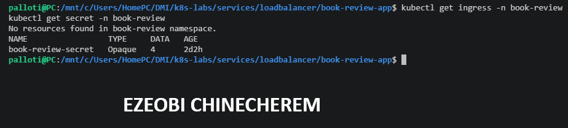

---

### Notes

Report the Kubernetes platform used, the public frontend URL/IP, a GitHub link to your manifests/Helm chart (if applicable), and the architecture diagram link. Summarize what worked, issues encountered and how they were resolved, and the tools/sources that helped the most.

Kubernetes platform
Amazon EKS (Kubernetes v1.34), region us-west-1, created with eksctl, managed node group of t3.small nodes
Public frontend URL
http://a75ed8485a0be430fb6fca93b1f665f1-876787392.us-west-1.elb.amazonaws.com (AWS load balancer).

Architecture
A three-tier Book Review application runs in the book-review namespace. The request path is:
Browser -> AWS load balancer (Service type LoadBalancer, port 80)
        -> nginx (in the frontend pod)
             /api/*      -> backend-service:3001 -> Express API -> MySQL
             everything else -> Next.js frontend on port 3000
• Frontend: a Next.js app built as a small standalone image, with an nginx sidecar that acts as the reverse proxy (configured through the nginx-config ConfigMap).
• Backend: a Node.js Express API with user registration, login (JWT), books and reviews routes under /api.
• Database: MySQL running as pod mysql-0 behind a headless Service, with the schema and sample books loaded.
• Configuration: a ConfigMap (backend-config) for non-sensitive settings and a Secret (book-review-secret) for the database credentials and JWT key. Real secret values were never committed to Git.
• Storage: the AWS EBS CSI driver, installed as a managed EKS add-on with its own IAM role.
What Worked
• An EKS cluster with a managed node group, reached from WSL with kubectl.
• A public AWS load balancer created automatically by a Service of type LoadBalancer.
• The frontend, backend and MySQL running as separate workloads that talk to each other through Kubernetes Services.
• The books stored in MySQL were returned by the API and displayed in the browser.
• A rolling update and a deliberate readiness-probe failure showed that unready pods are kept out of Service traffic.
• Clean-up of the load balancers, nodes, cluster and IAM role afterwards, checked with AWS CLI queries.

---

# Submission Instructions

- Add all required screenshots and links in your submission
- Do not display decoded Secret values in screenshots or the report

---

# Completion Checklist

- [ ] Task 1: Cluster and tooling verified (Screenshots 1–2)
- [ ] Task 2: Architecture diagram completed (Screenshot 3)
- [ ] Task 3: ConfigMaps and Secrets created (Screenshots 4–5)
- [ ] Task 4: MySQL data tier deployed and verified (Screenshots 6–7)
- [ ] Task 5: Backend tier deployed internally (Screenshots 8–9)
- [ ] Task 6: Frontend deployed behind Nginx (Screenshots 10–11)
- [ ] Task 7: External/internal networking configured (Screenshots 12–13)
- [ ] Task 8: End-to-end validation completed (Screenshots 14–18)
- [ ] Task 9: Optional production enhancements documented (Screenshot 19)
- [ ] Report completed (Notes)
- [ ] No sensitive information exposed

---

## 📌 About DMI & CloudAdvisory

DevOps Micro Internship (DMI) is a project-based DevOps program run by Pravin Mishra (The CloudAdvisory) focused on real-world execution, systems thinking, and career readiness.

It helps learners build strong DevOps foundations with hands-on experience.

---

## 📌 Resources

- 🌐 DMI Official Website: https://dmi.pravinmishra.com?utm_source=github&utm_medium=readme  
- 🎓 University: https://university.pravinmishra.com?utm_source=github&utm_medium=readme  
- 💬 Discord Community: https://discord.pravinmishra.com?utm_source=github&utm_medium=readme  
- 📝 Blog: https://dmi.pravinmishra.com/blog?utm_source=github&utm_medium=readme  
- ▶️ YouTube Playlist: https://www.youtube.com/playlist?list=PLFeSNDtI4Cho  
- 🔗 Pravin Mishra (LinkedIn): https://www.linkedin.com/in/pravin-mishra-aws-trainer/  
- 🏢 CloudAdvisory (LinkedIn): https://www.linkedin.com/company/thecloudadvisory/

---

*This submission is part of DevOps Micro Internship (DMI) — Agentic AI Track.*
