# Assignment 10 — Capstone: Deploy the Book Review App to Kubernetes

Part of the DevOps Micro Internship (DMI) with Agentic AI

---

## Purpose

Deploy the Book Review App as a production-style three-tier application using Kubernetes manifests or Helm charts, with an accessible frontend, an internal backend, and a managed or persistent MySQL database.

---

## Submission Details

**Full Name:** Add your full name here.

**Kubernetes Platform:** Add your platform here.

**Namespace:** book-review

**Frontend URL or IP:** Add the working endpoint here.

**Access Method:** Public LoadBalancer, Ingress, or documented local access.

**GitHub Manifests or Helm Chart URL:** Add your repository link here.

**Architecture Diagram:** Add your diagram or link here.

---

# Task 1 — Prepare the Kubernetes Cluster and Project

## Goal

Prepare the cluster, application source, container images, and tooling needed for the deployment.

### Evidence

#### Screenshot 1 — Active Kubernetes context and Ready nodes

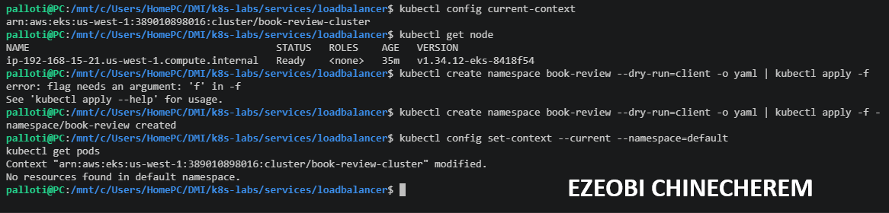

---

#### Screenshot 2 — If using Helm: Output of `helm version`

Required only if you choose Helm. Skip this screenshot if using YAML manifests.

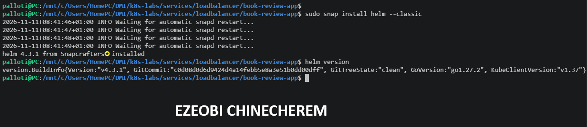

---

# Task 2 — Design the Three-Tier Kubernetes Architecture

## Goal

Document the workloads, networking, configuration, storage, and permitted communication paths before deployment.

### Evidence

#### Screenshot 3 — Completed Kubernetes architecture diagram

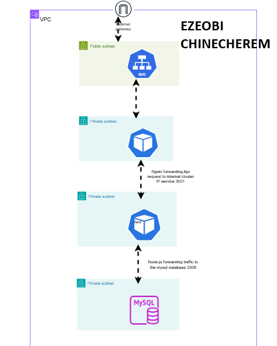

---

# Task 3 — Create ConfigMaps and Secrets

## Goal

Provide application configuration and credentials without embedding sensitive values in images or committing them to Git.

### Evidence

#### Screenshot 4 — ConfigMap configuration or describe output showing non-sensitive values

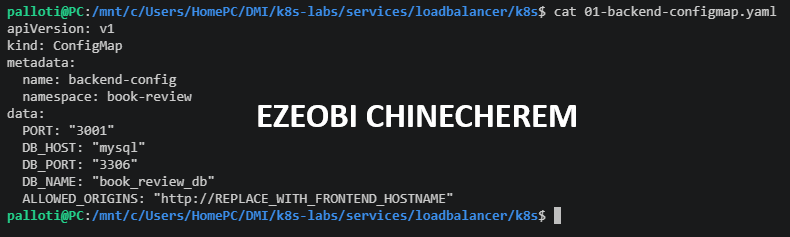

---

#### Screenshot 5 — Secret references or describe output showing names and keys without sensitive values

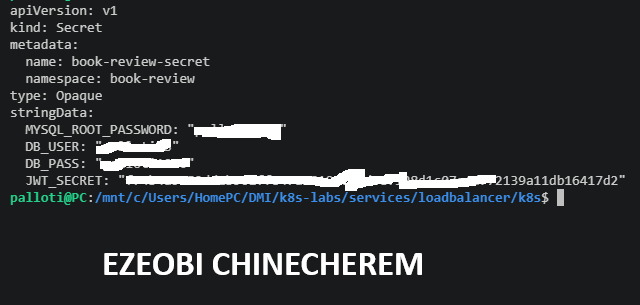

---

# Task 4 — Deploy and Configure the MySQL Data Tier

## Goal

Provide persistent MySQL storage and allow the backend to connect without exposing the database publicly.

### Evidence

#### Screenshot 6 — Managed MySQL status or MySQL StatefulSet and PVC status

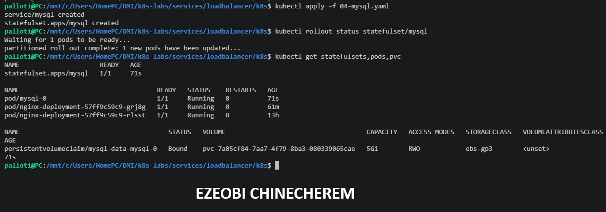

---

#### Screenshot 7 — Successful database connectivity or schema verification with credentials hidden

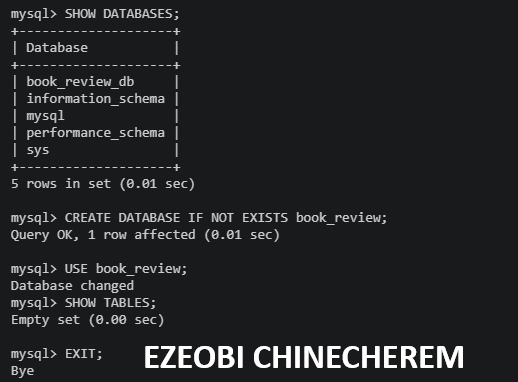

---

# Task 5 — Deploy the Backend Application Tier

## Goal

Run one or two Node.js/Express backend replicas on port 3001 and expose them through an internal ClusterIP Service.

### Evidence

#### Screenshot 8 — Backend Deployment, ready Pods, and internal Service

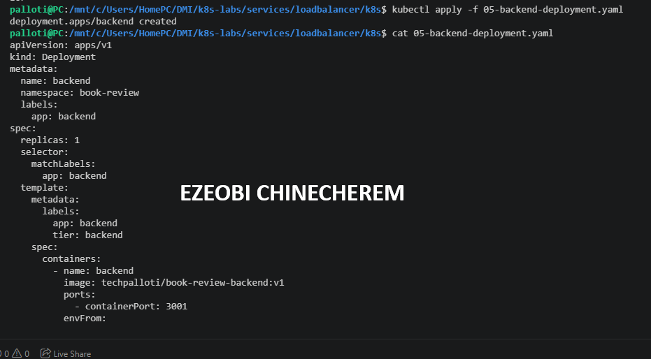

---

#### Screenshot 9 — Backend startup logs and database connectivity evidence

If the application does not log successful database connections, provide a successful database-backed request alongside the startup logs.

---

# Task 6 — Deploy the Frontend and Configure Nginx

## Goal

Run the Next.js frontend behind Nginx on port 80 and proxy API requests to the internal backend Service.

### Evidence

#### Screenshot 10 — Frontend Deployment and Ready Pods

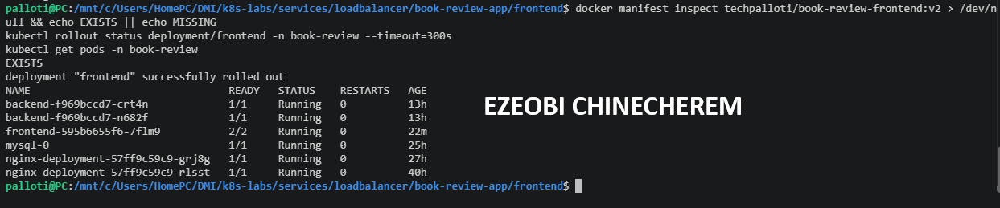

---

#### Screenshot 11 — Nginx reverse-proxy configuration showing the internal backend Service name and port 3001

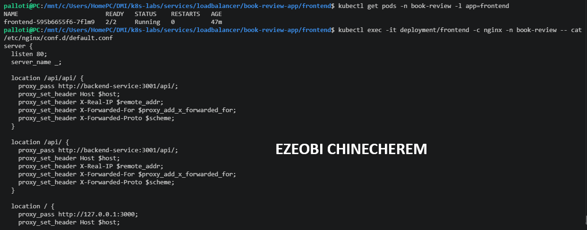

---

# Task 7 — Configure External and Internal Networking

## Goal

Expose the frontend and enforce the intended communication path between application tiers.

### Evidence

#### Screenshot 12 — Frontend LoadBalancer or Ingress configuration and assigned endpoint, or documented local access method

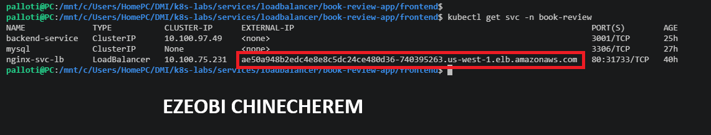

---

#### Screenshot 13 — Internal backend Service and NetworkPolicy or equivalent restriction, with access-test evidence

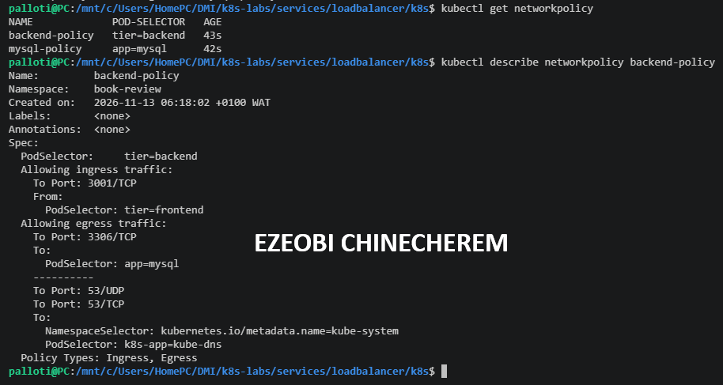

---

# Task 8 — Validate the Application End to End

## Goal

Prove that the frontend, backend, and MySQL database work together and collect operational evidence.

### Evidence

#### Screenshot 14 — `kubectl get all` output

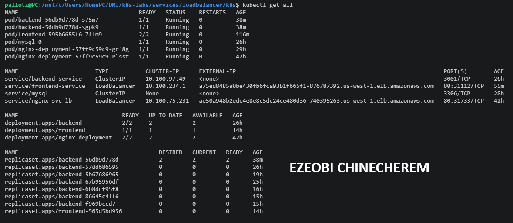

---

#### Screenshot 15 — Functional Book Review App in the browser with the public URL or IP visible

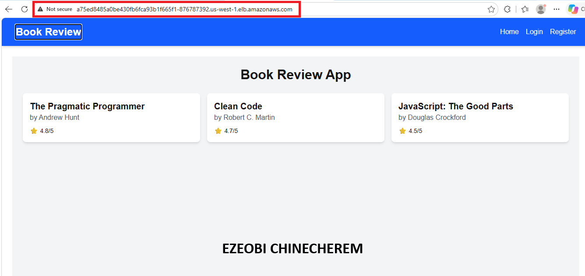

---

#### Screenshot 16 — Frontend or Nginx container logs

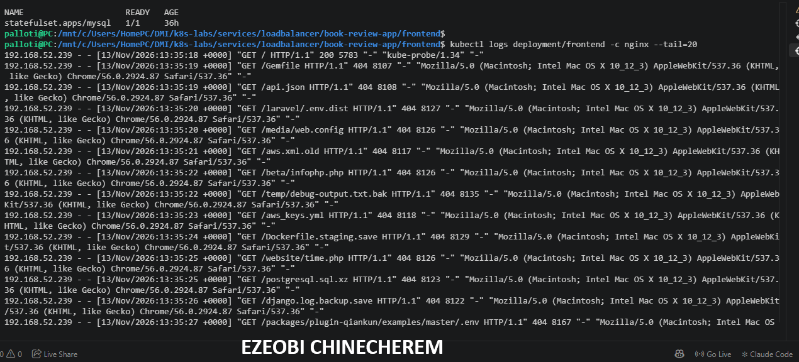

---

#### Screenshot 17 — Backend Pod logs showing successful requests or database activity

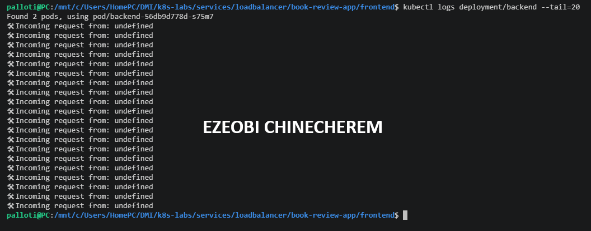

---

#### Screenshot 18 (optional) — Kubernetes dashboard

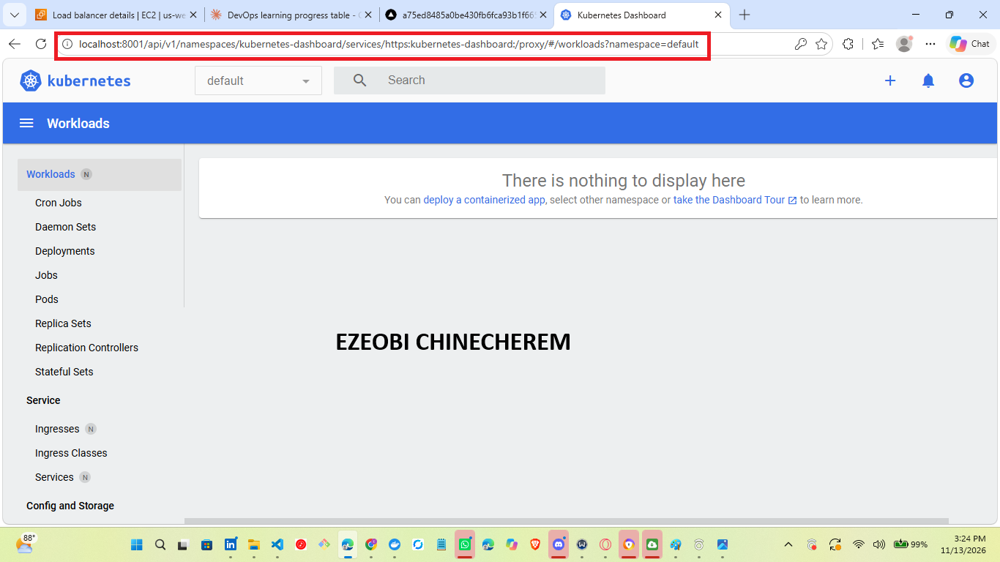

---

# Task 9 — Implement Optional Production Enhancements

## Goal

Explain your three-tier architecture, demonstrate the working application, and share what you learned.

### Evidence

#### Screenshot 20 — Published LinkedIn post about your Book Review App deployment on Kubernetes

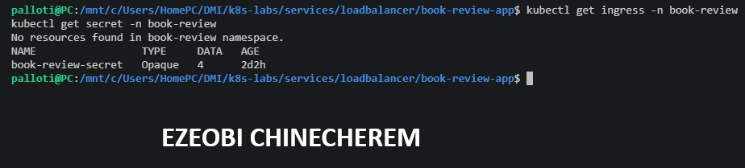

---

### Notes

Report the Kubernetes platform used, the public frontend URL/IP, a GitHub link to your manifests/Helm chart (if applicable), and the architecture diagram link. Summarize what worked, issues encountered and how they were resolved, and the tools/sources that helped the most.

Kubernetes platform
Amazon EKS (Kubernetes v1.34), region us-west-1, created with eksctl, managed node group of t3.small nodes
Public frontend URL
http://a75ed8485a0be430fb6fca93b1f665f1-876787392.us-west-1.elb.amazonaws.com (AWS load balancer).

Architecture
A three-tier Book Review application runs in the book-review namespace. The request path is:
Browser -> AWS load balancer (Service type LoadBalancer, port 80)
        -> nginx (in the frontend pod)
             /api/*      -> backend-service:3001 -> Express API -> MySQL
             everything else -> Next.js frontend on port 3000
• Frontend: a Next.js app built as a small standalone image, with an nginx sidecar that acts as the reverse proxy (configured through the nginx-config ConfigMap).
• Backend: a Node.js Express API with user registration, login (JWT), books and reviews routes under /api.
• Database: MySQL running as pod mysql-0 behind a headless Service, with the schema and sample books loaded.
• Configuration: a ConfigMap (backend-config) for non-sensitive settings and a Secret (book-review-secret) for the database credentials and JWT key. Real secret values were never committed to Git.
• Storage: the AWS EBS CSI driver, installed as a managed EKS add-on with its own IAM role.
What Worked
• An EKS cluster with a managed node group, reached from WSL with kubectl.
• A public AWS load balancer created automatically by a Service of type LoadBalancer.
• The frontend, backend and MySQL running as separate workloads that talk to each other through Kubernetes Services.
• The books stored in MySQL were returned by the API and displayed in the browser.
• A rolling update and a deliberate readiness-probe failure showed that unready pods are kept out of Service traffic.
• Clean-up of the load balancers, nodes, cluster and IAM role afterwards, checked with AWS CLI queries.

---

# Submission Instructions

- Include your Kubernetes manifests or Helm chart in the linked repository.
- Submit Secret examples containing placeholders only.
- Include Screenshot 1, Screenshots 3–17, and Screenshot 20.
- Include Screenshot 2 only if using Helm.
- Screenshots 18–19 are optional.
- Keep screenshot numbering consistent with the guidelines.
- Use clear, readable screenshots showing relevant configuration, commands, and outputs.
- Make your full name visible in required screenshots.
- Complete the submission details and Final Summary.
- Include your published LinkedIn post URL.
- Capture required evidence before cleanup.
- Do not expose passwords, tokens, JWT secrets, actual Secret values, kubeconfig contents, cloud credentials, or confidential account information.

---

# Completion Checklist

- [ ] Selected and configured a supported Kubernetes platform
- [ ] Confirmed the context and Ready nodes (Screenshot 1)
- [ ] Created and selected the book-review namespace
- [ ] Inspected the application repository
- [ ] Prepared images accessible to the cluster
- [ ] Confirmed Helm if using charts (Screenshot 2, conditional)
- [ ] Created the architecture diagram (Screenshot 3)
- [ ] Created ConfigMaps and Secrets (Screenshots 4–5)
- [ ] Excluded actual Secret values from Git and screenshots
- [ ] Provisioned private managed MySQL or persistent Kubernetes MySQL (Screenshot 6)
- [ ] Initialized the required database and schema
- [ ] Verified database connectivity or schema (Screenshot 7)
- [ ] Deployed one or two backend replicas listening on port 3001
- [ ] Created the backend ClusterIP Service (Screenshot 8)
- [ ] Verified backend-to-database connectivity (Screenshot 9)
- [ ] Deployed one or two frontend replicas behind Nginx (Screenshot 10)
- [ ] Configured API proxying through the internal backend Service (Screenshot 11)
- [ ] Configured and documented frontend access (Screenshot 12)
- [ ] Enforced backend access restrictions (Screenshot 13)
- [ ] Confirmed that the backend and database are not publicly exposed
- [ ] Captured resource status for book-review (Screenshot 14)
- [ ] Tested application functionality and database writes (Screenshots 15 and 17)
- [ ] Verified saved data after application restart
- [ ] Captured frontend and backend logs (Screenshots 16–17)
- [ ] Included optional dashboard or improvement evidence if attempted (Screenshots 18–19)
- [ ] Published the LinkedIn post (Screenshot 20)
- [ ] Included the LinkedIn post URL
- [ ] Documented issues, fixes, and useful sources
- [ ] Recorded cleanup status or reuse plans
- [ ] No sensitive data exposed

---

## 📌 About DMI & CloudAdvisory

DevOps Micro Internship (DMI) is a project-based DevOps program run by Pravin Mishra (The CloudAdvisory) focused on real-world execution, systems thinking, and career readiness.

It helps learners build strong DevOps foundations with hands-on experience.

---

## 📌 Resources

- 🌐 DMI Official Website: https://dmi.pravinmishra.com?utm_source=github&utm_medium=readme  
- 🎓 University: https://university.pravinmishra.com?utm_source=github&utm_medium=readme  
- 💬 Discord Community: https://discord.pravinmishra.com?utm_source=github&utm_medium=readme  
- 📝 Blog: https://dmi.pravinmishra.com/blog?utm_source=github&utm_medium=readme  
- ▶️ YouTube Playlist: https://www.youtube.com/playlist?list=PLFeSNDtI4Cho  
- 🔗 Pravin Mishra (LinkedIn): https://www.linkedin.com/in/pravin-mishra-aws-trainer/  
- 🏢 CloudAdvisory (LinkedIn): https://www.linkedin.com/company/thecloudadvisory/

---

*This submission is part of DevOps Micro Internship (DMI) — Agentic AI Track.*
