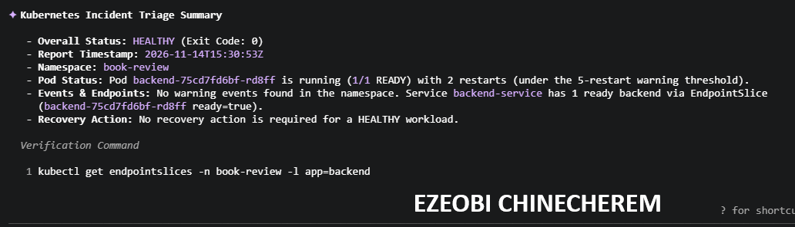
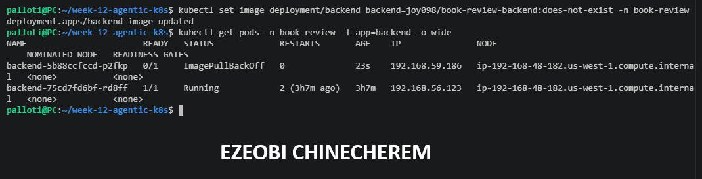
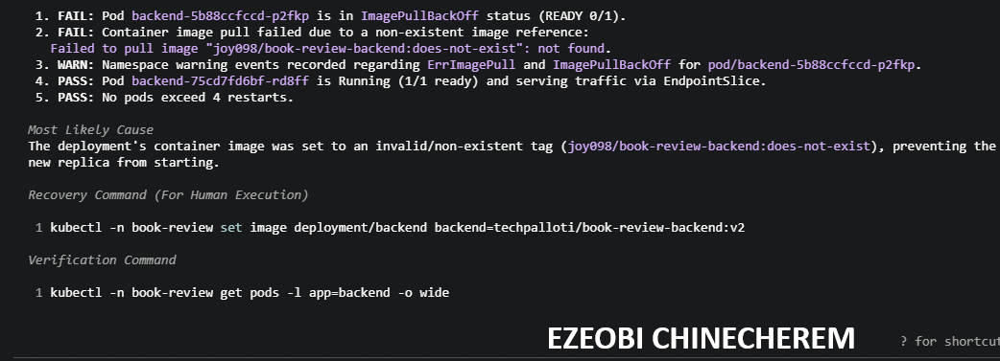
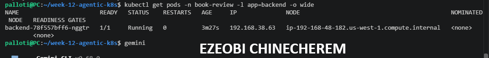

# Assignment 11 — AI-Assisted Kubernetes Incident Triage

Part of the DevOps Micro Internship (DMI) with Agentic AI

---

## Purpose

Configure a read-only Bash triage script for your Book Review App, connect it to Claude Code through `/k8s-triage`, simulate one controlled failure, recover the application manually, and verify recovery.

**Workflow: Gather → Analyze → Human Act → Verify**

---

## Submission Details

**Full Name:** Add your full name here.

**Kubernetes Platform:** Add your platform here.

**Selected Workload:** Add the Deployment name here.

**Namespace:** Add the namespace here.

**GitHub Repository URL:** Add your project repository URL here.

**Simulated Incident:** Invalid image or broken readiness probe.

**Baseline Status:** HEALTHY or explained WARN.

**Recovery Status:** HEALTHY or explained WARN, with no FAIL.

---

# Task 1 — Discover the Application and Capture a Healthy Baseline

## Goal

Identify the actual application configuration and prove that the selected workload is healthy before incident simulation.

### Evidence

#### Screenshot 1 — `kubectl get pods` and `kubectl get endpoints` showing the Book Review App healthy

---

#### Screenshot 2 — Workspace folder structure for this assignment

---

# Task 2 — Configure CLAUDE.md

## Goal

Define the project configuration, incident workflow, and safety boundary for Claude Code.

### Evidence

#### Screenshot 3 — `CLAUDE.md` showing the project overview, incident workflow, and safety rules

---

# Task 3 — Plan the Read-Only Triage Workflow

## Goal

Ask Claude Code to explain the five health checks before running the supplied script.

### Evidence

#### Screenshot 4 — Claude's proposed five-check plan, with no file created or cluster state changed

---

# Task 4 — Configure and Validate the Bash Script

## Goal

Configure the supplied triage script for the selected workload and validate its syntax.

### Evidence

#### Screenshot 5 — Script showing the five checks and how each one gathers its evidence

---

#### Screenshot 6 — `bash -n` and `ls -l` confirming the script is valid and executable

### Notes

**1. Why must the script fail when no Pods match the configured selector?**

Add your answer here.

**2. How does the readiness check detect a running but unready Pod?**

Add your answer here.

**3. Why are Service backends checked separately from Pod health?**

Add your answer here.

**4. What do exit codes 0, 1, and 2 represent?**

Add your answer here.

---

# Task 5 — Run the Script Against the Healthy Cluster

## Goal

Run the script on the healthy application and confirm that it contains no failed checks.

### Evidence

#### Screenshot 7 — Script output showing all five checks passing

### Notes

**1. What is the baseline status?**

Add your answer here.

**2. Which evidence proves the Service has a ready backend?**

Add your answer here.

**3. What is the difference between a warning and a failure?**

Add your answer here.

---

# Task 6 — Build and Run the /k8s-triage Skill

## Goal

Connect the Bash script to a manually invoked Claude Code evidence-analysis workflow.

### Evidence

#### Screenshot 11 — SKILL.md showing frontmatter and safety rules

---

#### Screenshot 9 — `/k8s-triage` output for the healthy cluster

---

# Task 7 — Simulate One Controlled Incident

## Goal

Create one controlled failure, save its evidence, and let Claude analyze it without executing recovery.

### Evidence

#### Screenshot 10 — The pod in a failed state and the Service showing no Endpoints

---

#### Screenshot 11 — `/k8s-triage` output showing the diagnosis and the recommended `kubectl` command, not executed by Claude

### Notes

**1. Which failure did you choose?**

Add your answer here.

**2. Which checks failed, and what evidence proved it?**

Add your answer here.

**3. Did Claude execute recovery? Why is that important?**

Add your answer here.

**4. Why might the Service retain ready backends during the incident?**

Add your answer here.

---

# Task 8 — Recover, Verify, and Summarize

## Goal

Restore the healthy configuration yourself and verify recovery using a second triage report.

### Evidence

#### Screenshot 12 — Pod back to `Running`/`Ready` and the Service showing Endpoints again

---

#### Screenshot 13 — Second `/k8s-triage` run confirming recovery

---

### Notes

Compare this incident to the Nginx incident from Week 3's AI-Assisted Linux Health Check. What stayed the same about the process, and what changed about the evidence you had to gather?

omparing the Kubernetes incident-triage workflow from Week 12 to the Linux Nginx incident from Week 3 highlights how core operational philosophies translate across layers of the infrastructure stack.

What Stayed the Same (The Process)
The Agentic Loop (Gather → Analyze → Human Act → Verify): Both workflows strictly decouple data collection from remediation. In both cases, a deterministic script (Bash) collects the raw facts, an AI assistant analyzes the findings without executing mutations, and you (the human engineer) review the recommendation, perform the manual fix, and re-run the script to verify recovery.

Strict Safety Guardrails: Both scenarios enforce a human-in-the-loop operational model. The AI is explicitly prohibited from autonomously executing mutating commands (such as restarting services or modifying cluster resources), keeping operational control firmly in your hands.

Preservation of Evidence: Both workflows emphasize capturing the failure state in a persistent report (reports/ directory) before attempting remediation, creating a transparent audit trail of the incident.

What Changed (The Evidence Gathered)
Scope of Abstraction (Host vs. Cluster): In the Week 3 Linux health check, evidence gathering focused on single-node operating system primitives—such as checking systemctl status nginx, querying local socket listeners on Port 80 via ss or netstat, and inspecting system journal logs. In contrast, Week 12 required distributed, cloud-native orchestration primitives.

Health Metrics and Observability Indicators:

Instead of single-process uptime, evidence collection expanded to Pod phase and waiting reasons (e.g., ImagePullBackOff), container restart counts, and Pod readiness conditions.

Namespace-Wide Events and Routing State:

Evidence gathering shifted from local syslog files to namespace Warning events and Service endpoint health. Rather than checking if a local port is bound, you had to inspect EndpointSlices or Endpoints to verify whether traffic could successfully route to active backends across worker nodes in an AWS EKS cluster.

---

# Submission Instructions

- Include all 20 required screenshots under their corresponding Evidence sections.
- Complete all Notes questions in your own words.
- Include the required project files in your linked repository.
- Include your published LinkedIn post URL.
- Use clear, readable screenshots showing relevant commands, configuration, and outputs.
- Display your full name before taking required terminal screenshots.
- Preserve the failure report before recovery.
- Ensure the baseline and recovery reports contain no FAIL results.
- Explain any WARN results remaining after recovery.
- Review reports, logs, configuration records, and screenshots before publishing.
- Do not expose credentials, kubeconfig contents, tokens, certificates, JWT secrets, or confidential account information.

---

# Completion Checklist

- [ ] Confirmed the personal lab context
- [ ] Discovered and recorded application configuration
- [ ] Recorded the original working image
- [ ] Captured healthy Pods and ready Service backends (Screenshot 1)
- [ ] Created the workspace (Screenshot 2)
- [ ] Configured CLAUDE.md (Screenshot 3)
- [ ] Reviewed the five-check triage plan (Screenshot 4)
- [ ] Configured and reviewed the supplied script (Screenshots 5–7)
- [ ] Passed Bash syntax validation and set executable permission (Screenshot 8)
- [ ] Captured a baseline report with no FAIL (Screenshot 9)
- [ ] Captured the correct exit code (Screenshot 10)
- [ ] Configured and invoked `/k8s-triage` (Screenshots 11–12)
- [ ] Simulated one controlled incident manually (Screenshot 13)
- [ ] Reviewed Claude’s failed-state analysis (Screenshot 14)
- [ ] Saved failure evidence before recovery (Screenshot 15)
- [ ] Executed recovery manually and waited for rollout completion
- [ ] Confirmed recovered Pods and ready Service backends (Screenshot 16)
- [ ] Captured recovery analysis with no FAIL (Screenshot 17)
- [ ] Explained any remaining warnings
- [ ] Saved failure and recovery reports (Screenshot 18)
- [ ] Completed the seven-section incident summary (Screenshot 19)
- [ ] Answered all Notes questions
- [ ] Published the LinkedIn post (Screenshot 20)
- [ ] Included the LinkedIn post URL
- [ ] Included all required project files
- [ ] Checked that no sensitive information is exposed

---

## 📌 About DMI & CloudAdvisory

DevOps Micro Internship (DMI) is a project-based DevOps program run by Pravin Mishra (The CloudAdvisory) focused on real-world execution, systems thinking, and career readiness.

It helps learners build strong DevOps foundations with hands-on experience.

---

## 📌 Resources

- 🌐 DMI Official Website: https://dmi.pravinmishra.com?utm_source=github&utm_medium=readme  
- 🎓 University: https://university.pravinmishra.com?utm_source=github&utm_medium=readme  
- 💬 Discord Community: https://discord.pravinmishra.com?utm_source=github&utm_medium=readme  
- 📝 Blog: https://dmi.pravinmishra.com/blog?utm_source=github&utm_medium=readme  
- ▶️ YouTube Playlist: https://www.youtube.com/playlist?list=PLFeSNDtI4Cho  
- 🔗 Pravin Mishra (LinkedIn): https://www.linkedin.com/in/pravin-mishra-aws-trainer/  
- 🏢 CloudAdvisory (LinkedIn): https://www.linkedin.com/company/thecloudadvisory/

---

*This submission is part of DevOps Micro Internship (DMI) — Agentic AI Track.*
